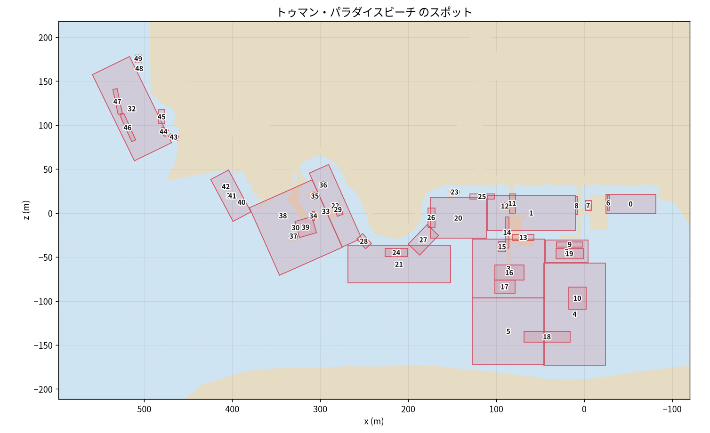

# トゥマン・パラダイスビーチ

[湧き確率の読み方](../spawn.md) ・ [地図の読み方](../maps.md) ・ [目次](../../README.md)

## スポット一覧

| スポット | 出現表 | 幅×奥行 m | 面積 m² | 上限 朝/昼/夕/夜 | 補充秒 | エサ補正 |
|--:|:-:|--:|--:|:-:|--:|--:|
| 0 | A | 57×22 | 1,254 | 45/45/45/45 | 6 | 0 |
| 1 | B | 100×40 | 4,000 | 45/45/45/45 | 6 | 0 |
| 2 | C | 48×26 | 1,248 | 35/35/35/35 | 6 | 0 |
| 3 | D | 82×67 | 5,494 | 64/64/64/64 | 6 | 0 |
| 4 | E | 70×116 | 8,120 | 64/64/64/64 | 6 | 0 |
| 5 | E | 81×76 | 6,156 | 64/64/64/64 | 6 | 0 |
| 6 | F | 2×17 | 34 | 15/15/15/15 | 6 | 0 |
| 7 | G | 7×11 | 77 | 15/15/15/15 | 6 | 0 |
| 8 | B | 2×20 | 40 | 15/15/15/15 | 6 | 0 |
| 9 | C | 30×6 | 180 | 25/25/25/25 | 6 | 0 |
| 10 | E | 20×25 | 500 | 25/25/25/25 | 6 | 0 |
| 11 | B | 7×22 | 154 | 15/15/15/15 | 6 | 0 |
| 12 | H | 7×7 | 49 | 10/10/10/10 | 6 | 0 |
| 13 | B | 24×7 | 168 | 15/15/15/15 | 6 | 0 |
| 14 | B | 4×35 | 140 | 10/10/10/10 | 6 | 0 |
| 15 | D | 8×12 | 96 | 15/15/15/15 | 6 | 0 |
| 16 | D | 33×17 | 561 | 50/50/50/50 | 6 | 0 |
| 17 | D | 23×15 | 345 | 40/40/40/40 | 6 | 0 |
| 18 | E | 52×12 | 624 | 30/30/30/30 | 6 | 0 |
| 19 | C | 31×12 | 372 | 25/25/25/25 | 6 | 0 |
| 20 | B | 64×46 | 2,944 | 64/64/64/64 | 6 | 0 |
| 21 | I | 117×43 | 5,031 | 64/64/64/64 | 6 | 0 |
| 22 | I | 24×92 | 2,208 | 64/64/64/64 | 6 | 0 |
| 23 | H | 10×3 | 30 | 14/14/14/14 | 6 | 0 |
| 24 | J | 26×9 | 234 | 20/20/20/20 | 6 | 0 |
| 25 | B | 28×6 | 168 | 15/15/15/15 | 6 | 0 |
| 26 | D | 8×22 | 176 | 10/10/10/10 | 6 | 0 |
| 27 | J | 18×31 | 558 | 30/30/30/30 | 6 | 0 |
| 28 | J | 15×9 | 135 | 9/9/9/9 | 6 | 0 |
| 29 | J | 7×14 | 98 | 10/10/10/10 | 6 | 0 |
| 30 | K | 78×84 | 6,552 | 64/64/64/64 | 6 | 0 |
| 31 | L | 23×54 | 1,242 | 64/64/64/64 | 30 | 0 |
| 32 | M | 109×47 | 5,123 | 64/64/64/64 | 6 | 0 |
| 33 | K | 7×6 | 42 | 10/10/10/10 | 6 | 0 |
| 34 | K | 2×10 | 20 | 10/10/10/10 | 6 | 0 |
| 35 | K | 6×8 | 48 | 10/10/10/10 | 6 | 0 |
| 36 | K | 6×7 | 42 | 10/10/10/10 | 6 | 0 |
| 37 | K | 9×4 | 36 | 15/15/15/15 | 6 | 0 |
| 38 | K | 4×4 | 16 | 10/10/10/10 | 6 | 0 |
| 39 | K | 20×19 | 380 | 25/25/25/25 | 6 | 0 |
| 40 | L | 6×6 | 36 | 12/12/12/12 | 6 | 0 |
| 41 | L | 6×6 | 36 | 12/12/12/12 | 6 | 0 |
| 42 | L | 6×6 | 36 | 12/12/12/12 | 6 | 0 |
| 43 | M | 10×5 | 50 | 10/10/10/10 | 6 | 0 |
| 44 | M | 8×8 | 64 | 15/15/15/15 | 6 | 0 |
| 45 | M | 7×16 | 112 | 15/15/15/15 | 6 | 0 |
| 46 | M | 5×33 | 165 | 20/20/20/20 | 6 | 0 |
| 47 | M | 5×29 | 145 | 20/20/20/20 | 6 | 0 |
| 48 | M | 6×6 | 36 | 10/10/10/10 | 6 | 0 |
| 49 | M | 7×8 | 56 | 10/10/10/10 | 6 | 0 |

「補充秒」は、そのスポットで魚がつつき始めてから60秒の間の補充の間隔である ([補充の速さ](../spawn-paths.md#補充の速さ))。

## 出現表

### 表A (スポット 0)

| 魚 | 重み | 確率% | 放流解禁時% | 条件 |
|---|--:|--:|--:|---|
| フエヤッコダイ | 5 | 25.0 | 25.0 |  |
| アデヤッコ | 5 | 25.0 | 25.0 |  |
| ニシキヤッコ | 5 | 25.0 | 25.0 |  |
| クダゴンベ | 3 | 15.0 | 15.0 |  |
| ありきたりな流木 | 1 | 5.0 | 5.0 |  |
| ナンヨウハギ | 1 | 5.0 | 5.0 |  |

### 表B (スポット 1、8、11、13〜14、20、25)

| 魚 | 重み | 確率% | 放流解禁時% | 条件 |
|---|--:|--:|--:|---|
| チョウチョウウオ | 5 | 20.0 | 20.0 |  |
| ハタタテダイ | 5 | 20.0 | 20.0 |  |
| クマノミ | 5 | 20.0 | 20.0 |  |
| ツノダシ | 5 | 20.0 | 20.0 |  |
| クダゴンベ | 3 | 12.0 | 12.0 |  |
| ありきたりな流木 | 1 | 4.0 | 4.0 |  |
| ナンヨウハギ | 1 | 4.0 | 4.0 |  |

### 表C (スポット 2、9、19)

| 魚 | 重み | 確率% | 放流解禁時% | 条件 |
|---|--:|--:|--:|---|
| クダゴンベ | 4 | 21.1 | 20.0 |  |
| タテジマキンチャクダイ | 4 | 21.1 | 20.0 |  |
| ミノカサゴ | 2 | 10.5 | 10.0 |  |
| ホシギス | 2 | 10.5 | 10.0 |  |
| クサフグ | 2 | 10.5 | 10.0 |  |
| カレイ | 1 | 5.3 | 5.0 |  |
| ミツボシクロスズメダイ | 1 | - | 5.0 | 放流 |
| フエヤッコダイ | 1 | 5.3 | 5.0 |  |
| アデヤッコ | 1 | 5.3 | 5.0 |  |
| ニシキヤッコ | 1 | 5.3 | 5.0 |  |
| りっぱな流木 | 1 | 5.3 | 5.0 |  |

### 表D (スポット 3、15〜17、26)

| 魚 | 重み | 確率% | 放流解禁時% | 条件 |
|---|--:|--:|--:|---|
| ミノカサゴ | 4 | 20.0 | 19.0 |  |
| ナンヨウハギ | 4 | 20.0 | 19.0 |  |
| タテジマキンチャクダイ | 2 | 10.0 | 9.5 |  |
| ホシギス | 2 | 10.0 | 9.5 |  |
| クサフグ | 2 | 10.0 | 9.5 |  |
| チョウチョウウオ | 1 | 5.0 | 4.8 |  |
| ハタタテダイ | 1 | 5.0 | 4.8 |  |
| クマノミ | 1 | 5.0 | 4.8 |  |
| カレイ | 1 | 5.0 | 4.8 |  |
| ミツボシクロスズメダイ | 1 | - | 4.8 | 放流 |
| ツノダシ | 1 | 5.0 | 4.8 |  |
| りっぱな流木 | 1 | 5.0 | 4.8 |  |

### 表E (スポット 4〜5、10、18)

| 魚 | 重み | 確率% | 放流解禁時% | 条件 |
|---|--:|--:|--:|---|
| ナンヨウハギ | 6 | 28.6 | 25.0 |  |
| ミツボシクロスズメダイ | 3 | - | 12.5 | 放流 |
| イチモンジブダイ | 3 | 14.3 | 12.5 |  |
| ヒラメ | 1 | 4.8 | 4.2 |  |
| カレイ | 1 | 4.8 | 4.2 |  |
| クダゴンベ | 1 | 4.8 | 4.2 |  |
| ミノカサゴ | 1 | 4.8 | 4.2 |  |
| フエヤッコダイ | 1 | 4.8 | 4.2 |  |
| もさもさした海藻 | 1 | 4.8 | 4.2 |  |
| アデヤッコ | 1 | 4.8 | 4.2 |  |
| タテジマキンチャクダイ | 1 | 4.8 | 4.2 |  |
| ニシキヤッコ | 1 | 4.8 | 4.2 |  |
| ホシギス | 1 | 4.8 | 4.2 |  |
| クサフグ | 1 | 4.8 | 4.2 |  |
| ふつうの海藻 | 1 | 4.8 | 4.2 |  |

### 表F (スポット 6)

| 魚 | 重み | 確率% | 放流解禁時% | 条件 |
|---|--:|--:|--:|---|
| フエヤッコダイ | 5 | 22.7 | 22.7 |  |
| アデヤッコ | 5 | 22.7 | 22.7 |  |
| ニシキヤッコ | 5 | 22.7 | 22.7 |  |
| クダゴンベ | 3 | 13.6 | 13.6 |  |
| カクレクマノミ | 1 | 4.5 | 4.5 |  |
| ありきたりな流木 | 1 | 4.5 | 4.5 |  |
| タツノオトシゴ | 1 | 4.5 | 4.5 |  |
| ナンヨウハギ | 1 | 4.5 | 4.5 |  |

### 表G (スポット 7)

| 魚 | 重み | 確率% | 放流解禁時% | 条件 |
|---|--:|--:|--:|---|
| フエヤッコダイ | 5 | 21.7 | 21.7 |  |
| アデヤッコ | 5 | 21.7 | 21.7 |  |
| ニシキヤッコ | 5 | 21.7 | 21.7 |  |
| クダゴンベ | 3 | 13.0 | 13.0 |  |
| タツノオトシゴ | 2 | 8.7 | 8.7 |  |
| カクレクマノミ | 1 | 4.3 | 4.3 |  |
| ありきたりな流木 | 1 | 4.3 | 4.3 |  |
| ナンヨウハギ | 1 | 4.3 | 4.3 |  |

### 表H (スポット 12、23)

| 魚 | 重み | 確率% | 放流解禁時% | 条件 |
|---|--:|--:|--:|---|
| チョウチョウウオ | 5 | 17.9 | 17.9 |  |
| ハタタテダイ | 5 | 17.9 | 17.9 |  |
| クマノミ | 5 | 17.9 | 17.9 |  |
| ツノダシ | 5 | 17.9 | 17.9 |  |
| クダゴンベ | 3 | 10.7 | 10.7 |  |
| カクレクマノミ | 2 | 7.1 | 7.1 |  |
| ありきたりな流木 | 1 | 3.6 | 3.6 |  |
| タツノオトシゴ | 1 | 3.6 | 3.6 |  |
| ナンヨウハギ | 1 | 3.6 | 3.6 |  |

### 表I (スポット 21〜22)

| 魚 | 重み | 確率% | 放流解禁時% | 条件 |
|---|--:|--:|--:|---|
| フエヤッコダイ | 5 | 23.8 | 23.8 |  |
| アデヤッコ | 5 | 23.8 | 23.8 |  |
| ニシキヤッコ | 5 | 23.8 | 23.8 |  |
| クダゴンベ | 3 | 14.3 | 14.3 |  |
| ありきたりな流木 | 1 | 4.8 | 4.8 |  |
| ナンヨウハギ | 1 | 4.8 | 4.8 |  |
| アカエイ | 1 | 4.8 | 4.8 |  |

### 表J (スポット 24、27〜29)

| 魚 | 重み | 確率% | 放流解禁時% | 条件 |
|---|--:|--:|--:|---|
| ミノカサゴ | 4 | 18.2 | 17.4 |  |
| ナンヨウハギ | 4 | 18.2 | 17.4 |  |
| タテジマキンチャクダイ | 2 | 9.1 | 8.7 |  |
| アカエイ | 2 | 9.1 | 8.7 |  |
| ホシギス | 2 | 9.1 | 8.7 |  |
| クサフグ | 2 | 9.1 | 8.7 |  |
| チョウチョウウオ | 1 | 4.5 | 4.3 |  |
| ハタタテダイ | 1 | 4.5 | 4.3 |  |
| クマノミ | 1 | 4.5 | 4.3 |  |
| カレイ | 1 | 4.5 | 4.3 |  |
| ミツボシクロスズメダイ | 1 | - | 4.3 | 放流 |
| ツノダシ | 1 | 4.5 | 4.3 |  |
| りっぱな流木 | 1 | 4.5 | 4.3 |  |

### 表K (スポット 30、33〜39)

| 魚 | 重み | 確率% | 放流解禁時% | 条件 |
|---|--:|--:|--:|---|
| アジ | 4 | 13.3 | 13.3 |  |
| ホシギス | 4 | 13.3 | 13.3 |  |
| イワシ | 3 | 10.0 | 10.0 |  |
| クサフグ | 3 | 10.0 | 10.0 |  |
| メバル | 2 | 6.7 | 6.7 |  |
| アナゴ | 1 | 3.3 | 3.3 |  |
| アカザエビ | 1 | 3.3 | 3.3 |  |
| シーバス | 1 | 3.3 | 3.3 |  |
| クロダイ | 1 | 3.3 | 3.3 |  |
| ありきたりな流木 | 1 | 3.3 | 3.3 |  |
| ウツボ | 1 | 3.3 | 3.3 |  |
| カサゴ | 1 | 3.3 | 3.3 |  |
| クロメジナ | 1 | 3.3 | 3.3 |  |
| もさもさした海藻 | 1 | 3.3 | 3.3 |  |
| ネコザメ | 1 | 3.3 | 3.3 | クエスト |
| テナガエビ | 1 | 3.3 | 3.3 |  |
| りっぱな流木 | 1 | 3.3 | 3.3 |  |
| ふつうの海藻 | 1 | 3.3 | 3.3 |  |
| オニオコゼ | 1 | 3.3 | 3.3 |  |

### 表L (スポット 31、40〜42)

| 魚 | 重み | 確率% | 放流解禁時% | 条件 |
|---|--:|--:|--:|---|
| ホシギス | 4 | 28.6 | 28.6 |  |
| クサフグ | 3 | 21.4 | 21.4 |  |
| アナゴ | 1 | 7.1 | 7.1 |  |
| ヒラメ | 1 | 7.1 | 7.1 |  |
| カレイ | 1 | 7.1 | 7.1 |  |
| ありきたりな流木 | 1 | 7.1 | 7.1 |  |
| ホウボウ | 1 | 7.1 | 7.1 |  |
| ネコザメ | 1 | 7.1 | 7.1 | クエスト |
| りっぱな流木 | 1 | 7.1 | 7.1 |  |

### 表M (スポット 32、43〜49)

| 魚 | 重み | 確率% | 放流解禁時% | 条件 |
|---|--:|--:|--:|---|
| アジ | 4 | 13.8 | 13.3 |  |
| ホシギス | 4 | 13.8 | 13.3 |  |
| イワシ | 3 | 10.3 | 10.0 |  |
| クサフグ | 3 | 10.3 | 10.0 |  |
| メバル | 2 | 6.9 | 6.7 |  |
| アナゴ | 1 | 3.4 | 3.3 |  |
| アカザエビ | 1 | 3.4 | 3.3 |  |
| シーバス | 1 | 3.4 | 3.3 |  |
| クロダイ | 1 | 3.4 | 3.3 |  |
| ありきたりな流木 | 1 | 3.4 | 3.3 |  |
| ハリセンボン | 1 | - | 3.3 | 放流 |
| もさもさした海藻 | 1 | 3.4 | 3.3 |  |
| ネコザメ | 1 | 3.4 | 3.3 | クエスト |
| テナガエビ | 1 | 3.4 | 3.3 |  |
| キュウセン | 1 | 3.4 | 3.3 |  |
| ダツ | 1 | 3.4 | 3.3 |  |
| りっぱな流木 | 1 | 3.4 | 3.3 |  |
| ふつうの海藻 | 1 | 3.4 | 3.3 |  |
| オニオコゼ | 1 | 3.4 | 3.3 |  |
