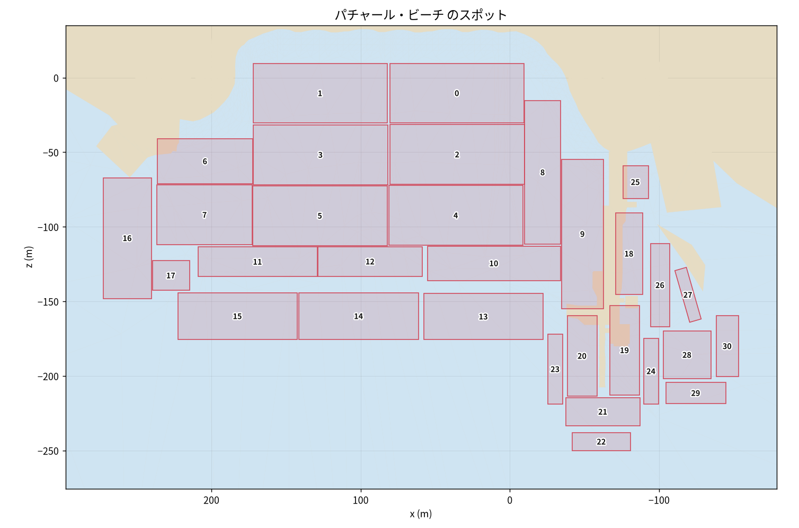

# パチャール・ビーチ

[湧き確率の読み方](../spawn.md) ・ [地図の読み方](../maps.md) ・ [目次](../../README.md)

## スポット一覧

| スポット | 出現表 | 幅×奥行 m | 面積 m² | 上限 朝/昼/夕/夜 | 補充秒 | エサ補正 |
|--:|:-:|--:|--:|:-:|--:|--:|
| 0 | A | 90×40 | 3,600 | 30/20/24/26 | 42 | 0 |
| 1 | A | 90×40 | 3,600 | 30/20/24/26 | 42 | 0 |
| 2 | B | 90×40 | 3,600 | 40/30/32/35 | 42 | 0 |
| 3 | B | 90×40 | 3,600 | 40/30/32/35 | 42 | 0 |
| 4 | C | 90×40 | 3,600 | 45/36/38/40 | 42 | 0 |
| 5 | C | 90×40 | 3,600 | 45/36/38/40 | 42 | 0 |
| 6 | B | 64×30 | 1,920 | 35/28/30/32 | 42 | 0 |
| 7 | C | 64×40 | 2,560 | 36/30/32/34 | 42 | 0 |
| 8 | A | 24×96 | 2,304 | 35/28/30/32 | 42 | 0 |
| 9 | A | 28×100 | 2,800 | 40/35/36/37 | 42 | 0 |
| 10 | D | 89×23 | 2,047 | 40/30/34/38 | 42 | 0 |
| 11 | D | 80×20 | 1,600 | 40/30/34/38 | 42 | 0 |
| 12 | D | 70×20 | 1,400 | 30/30/30/30 | 42 | 0 |
| 13 | E | 80×31 | 2,480 | 20/20/20/20 | 42 | 0 |
| 14 | E | 80×31 | 2,480 | 20/20/20/20 | 42 | 0 |
| 15 | E | 80×31 | 2,480 | 20/20/20/20 | 42 | 0 |
| 16 | E | 32×81 | 2,592 | 30/30/30/30 | 42 | 0 |
| 17 | E | 25×20 | 500 | 15/15/15/15 | 42 | 0 |
| 18 | F | 18×55 | 990 | 25/25/25/25 | 42 | 0 |
| 19 | F | 20×60 | 1,200 | 30/30/30/30 | 42 | 0 |
| 20 | F | 20×54 | 1,080 | 30/30/30/30 | 42 | 0 |
| 21 | G | 50×19 | 950 | 25/20/20/25 | 42 | 0 |
| 22 | H | 39×12 | 468 | 20/15/15/20 | 42 | 0 |
| 23 | H | 10×47 | 470 | 20/15/15/20 | 42 | 0 |
| 24 | H | 10×44 | 440 | 20/15/15/20 | 42 | 0 |
| 25 | I | 17×22 | 374 | 15/15/15/15 | 42 | 0 |
| 26 | J | 13×56 | 728 | 20/20/20/20 | 42 | 0 |
| 27 | K | 8×36 | 288 | 18/18/18/18 | 42 | 0 |
| 28 | L | 32×32 | 1,024 | 20/20/20/20 | 42 | 0 |
| 29 | M | 40×14 | 560 | 15/15/15/15 | 42 | 0 |
| 30 | N | 15×41 | 615 | 18/18/18/18 | 42 | 0 |

「補充秒」は、そのスポットで魚がつつき始めてから60秒の間の補充の間隔である ([補充の速さ](../spawn-paths.md#補充の速さ))。

## 出現表

### 表A (スポット 0〜1、8〜9)

| 魚 | 重み | 確率% | 放流解禁時% | 条件 |
|---|--:|--:|--:|---|
| アデヤッコ | 4 | 22.2 | 22.2 |  |
| ニシキヤッコ | 4 | 22.2 | 22.2 |  |
| フエヤッコダイ | 2 | 11.1 | 11.1 |  |
| ナンヨウハギ | 1 | 5.6 | 5.6 |  |
| もさもさした海藻 | 1 | 5.6 | 5.6 |  |
| ボラ | 1 | 5.6 | 5.6 |  |
| ホシギス | 1 | 5.6 | 5.6 |  |
| ウマヅラハギ | 1 | 5.6 | 5.6 |  |
| クサフグ | 1 | 5.6 | 5.6 |  |
| マハゼ | 1 | 5.6 | 5.6 |  |
| ふつうの海藻 | 1 | 5.6 | 5.6 |  |

### 表B (スポット 2〜3、6)

| 魚 | 重み | 確率% | 放流解禁時% | 条件 |
|---|--:|--:|--:|---|
| モンガラカワハギ | 6 | 16.2 | 16.2 |  |
| タテジマキンチャクダイ | 6 | 16.2 | 16.2 |  |
| カレイ | 3 | 8.1 | 8.1 |  |
| アデヤッコ | 3 | 8.1 | 8.1 |  |
| ニシキヤッコ | 3 | 8.1 | 8.1 |  |
| コルビナ | 3 | 8.1 | 8.1 |  |
| ナンヨウハギ | 2 | 5.4 | 5.4 |  |
| フエヤッコダイ | 2 | 5.4 | 5.4 |  |
| ヒラメ | 1 | 2.7 | 2.7 |  |
| もさもさした海藻 | 1 | 2.7 | 2.7 |  |
| イソマグロ | 1 | 2.7 | 2.7 |  |
| ボラ | 1 | 2.7 | 2.7 |  |
| ホシギス | 1 | 2.7 | 2.7 |  |
| ウマヅラハギ | 1 | 2.7 | 2.7 |  |
| クサフグ | 1 | 2.7 | 2.7 |  |
| マハゼ | 1 | 2.7 | 2.7 |  |
| ふつうの海藻 | 1 | 2.7 | 2.7 |  |

### 表C (スポット 4〜5、7)

| 魚 | 重み | 確率% | 放流解禁時% | 条件 |
|---|--:|--:|--:|---|
| コルビナ | 6 | 19.4 | 19.4 |  |
| ナンヨウハギ | 3 | 9.7 | 9.7 |  |
| フエヤッコダイ | 3 | 9.7 | 9.7 |  |
| モンガラカワハギ | 3 | 9.7 | 9.7 |  |
| タテジマキンチャクダイ | 3 | 9.7 | 9.7 |  |
| ヒラメ | 1 | 3.2 | 3.2 |  |
| カレイ | 1 | 3.2 | 3.2 |  |
| ボーンフィッシュ | 1 | 3.2 | 3.2 | クエスト |
| もさもさした海藻 | 1 | 3.2 | 3.2 |  |
| イソマグロ | 1 | 3.2 | 3.2 |  |
| アデヤッコ | 1 | 3.2 | 3.2 |  |
| ニシキヤッコ | 1 | 3.2 | 3.2 |  |
| ボラ | 1 | 3.2 | 3.2 |  |
| ホシギス | 1 | 3.2 | 3.2 |  |
| ウマヅラハギ | 1 | 3.2 | 3.2 |  |
| クサフグ | 1 | 3.2 | 3.2 |  |
| マハゼ | 1 | 3.2 | 3.2 |  |
| ふつうの海藻 | 1 | 3.2 | 3.2 |  |

### 表D (スポット 10〜12)

| 魚 | 重み | 確率% | 放流解禁時% | 条件 |
|---|--:|--:|--:|---|
| ナンヨウハギ | 4 | 13.8 | 13.8 |  |
| ボーンフィッシュ | 3 | 10.3 | 10.3 | クエスト |
| カレイ | 2 | 6.9 | 6.9 |  |
| イソマグロ | 2 | 6.9 | 6.9 |  |
| アデヤッコ | 2 | 6.9 | 6.9 |  |
| ニシキヤッコ | 2 | 6.9 | 6.9 |  |
| ヒラメ | 1 | 3.4 | 3.4 |  |
| トレバリー | 1 | 3.4 | 3.4 | クエスト |
| フエヤッコダイ | 1 | 3.4 | 3.4 |  |
| もさもさした海藻 | 1 | 3.4 | 3.4 |  |
| モンガラカワハギ | 1 | 3.4 | 3.4 |  |
| タテジマキンチャクダイ | 1 | 3.4 | 3.4 |  |
| イシガキダイ | 1 | 3.4 | 3.4 |  |
| コルビナ | 1 | 3.4 | 3.4 |  |
| ボラ | 1 | 3.4 | 3.4 |  |
| ホシギス | 1 | 3.4 | 3.4 |  |
| ウマヅラハギ | 1 | 3.4 | 3.4 |  |
| クサフグ | 1 | 3.4 | 3.4 |  |
| マハゼ | 1 | 3.4 | 3.4 |  |
| ふつうの海藻 | 1 | 3.4 | 3.4 |  |

### 表E (スポット 13〜17)

| 魚 | 重み | 確率% | 放流解禁時% | 条件 |
|---|--:|--:|--:|---|
| ヒラメ | 2 | 9.5 | 8.7 |  |
| トレバリー | 2 | 9.5 | 8.7 | クエスト |
| ナポレオンフィッシュ | 2 | - | 8.7 | 放流 |
| イソマグロ | 2 | 9.5 | 8.7 |  |
| サバ | 1 | 4.8 | 4.3 |  |
| カレイ | 1 | 4.8 | 4.3 |  |
| ありきたりな流木 | 1 | 4.8 | 4.3 |  |
| ボーンフィッシュ | 1 | 4.8 | 4.3 | クエスト |
| ナンヨウハギ | 1 | 4.8 | 4.3 |  |
| カスミアジ | 1 | 4.8 | 4.3 |  |
| モンガラカワハギ | 1 | 4.8 | 4.3 |  |
| イシガキダイ | 1 | 4.8 | 4.3 |  |
| コルビナ | 1 | 4.8 | 4.3 |  |
| ボラ | 1 | 4.8 | 4.3 |  |
| ホシギス | 1 | 4.8 | 4.3 |  |
| ウマヅラハギ | 1 | 4.8 | 4.3 |  |
| クサフグ | 1 | 4.8 | 4.3 |  |
| マハゼ | 1 | 4.8 | 4.3 |  |
| りっぱな流木 | 1 | 4.8 | 4.3 |  |

### 表F (スポット 18〜20)

| 魚 | 重み | 確率% | 放流解禁時% | 条件 |
|---|--:|--:|--:|---|
| クサフグ | 3 | 16.7 | 16.7 |  |
| サバ | 2 | 11.1 | 11.1 |  |
| ボラ | 2 | 11.1 | 11.1 |  |
| ウマヅラハギ | 2 | 11.1 | 11.1 |  |
| ヒラメ | 1 | 5.6 | 5.6 |  |
| カレイ | 1 | 5.6 | 5.6 |  |
| ありきたりな流木 | 1 | 5.6 | 5.6 |  |
| ナンヨウハギ | 1 | 5.6 | 5.6 |  |
| イシガキダイ | 1 | 5.6 | 5.6 |  |
| コルビナ | 1 | 5.6 | 5.6 |  |
| ホシギス | 1 | 5.6 | 5.6 |  |
| マハゼ | 1 | 5.6 | 5.6 |  |
| りっぱな流木 | 1 | 5.6 | 5.6 |  |

### 表G (スポット 21)

| 魚 | 重み | 確率% | 放流解禁時% | 条件 |
|---|--:|--:|--:|---|
| サバ | 3 | 15.8 | 15.8 |  |
| クサフグ | 3 | 15.8 | 15.8 |  |
| ボラ | 2 | 10.5 | 10.5 |  |
| ウマヅラハギ | 2 | 10.5 | 10.5 |  |
| ヒラメ | 1 | 5.3 | 5.3 |  |
| カレイ | 1 | 5.3 | 5.3 |  |
| ありきたりな流木 | 1 | 5.3 | 5.3 |  |
| ナンヨウハギ | 1 | 5.3 | 5.3 |  |
| イシガキダイ | 1 | 5.3 | 5.3 |  |
| コルビナ | 1 | 5.3 | 5.3 |  |
| ホシギス | 1 | 5.3 | 5.3 |  |
| マハゼ | 1 | 5.3 | 5.3 |  |
| りっぱな流木 | 1 | 5.3 | 5.3 |  |

### 表H (スポット 22〜24)

| 魚 | 重み | 確率% | 放流解禁時% | 条件 |
|---|--:|--:|--:|---|
| サバ | 3 | 13.6 | 13.6 |  |
| クサフグ | 3 | 13.6 | 13.6 |  |
| カスミアジ | 2 | 9.1 | 9.1 |  |
| ボラ | 2 | 9.1 | 9.1 |  |
| ウマヅラハギ | 2 | 9.1 | 9.1 |  |
| ヒラメ | 1 | 4.5 | 4.5 |  |
| カレイ | 1 | 4.5 | 4.5 |  |
| ありきたりな流木 | 1 | 4.5 | 4.5 |  |
| トレバリー | 1 | 4.5 | 4.5 | クエスト |
| ナンヨウハギ | 1 | 4.5 | 4.5 |  |
| イシガキダイ | 1 | 4.5 | 4.5 |  |
| コルビナ | 1 | 4.5 | 4.5 |  |
| ホシギス | 1 | 4.5 | 4.5 |  |
| マハゼ | 1 | 4.5 | 4.5 |  |
| りっぱな流木 | 1 | 4.5 | 4.5 |  |

### 表I (スポット 25)

| 魚 | 重み | 確率% | 放流解禁時% | 条件 |
|---|--:|--:|--:|---|
| ボラ | 3 | 16.7 | 16.7 |  |
| マハゼ | 3 | 16.7 | 16.7 |  |
| フエヤッコダイ | 2 | 11.1 | 11.1 |  |
| アデヤッコ | 2 | 11.1 | 11.1 |  |
| ニシキヤッコ | 2 | 11.1 | 11.1 |  |
| ありきたりな流木 | 1 | 5.6 | 5.6 |  |
| ナンヨウハギ | 1 | 5.6 | 5.6 |  |
| ホシギス | 1 | 5.6 | 5.6 |  |
| ウマヅラハギ | 1 | 5.6 | 5.6 |  |
| クサフグ | 1 | 5.6 | 5.6 |  |
| りっぱな流木 | 1 | 5.6 | 5.6 |  |

### 表J (スポット 26)

| 魚 | 重み | 確率% | 放流解禁時% | 条件 |
|---|--:|--:|--:|---|
| カレイ | 2 | 12.5 | 12.5 |  |
| イシダイ | 2 | 12.5 | 12.5 |  |
| メジナ | 2 | 12.5 | 12.5 |  |
| ホシギス | 2 | 12.5 | 12.5 |  |
| サバ | 1 | 6.2 | 6.2 |  |
| ありきたりな流木 | 1 | 6.2 | 6.2 |  |
| イシガキダイ | 1 | 6.2 | 6.2 |  |
| ボラ | 1 | 6.2 | 6.2 |  |
| ウマヅラハギ | 1 | 6.2 | 6.2 |  |
| クサフグ | 1 | 6.2 | 6.2 |  |
| マハゼ | 1 | 6.2 | 6.2 |  |
| りっぱな流木 | 1 | 6.2 | 6.2 |  |

### 表K (スポット 27)

| 魚 | 重み | 確率% | 放流解禁時% | 条件 |
|---|--:|--:|--:|---|
| イシガキダイ | 3 | 12.0 | 12.0 |  |
| サバ | 2 | 8.0 | 8.0 |  |
| クロダイ | 2 | 8.0 | 8.0 |  |
| カレイ | 2 | 8.0 | 8.0 |  |
| トレバリー | 2 | 8.0 | 8.0 | クエスト |
| イソマグロ | 2 | 8.0 | 8.0 |  |
| マダイ | 2 | 8.0 | 8.0 |  |
| ホシギス | 2 | 8.0 | 8.0 |  |
| ありきたりな流木 | 1 | 4.0 | 4.0 |  |
| イシダイ | 1 | 4.0 | 4.0 |  |
| メジナ | 1 | 4.0 | 4.0 |  |
| ボラ | 1 | 4.0 | 4.0 |  |
| ウマヅラハギ | 1 | 4.0 | 4.0 |  |
| クサフグ | 1 | 4.0 | 4.0 |  |
| マハゼ | 1 | 4.0 | 4.0 |  |
| りっぱな流木 | 1 | 4.0 | 4.0 |  |

### 表L (スポット 28)

| 魚 | 重み | 確率% | 放流解禁時% | 条件 |
|---|--:|--:|--:|---|
| カレイ | 2 | 10.5 | 10.5 |  |
| イソマグロ | 2 | 10.5 | 10.5 |  |
| イシダイ | 2 | 10.5 | 10.5 |  |
| メジナ | 2 | 10.5 | 10.5 |  |
| ホシギス | 2 | 10.5 | 10.5 |  |
| サバ | 1 | 5.3 | 5.3 |  |
| ありきたりな流木 | 1 | 5.3 | 5.3 |  |
| イシガキダイ | 1 | 5.3 | 5.3 |  |
| マダイ | 1 | 5.3 | 5.3 |  |
| ボラ | 1 | 5.3 | 5.3 |  |
| ウマヅラハギ | 1 | 5.3 | 5.3 |  |
| クサフグ | 1 | 5.3 | 5.3 |  |
| マハゼ | 1 | 5.3 | 5.3 |  |
| りっぱな流木 | 1 | 5.3 | 5.3 |  |

### 表M (スポット 29)

| 魚 | 重み | 確率% | 放流解禁時% | 条件 |
|---|--:|--:|--:|---|
| クロダイ | 3 | 11.1 | 11.1 |  |
| トレバリー | 3 | 11.1 | 11.1 | クエスト |
| イシガキダイ | 3 | 11.1 | 11.1 |  |
| サバ | 2 | 7.4 | 7.4 |  |
| カレイ | 2 | 7.4 | 7.4 |  |
| イソマグロ | 2 | 7.4 | 7.4 |  |
| マダイ | 2 | 7.4 | 7.4 |  |
| ホシギス | 2 | 7.4 | 7.4 |  |
| ありきたりな流木 | 1 | 3.7 | 3.7 |  |
| イシダイ | 1 | 3.7 | 3.7 |  |
| メジナ | 1 | 3.7 | 3.7 |  |
| ボラ | 1 | 3.7 | 3.7 |  |
| ウマヅラハギ | 1 | 3.7 | 3.7 |  |
| クサフグ | 1 | 3.7 | 3.7 |  |
| マハゼ | 1 | 3.7 | 3.7 |  |
| りっぱな流木 | 1 | 3.7 | 3.7 |  |

### 表N (スポット 30)

| 魚 | 重み | 確率% | 放流解禁時% | 条件 |
|---|--:|--:|--:|---|
| クロダイ | 3 | 10.3 | 10.3 |  |
| トレバリー | 3 | 10.3 | 10.3 | クエスト |
| イシガキダイ | 3 | 10.3 | 10.3 |  |
| サバ | 2 | 6.9 | 6.9 |  |
| カレイ | 2 | 6.9 | 6.9 |  |
| イソマグロ | 2 | 6.9 | 6.9 |  |
| イシダイ | 2 | 6.9 | 6.9 |  |
| マダイ | 2 | 6.9 | 6.9 |  |
| メジナ | 2 | 6.9 | 6.9 |  |
| ホシギス | 2 | 6.9 | 6.9 |  |
| ありきたりな流木 | 1 | 3.4 | 3.4 |  |
| ボラ | 1 | 3.4 | 3.4 |  |
| ウマヅラハギ | 1 | 3.4 | 3.4 |  |
| クサフグ | 1 | 3.4 | 3.4 |  |
| マハゼ | 1 | 3.4 | 3.4 |  |
| りっぱな流木 | 1 | 3.4 | 3.4 |  |
