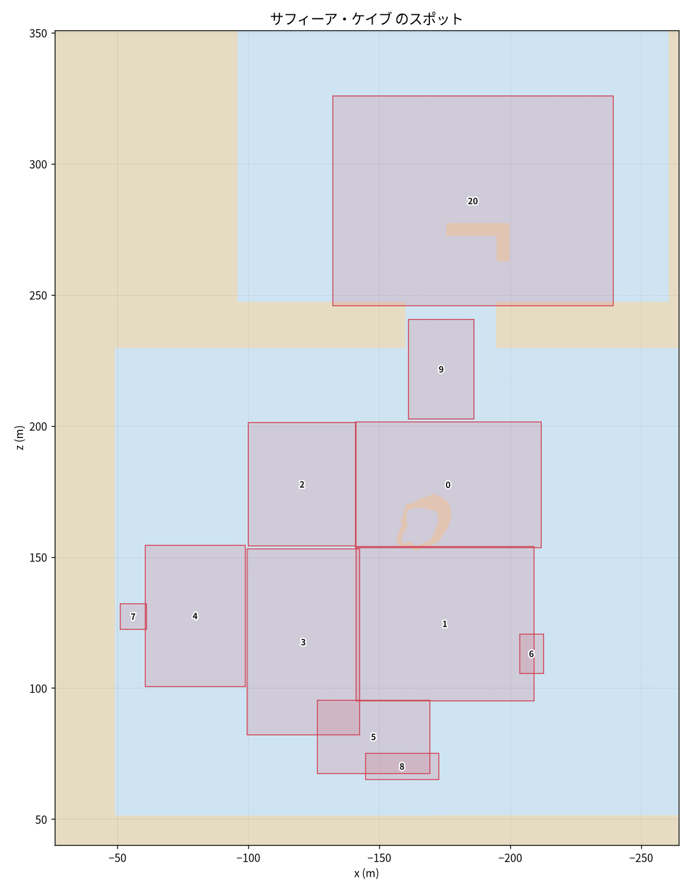

# サフィーア・ケイブ

[湧き確率の読み方](../spawn.md) ・ [地図の読み方](../maps.md) ・ [目次](../../README.md)

## スポット一覧

| スポット | 出現表 | 幅×奥行 m | 面積 m² | 上限 朝/昼/夕/夜 | 補充秒 | エサ補正 |
|--:|:-:|--:|--:|:-:|--:|--:|
| 0 | A | 71×48 | 3,408 | 15/15/15/16 | 120 | -2 |
| 1 | B | 68×59 | 4,012 | 18/12/14/16 | 120 | -2 |
| 2 | C | 41×47 | 1,927 | 18/12/14/16 | 120 | -2 |
| 3 | D | 43×71 | 3,053 | 18/12/14/16 | 120 | -2 |
| 4 | E | 38×54 | 2,052 | 12/6/8/10 | 120 | -2 |
| 5 | F | 43×28 | 1,204 | 11/7/9/11 | 120 | -2 |
| 6 | G | 9×15 | 135 | 6/6/6/6 | 120 | -2 |
| 7 | H | 10×10 | 100 | 6/6/6/6 | 120 | -2 |
| 8 | I | 28×10 | 280 | 7/7/7/7 | 120 | -2 |
| 9 | J | 25×38 | 950 | 10/10/10/10 | 120 | -2 |
| 20 | K | 107×80 | 8,560 | 35/35/35/35 | 60 | 0 |

「補充秒」は、そのスポットで魚がつつき始めてから60秒の間の補充の間隔である ([補充の速さ](../spawn-paths.md#補充の速さ))。

## 出現表

### 表A (スポット 0)

| 魚 | 重み | 確率% | 放流解禁時% | 条件 |
|---|--:|--:|--:|---|
| メンダコ | 6 | 33.3 | 33.3 |  |
| チョウチンアンコウ | 4 | 22.2 | 22.2 |  |
| ソコボウズ | 4 | 22.2 | 22.2 |  |
| ラブカ | 2 | 11.1 | 11.1 |  |
| ありきたりな流木 | 1 | 5.6 | 5.6 |  |
| アンモナイトの化石 | 1 | 5.6 | 5.6 |  |

### 表B (スポット 1)

| 魚 | 重み | 確率% | 放流解禁時% | 条件 |
|---|--:|--:|--:|---|
| メンダコ | 6 | 30.0 | 27.3 |  |
| チョウチンアンコウ | 4 | 20.0 | 18.2 |  |
| ラブカ | 4 | 20.0 | 18.2 |  |
| ソコボウズ | 4 | 20.0 | 18.2 |  |
| シーラカンス | 2 | - | 9.1 | 放流 |
| 三葉虫の化石 | 1 | 5.0 | 4.5 |  |
| りっぱな流木 | 1 | 5.0 | 4.5 |  |

### 表C (スポット 2)

| 魚 | 重み | 確率% | 放流解禁時% | 条件 |
|---|--:|--:|--:|---|
| ソコボウズ | 10 | 41.7 | 38.5 |  |
| メンダコ | 6 | 25.0 | 23.1 |  |
| チョウチンアンコウ | 4 | 16.7 | 15.4 |  |
| シーラカンス | 2 | - | 7.7 | 放流 |
| ラブカ | 2 | 8.3 | 7.7 |  |
| ありきたりな流木 | 1 | 4.2 | 3.8 |  |
| アンモナイトの化石 | 1 | 4.2 | 3.8 |  |

### 表D (スポット 3)

| 魚 | 重み | 確率% | 放流解禁時% | 条件 |
|---|--:|--:|--:|---|
| メンダコ | 6 | 28.6 | 28.6 |  |
| チョウチンアンコウ | 4 | 19.0 | 19.0 |  |
| ソコボウズ | 4 | 19.0 | 19.0 |  |
| ラブカ | 3 | 14.3 | 14.3 |  |
| リュウグウノツカイ | 2 | 9.5 | 9.5 |  |
| 三葉虫の化石 | 1 | 4.8 | 4.8 |  |
| りっぱな流木 | 1 | 4.8 | 4.8 |  |

### 表E (スポット 4)

| 魚 | 重み | 確率% | 放流解禁時% | 条件 |
|---|--:|--:|--:|---|
| メンダコ | 6 | 31.6 | 31.6 |  |
| チョウチンアンコウ | 3 | 15.8 | 15.8 |  |
| ラブカ | 3 | 15.8 | 15.8 |  |
| ソコボウズ | 3 | 15.8 | 15.8 |  |
| デメニギス | 2 | 10.5 | 10.5 |  |
| ありきたりな流木 | 1 | 5.3 | 5.3 |  |
| アンモナイトの化石 | 1 | 5.3 | 5.3 |  |

### 表F (スポット 5)

| 魚 | 重み | 確率% | 放流解禁時% | 条件 |
|---|--:|--:|--:|---|
| メンダコ | 6 | 31.6 | 31.6 |  |
| チョウチンアンコウ | 3 | 15.8 | 15.8 |  |
| ラブカ | 3 | 15.8 | 15.8 |  |
| ソコボウズ | 3 | 15.8 | 15.8 |  |
| デメニギス | 2 | 10.5 | 10.5 |  |
| 三葉虫の化石 | 1 | 5.3 | 5.3 |  |
| りっぱな流木 | 1 | 5.3 | 5.3 |  |

### 表G (スポット 6)

| 魚 | 重み | 確率% | 放流解禁時% | 条件 |
|---|--:|--:|--:|---|
| シーラカンス | 2 | - | 20.0 | 放流 |
| デメニギス | 2 | 25.0 | 20.0 |  |
| チョウチンアンコウ | 1 | 12.5 | 10.0 |  |
| ありきたりな流木 | 1 | 12.5 | 10.0 |  |
| ラブカ | 1 | 12.5 | 10.0 |  |
| ソコボウズ | 1 | 12.5 | 10.0 |  |
| アンモナイトの化石 | 1 | 12.5 | 10.0 |  |
| メンダコ | 1 | 12.5 | 10.0 |  |

### 表H (スポット 7)

| 魚 | 重み | 確率% | 放流解禁時% | 条件 |
|---|--:|--:|--:|---|
| ミツクリザメ | 2 | 20.0 | 20.0 |  |
| デメニギス | 2 | 20.0 | 20.0 |  |
| チョウチンアンコウ | 1 | 10.0 | 10.0 |  |
| ラブカ | 1 | 10.0 | 10.0 |  |
| ソコボウズ | 1 | 10.0 | 10.0 |  |
| 三葉虫の化石 | 1 | 10.0 | 10.0 |  |
| メンダコ | 1 | 10.0 | 10.0 |  |
| りっぱな流木 | 1 | 10.0 | 10.0 |  |

### 表I (スポット 8)

| 魚 | 重み | 確率% | 放流解禁時% | 条件 |
|---|--:|--:|--:|---|
| ミツクリザメ | 2 | 20.0 | 20.0 |  |
| デメニギス | 2 | 20.0 | 20.0 |  |
| チョウチンアンコウ | 1 | 10.0 | 10.0 |  |
| ありきたりな流木 | 1 | 10.0 | 10.0 |  |
| ラブカ | 1 | 10.0 | 10.0 |  |
| ソコボウズ | 1 | 10.0 | 10.0 |  |
| アンモナイトの化石 | 1 | 10.0 | 10.0 |  |
| メンダコ | 1 | 10.0 | 10.0 |  |

### 表J (スポット 9)

| 魚 | 重み | 確率% | 放流解禁時% | 条件 |
|---|--:|--:|--:|---|
| 三葉虫の化石 | 1 | 33.3 | 33.3 |  |
| メンダコ | 1 | 33.3 | 33.3 |  |
| りっぱな流木 | 1 | 33.3 | 33.3 |  |

### 表K (スポット 20)

| 魚 | 重み | 確率% | 放流解禁時% | 条件 |
|---|--:|--:|--:|---|
| アジ | 5 | 31.2 | 31.2 |  |
| サバ | 5 | 31.2 | 31.2 |  |
| マトウダイ | 3 | 18.8 | 18.8 |  |
| ありきたりな流木 | 1 | 6.2 | 6.2 |  |
| ツムブリ | 1 | 6.2 | 6.2 |  |
| アンモナイトの化石 | 1 | 6.2 | 6.2 |  |
