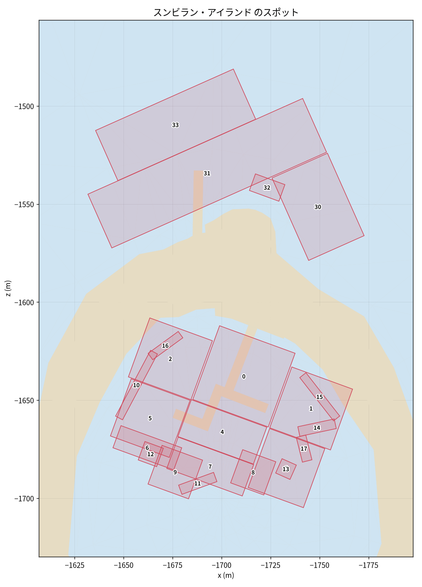

# スンビラン・アイランド

[湧き確率の読み方](../spawn.md) ・ [地図の読み方](../maps.md) ・ [目次](../../README.md)

## スポット一覧

| スポット | 出現表 | 幅×奥行 m | 面積 m² | 上限 朝/昼/夕/夜 | 補充秒 | エサ補正 |
|--:|:-:|--:|--:|:-:|--:|--:|
| 0 | A | 41×40 | 1,640 | 20/14/16/18 | 60 | -1 |
| 1 | A | 33×33 | 1,089 | 16/10/12/14 | 60 | -1 |
| 2 | A | 34×32 | 1,088 | 16/10/12/14 | 60 | -1 |
| 3 | B | 30×32 | 960 | 16/10/12/14 | 60 | -1 |
| 4 | B | 41×20 | 820 | 12/8/10/11 | 60 | -1 |
| 5 | B | 32×31 | 992 | 16/10/12/14 | 60 | -1 |
| 6 | C | 33×12 | 396 | 16/10/12/14 | 60 | -1 |
| 7 | D | 41×17 | 697 | 12/8/10/11 | 60 | -1 |
| 8 | D | 18×18 | 324 | 20/14/16/18 | 60 | -1 |
| 9 | C | 22×21 | 462 | 20/14/16/18 | 60 | -1 |
| 10 | E | 4×38 | 152 | 10/7/8/9 | 60 | -1 |
| 11 | F | 19×5 | 95 | 8/5/6/7 | 60 | -1 |
| 12 | F | 10×10 | 100 | 8/5/6/7 | 60 | -1 |
| 13 | G | 8×8 | 64 | 6/3/4/5 | 60 | -1 |
| 14 | G | 19×5 | 95 | 6/3/4/5 | 60 | -1 |
| 15 | H | 28×4 | 112 | 10/7/8/9 | 60 | -1 |
| 16 | H | 19×4 | 76 | 8/5/6/7 | 60 | -1 |
| 17 | G | 13×5 | 65 | 8/5/6/7 | 60 | -1 |
| 30 | I | 31×46 | 1,426 | 20/14/16/18 | 60 | -1 |
| 31 | I | 120×30 | 3,600 | 26/20/22/24 | 60 | -1 |
| 32 | I | 16×9 | 144 | 8/5/6/7 | 60 | -1 |
| 33 | J | 77×28 | 2,156 | 16/10/12/14 | 60 | -1 |

「補充秒」は、そのスポットで魚がつつき始めてから60秒の間の補充の間隔である ([補充の速さ](../spawn-paths.md#補充の速さ))。

## 出現表

### 表A (スポット 0〜2)

| 魚 | 重み | 確率% | 放流解禁時% | 条件 |
|---|--:|--:|--:|---|
| ハナビラクマノミ | 3 | 18.8 | 18.8 |  |
| イースタンブルーデビル | 3 | 18.8 | 18.8 |  |
| モンガラカワハギ | 2 | 12.5 | 12.5 |  |
| アデヤッコ | 2 | 12.5 | 12.5 |  |
| タテジマキンチャクダイ | 2 | 12.5 | 12.5 |  |
| ニシキヤッコ | 2 | 12.5 | 12.5 |  |
| もさもさした海藻 | 1 | 6.2 | 6.2 |  |
| ふつうの海藻 | 1 | 6.2 | 6.2 |  |

### 表B (スポット 3〜5)

| 魚 | 重み | 確率% | 放流解禁時% | 条件 |
|---|--:|--:|--:|---|
| タマカイ | 3 | 18.8 | 18.8 |  |
| ユメウメイロ | 3 | 18.8 | 18.8 |  |
| モンガラカワハギ | 2 | 12.5 | 12.5 |  |
| アデヤッコ | 2 | 12.5 | 12.5 |  |
| タテジマキンチャクダイ | 2 | 12.5 | 12.5 |  |
| ニシキヤッコ | 2 | 12.5 | 12.5 |  |
| もさもさした海藻 | 1 | 6.2 | 6.2 |  |
| ふつうの海藻 | 1 | 6.2 | 6.2 |  |

### 表C (スポット 6、9)

| 魚 | 重み | 確率% | 放流解禁時% | 条件 |
|---|--:|--:|--:|---|
| ユメウメイロ | 4 | 23.5 | 23.5 |  |
| タマカイ | 3 | 17.6 | 17.6 |  |
| モンガラカワハギ | 2 | 11.8 | 11.8 |  |
| アデヤッコ | 2 | 11.8 | 11.8 |  |
| タテジマキンチャクダイ | 2 | 11.8 | 11.8 |  |
| ニシキヤッコ | 2 | 11.8 | 11.8 |  |
| もさもさした海藻 | 1 | 5.9 | 5.9 |  |
| ふつうの海藻 | 1 | 5.9 | 5.9 |  |

### 表D (スポット 7〜8)

| 魚 | 重み | 確率% | 放流解禁時% | 条件 |
|---|--:|--:|--:|---|
| ハナビラクマノミ | 4 | 22.2 | 22.2 |  |
| イースタンブルーデビル | 4 | 22.2 | 22.2 |  |
| モンガラカワハギ | 2 | 11.1 | 11.1 |  |
| アデヤッコ | 2 | 11.1 | 11.1 |  |
| タテジマキンチャクダイ | 2 | 11.1 | 11.1 |  |
| ニシキヤッコ | 2 | 11.1 | 11.1 |  |
| もさもさした海藻 | 1 | 5.6 | 5.6 |  |
| ふつうの海藻 | 1 | 5.6 | 5.6 |  |

### 表E (スポット 10)

| 魚 | 重み | 確率% | 放流解禁時% | 条件 |
|---|--:|--:|--:|---|
| ユメウメイロ | 4 | 36.4 | 36.4 |  |
| タマカイ | 3 | 27.3 | 27.3 |  |
| モンガラカワハギ | 1 | 9.1 | 9.1 |  |
| アデヤッコ | 1 | 9.1 | 9.1 |  |
| タテジマキンチャクダイ | 1 | 9.1 | 9.1 |  |
| ニシキヤッコ | 1 | 9.1 | 9.1 |  |

### 表F (スポット 11〜12)

| 魚 | 重み | 確率% | 放流解禁時% | 条件 |
|---|--:|--:|--:|---|
| パープルビューティー | 7 | 35.0 | 35.0 |  |
| ユメウメイロ | 6 | 30.0 | 30.0 |  |
| タマカイ | 4 | 20.0 | 20.0 |  |
| もさもさした海藻 | 1 | 5.0 | 5.0 |  |
| ロルフォステウス | 1 | 5.0 | 5.0 |  |
| ふつうの海藻 | 1 | 5.0 | 5.0 |  |

### 表G (スポット 13〜14、17)

| 魚 | 重み | 確率% | 放流解禁時% | 条件 |
|---|--:|--:|--:|---|
| ハナビラクマノミ | 6 | 26.1 | 26.1 |  |
| イースタンブルーデビル | 6 | 26.1 | 26.1 |  |
| アデヤッコ | 2 | 8.7 | 8.7 |  |
| タテジマキンチャクダイ | 2 | 8.7 | 8.7 |  |
| パープルビューティー | 2 | 8.7 | 8.7 |  |
| もさもさした海藻 | 1 | 4.3 | 4.3 |  |
| アンモナイトの化石 | 1 | 4.3 | 4.3 |  |
| 三葉虫の化石 | 1 | 4.3 | 4.3 |  |
| ロルフォステウス | 1 | 4.3 | 4.3 |  |
| ふつうの海藻 | 1 | 4.3 | 4.3 |  |

### 表H (スポット 15〜16)

| 魚 | 重み | 確率% | 放流解禁時% | 条件 |
|---|--:|--:|--:|---|
| モンガラカワハギ | 1 | 12.5 | 12.5 |  |
| アデヤッコ | 1 | 12.5 | 12.5 |  |
| タテジマキンチャクダイ | 1 | 12.5 | 12.5 |  |
| ニシキヤッコ | 1 | 12.5 | 12.5 |  |
| ハナビラクマノミ | 1 | 12.5 | 12.5 |  |
| パープルビューティー | 1 | 12.5 | 12.5 |  |
| イースタンブルーデビル | 1 | 12.5 | 12.5 |  |
| ユメウメイロ | 1 | 12.5 | 12.5 |  |

### 表I (スポット 30〜32)

| 魚 | 重み | 確率% | 放流解禁時% | 条件 |
|---|--:|--:|--:|---|
| ウマヅラハギ | 7 | 21.2 | 21.2 |  |
| クサフグ | 7 | 21.2 | 21.2 |  |
| クダゴンベ | 5 | 15.2 | 15.2 |  |
| ナンヨウハギ | 5 | 15.2 | 15.2 |  |
| フエヤッコダイ | 5 | 15.2 | 15.2 |  |
| ありきたりな流木 | 1 | 3.0 | 3.0 |  |
| トレバリー | 1 | 3.0 | 3.0 | クエスト |
| カスミアジ | 1 | 3.0 | 3.0 |  |
| りっぱな流木 | 1 | 3.0 | 3.0 |  |

### 表J (スポット 33)

| 魚 | 重み | 確率% | 放流解禁時% | 条件 |
|---|--:|--:|--:|---|
| ナンヨウハギ | 4 | 18.2 | 18.2 |  |
| ウマヅラハギ | 4 | 18.2 | 18.2 |  |
| フエヤッコダイ | 3 | 13.6 | 13.6 |  |
| クサフグ | 3 | 13.6 | 13.6 |  |
| トレバリー | 2 | 9.1 | 9.1 | クエスト |
| クダゴンベ | 2 | 9.1 | 9.1 |  |
| カスミアジ | 2 | 9.1 | 9.1 |  |
| ありきたりな流木 | 1 | 4.5 | 4.5 |  |
| りっぱな流木 | 1 | 4.5 | 4.5 |  |
