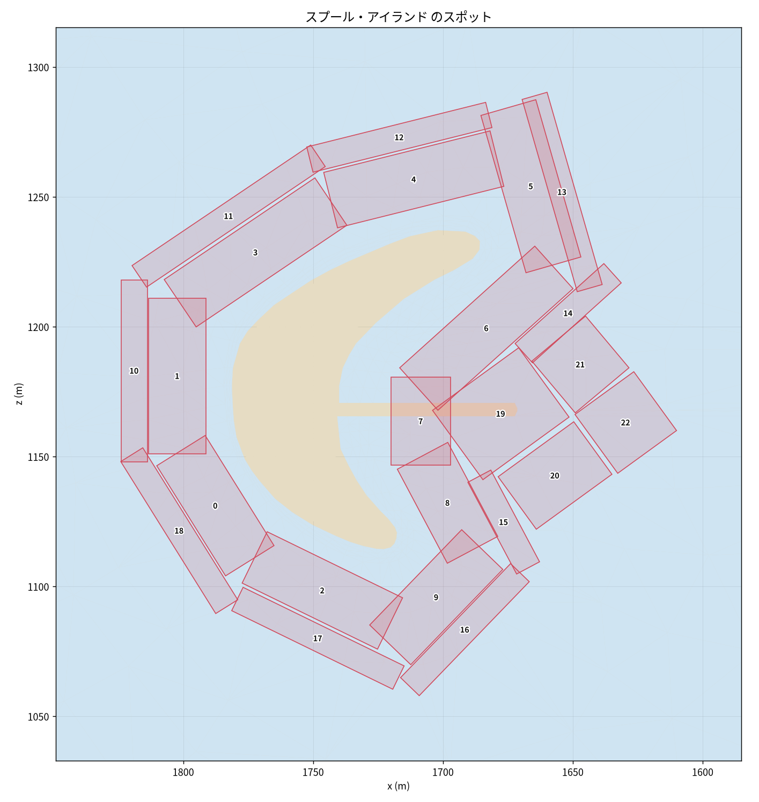

# スプール・アイランド

[湧き確率の読み方](../spawn.md) ・ [地図の読み方](../maps.md) ・ [目次](../../README.md)

## スポット一覧

| スポット | 出現表 | 幅×奥行 m | 面積 m² | 上限 朝/昼/夕/夜 | 補充秒 | エサ補正 |
|--:|:-:|--:|--:|:-:|--:|--:|
| 0 | A | 22×50 | 1,100 | 20/14/15/16 | 60 | -1 |
| 1 | A | 22×60 | 1,320 | 20/14/15/16 | 60 | -1 |
| 2 | A | 22×58 | 1,276 | 20/14/15/16 | 60 | -1 |
| 3 | B | 22×70 | 1,540 | 20/14/15/16 | 60 | -1 |
| 4 | B | 22×66 | 1,452 | 20/14/15/16 | 60 | -1 |
| 5 | B | 22×63 | 1,386 | 15/10/11/12 | 60 | -1 |
| 6 | C | 22×70 | 1,540 | 15/10/11/12 | 60 | -1 |
| 7 | C | 23×34 | 782 | 12/9/10/11 | 60 | -1 |
| 8 | C | 22×41 | 902 | 15/10/11/12 | 60 | -1 |
| 9 | C | 22×51 | 1,122 | 15/10/11/12 | 60 | -1 |
| 10 | D | 10×70 | 700 | 12/9/10/11 | 60 | -1 |
| 11 | E | 10×83 | 830 | 15/10/11/12 | 60 | -1 |
| 12 | E | 10×71 | 710 | 15/10/11/12 | 60 | -1 |
| 13 | F | 10×77 | 770 | 12/9/10/11 | 60 | -1 |
| 14 | G | 10×46 | 460 | 12/9/10/11 | 60 | -1 |
| 15 | G | 10×40 | 400 | 12/9/10/11 | 60 | -1 |
| 16 | H | 10×61 | 610 | 12/9/10/11 | 60 | -1 |
| 17 | I | 10×69 | 690 | 12/9/10/11 | 60 | -1 |
| 18 | I | 10×69 | 690 | 12/9/10/11 | 60 | -1 |
| 19 | J | 41×33 | 1,353 | 15/10/11/12 | 60 | -1 |
| 20 | K | 36×25 | 900 | 12/9/10/11 | 60 | -1 |
| 21 | K | 27×26 | 702 | 12/9/10/11 | 60 | -1 |
| 22 | L | 28×28 | 784 | 12/9/10/11 | 60 | -1 |

「補充秒」は、そのスポットで魚がつつき始めてから60秒の間の補充の間隔である ([補充の速さ](../spawn-paths.md#補充の速さ))。

## 出現表

### 表A (スポット 0〜2)

| 魚 | 重み | 確率% | 放流解禁時% | 条件 |
|---|--:|--:|--:|---|
| ウマヅラハギ | 5 | 35.7 | 35.7 |  |
| コルビナ | 3 | 21.4 | 21.4 |  |
| レッドエンペラー　幼魚 | 2 | 14.3 | 14.3 |  |
| ありきたりな流木 | 1 | 7.1 | 7.1 |  |
| ネコザメ | 1 | 7.1 | 7.1 | クエスト |
| パーミット | 1 | 7.1 | 7.1 |  |
| りっぱな流木 | 1 | 7.1 | 7.1 |  |

### 表B (スポット 3〜5)

| 魚 | 重み | 確率% | 放流解禁時% | 条件 |
|---|--:|--:|--:|---|
| コルビナ | 5 | 35.7 | 35.7 |  |
| ウマヅラハギ | 3 | 21.4 | 21.4 |  |
| レッドエンペラー　幼魚 | 2 | 14.3 | 14.3 |  |
| ありきたりな流木 | 1 | 7.1 | 7.1 |  |
| ネコザメ | 1 | 7.1 | 7.1 | クエスト |
| パーミット | 1 | 7.1 | 7.1 |  |
| りっぱな流木 | 1 | 7.1 | 7.1 |  |

### 表C (スポット 6〜9)

| 魚 | 重み | 確率% | 放流解禁時% | 条件 |
|---|--:|--:|--:|---|
| レッドエンペラー　幼魚 | 5 | 35.7 | 35.7 |  |
| ウマヅラハギ | 3 | 21.4 | 21.4 |  |
| コルビナ | 2 | 14.3 | 14.3 |  |
| ありきたりな流木 | 1 | 7.1 | 7.1 |  |
| ネコザメ | 1 | 7.1 | 7.1 | クエスト |
| パーミット | 1 | 7.1 | 7.1 |  |
| りっぱな流木 | 1 | 7.1 | 7.1 |  |

### 表D (スポット 10)

| 魚 | 重み | 確率% | 放流解禁時% | 条件 |
|---|--:|--:|--:|---|
| ターポン | 3 | 21.4 | 20.0 |  |
| ウマヅラハギ | 3 | 21.4 | 20.0 |  |
| コルビナ | 2 | 14.3 | 13.3 |  |
| ありきたりな流木 | 1 | 7.1 | 6.7 |  |
| ボーンフィッシュ | 1 | 7.1 | 6.7 | クエスト |
| ナポレオンフィッシュ | 1 | - | 6.7 | 放流 |
| ネコザメ | 1 | 7.1 | 6.7 | クエスト |
| レッドエンペラー　幼魚 | 1 | 7.1 | 6.7 |  |
| パーミット | 1 | 7.1 | 6.7 |  |
| りっぱな流木 | 1 | 7.1 | 6.7 |  |

### 表E (スポット 11〜12)

| 魚 | 重み | 確率% | 放流解禁時% | 条件 |
|---|--:|--:|--:|---|
| ボーンフィッシュ | 4 | 16.0 | 14.8 | クエスト |
| コルビナ | 3 | 12.0 | 11.1 |  |
| レッドエンペラー　幼魚 | 3 | 12.0 | 11.1 |  |
| ありきたりな流木 | 2 | 8.0 | 7.4 |  |
| ナポレオンフィッシュ | 2 | - | 7.4 | 放流 |
| ネコザメ | 2 | 8.0 | 7.4 | クエスト |
| ターポン | 2 | 8.0 | 7.4 |  |
| パーミット | 2 | 8.0 | 7.4 |  |
| ウマヅラハギ | 2 | 8.0 | 7.4 |  |
| りっぱな流木 | 2 | 8.0 | 7.4 |  |
| アンモナイトの化石 | 1 | 4.0 | 3.7 |  |
| 三葉虫の化石 | 1 | 4.0 | 3.7 |  |
| ロルフォステウス | 1 | 4.0 | 3.7 |  |

### 表F (スポット 13)

| 魚 | 重み | 確率% | 放流解禁時% | 条件 |
|---|--:|--:|--:|---|
| ボーンフィッシュ | 4 | 16.0 | 14.8 | クエスト |
| コルビナ | 3 | 12.0 | 11.1 |  |
| レッドエンペラー　幼魚 | 3 | 12.0 | 11.1 |  |
| ありきたりな流木 | 2 | 8.0 | 7.4 |  |
| ナポレオンフィッシュ | 2 | - | 7.4 | 放流 |
| ルースターフィッシュ | 2 | 8.0 | 7.4 |  |
| ネコザメ | 2 | 8.0 | 7.4 | クエスト |
| パーミット | 2 | 8.0 | 7.4 |  |
| ウマヅラハギ | 2 | 8.0 | 7.4 |  |
| りっぱな流木 | 2 | 8.0 | 7.4 |  |
| アンモナイトの化石 | 1 | 4.0 | 3.7 |  |
| 三葉虫の化石 | 1 | 4.0 | 3.7 |  |
| ロルフォステウス | 1 | 4.0 | 3.7 |  |

### 表G (スポット 14〜15)

| 魚 | 重み | 確率% | 放流解禁時% | 条件 |
|---|--:|--:|--:|---|
| パーミット | 4 | 26.7 | 22.2 |  |
| ナポレオンフィッシュ | 3 | - | 16.7 | 放流 |
| ルースターフィッシュ | 3 | 20.0 | 16.7 |  |
| レッドエンペラー　幼魚 | 3 | 20.0 | 16.7 |  |
| ありきたりな流木 | 1 | 6.7 | 5.6 |  |
| コルビナ | 1 | 6.7 | 5.6 |  |
| ネコザメ | 1 | 6.7 | 5.6 | クエスト |
| ウマヅラハギ | 1 | 6.7 | 5.6 |  |
| りっぱな流木 | 1 | 6.7 | 5.6 |  |

### 表H (スポット 16)

| 魚 | 重み | 確率% | 放流解禁時% | 条件 |
|---|--:|--:|--:|---|
| パーミット | 6 | 24.0 | 20.7 |  |
| ナポレオンフィッシュ | 4 | - | 13.8 | 放流 |
| ルースターフィッシュ | 4 | 16.0 | 13.8 |  |
| レッドエンペラー　幼魚 | 4 | 16.0 | 13.8 |  |
| ありきたりな流木 | 2 | 8.0 | 6.9 |  |
| コルビナ | 2 | 8.0 | 6.9 |  |
| ネコザメ | 2 | 8.0 | 6.9 | クエスト |
| ウマヅラハギ | 2 | 8.0 | 6.9 |  |
| りっぱな流木 | 2 | 8.0 | 6.9 |  |
| ロルフォステウス | 1 | 4.0 | 3.4 |  |

### 表I (スポット 17〜18)

| 魚 | 重み | 確率% | 放流解禁時% | 条件 |
|---|--:|--:|--:|---|
| ターポン | 3 | 20.0 | 18.8 |  |
| ウマヅラハギ | 3 | 20.0 | 18.8 |  |
| コルビナ | 2 | 13.3 | 12.5 |  |
| ありきたりな流木 | 1 | 6.7 | 6.2 |  |
| ボーンフィッシュ | 1 | 6.7 | 6.2 | クエスト |
| ナポレオンフィッシュ | 1 | - | 6.2 | 放流 |
| ルースターフィッシュ | 1 | 6.7 | 6.2 |  |
| ネコザメ | 1 | 6.7 | 6.2 | クエスト |
| レッドエンペラー　幼魚 | 1 | 6.7 | 6.2 |  |
| パーミット | 1 | 6.7 | 6.2 |  |
| りっぱな流木 | 1 | 6.7 | 6.2 |  |

### 表J (スポット 19)

| 魚 | 重み | 確率% | 放流解禁時% | 条件 |
|---|--:|--:|--:|---|
| レッドエンペラー　幼魚 | 3 | 27.3 | 27.3 |  |
| コルビナ | 2 | 18.2 | 18.2 |  |
| ウマヅラハギ | 2 | 18.2 | 18.2 |  |
| ありきたりな流木 | 1 | 9.1 | 9.1 |  |
| ネコザメ | 1 | 9.1 | 9.1 | クエスト |
| パーミット | 1 | 9.1 | 9.1 |  |
| りっぱな流木 | 1 | 9.1 | 9.1 |  |

### 表K (スポット 20〜21)

| 魚 | 重み | 確率% | 放流解禁時% | 条件 |
|---|--:|--:|--:|---|
| パーミット | 4 | 28.6 | 26.7 |  |
| コルビナ | 2 | 14.3 | 13.3 |  |
| ウマヅラハギ | 2 | 14.3 | 13.3 |  |
| ありきたりな流木 | 1 | 7.1 | 6.7 |  |
| ボーンフィッシュ | 1 | 7.1 | 6.7 | クエスト |
| ナポレオンフィッシュ | 1 | - | 6.7 | 放流 |
| ネコザメ | 1 | 7.1 | 6.7 | クエスト |
| レッドエンペラー　幼魚 | 1 | 7.1 | 6.7 |  |
| ジャイアントトレバリー | 1 | 7.1 | 6.7 | クエスト |
| りっぱな流木 | 1 | 7.1 | 6.7 |  |

### 表L (スポット 22)

| 魚 | 重み | 確率% | 放流解禁時% | 条件 |
|---|--:|--:|--:|---|
| ジャイアントトレバリー | 3 | 25.0 | 23.1 | クエスト |
| コルビナ | 2 | 16.7 | 15.4 |  |
| ありきたりな流木 | 1 | 8.3 | 7.7 |  |
| ボーンフィッシュ | 1 | 8.3 | 7.7 | クエスト |
| ナポレオンフィッシュ | 1 | - | 7.7 | 放流 |
| ネコザメ | 1 | 8.3 | 7.7 | クエスト |
| レッドエンペラー　幼魚 | 1 | 8.3 | 7.7 |  |
| パーミット | 1 | 8.3 | 7.7 |  |
| ウマヅラハギ | 1 | 8.3 | 7.7 |  |
| りっぱな流木 | 1 | 8.3 | 7.7 |  |
