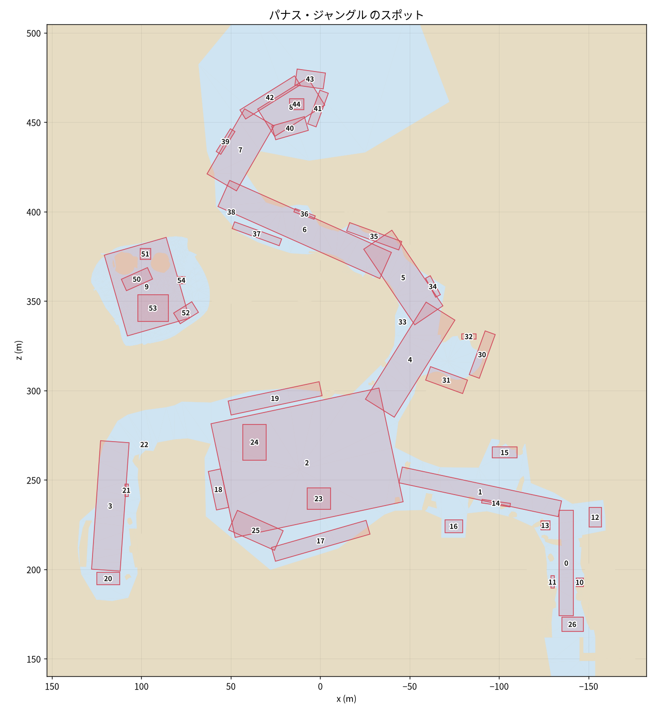

# パナス・ジャングル

[湧き確率の読み方](../spawn.md) ・ [地図の読み方](../maps.md) ・ [目次](../../README.md)

## スポット一覧

| スポット | 出現表 | 幅×奥行 m | 面積 m² | 上限 朝/昼/夕/夜 | 補充秒 | エサ補正 |
|--:|:-:|--:|--:|:-:|--:|--:|
| 0 | A | 8×59 | 472 | 30/25/26/28 | 42 | 0 |
| 1 | B | 91×9 | 819 | 30/25/26/28 | 42 | 0 |
| 2 | C | 96×65 | 6,240 | 50/40/40/45 | 42 | 0 |
| 3 | D | 16×72 | 1,152 | 30/25/26/28 | 42 | 0 |
| 4 | E | 19×64 | 1,216 | 25/16/18/20 | 42 | 0 |
| 5 | E | 51×19 | 969 | 30/25/26/28 | 42 | 0 |
| 6 | E | 99×16 | 1,584 | 30/25/26/28 | 42 | 0 |
| 7 | F | 42×19 | 798 | 18/12/14/16 | 42 | 0 |
| 8 | G | 33×18 | 594 | 20/14/16/18 | 42 | 0 |
| 9 | H | 36×47 | 1,692 | 20/12/14/16 | 42 | 0 |
| 10 | I | 4×5 | 20 | 8/5/6/7 | 42 | 0 |
| 11 | I | 2×7 | 14 | 5/5/5/5 | 42 | 0 |
| 12 | I | 7×11 | 77 | 8/5/6/7 | 42 | 0 |
| 13 | J | 5×5 | 25 | 7/7/7/7 | 42 | 0 |
| 14 | J | 16×2 | 32 | 6/6/6/6 | 42 | 0 |
| 15 | J | 14×6 | 84 | 7/7/7/7 | 42 | 0 |
| 16 | J | 10×7 | 70 | 6/6/6/6 | 42 | 0 |
| 17 | K | 55×8 | 440 | 18/14/15/16 | 42 | 0 |
| 18 | K | 7×22 | 154 | 15/15/15/15 | 42 | 0 |
| 19 | L | 52×8 | 416 | 18/14/15/16 | 42 | 0 |
| 20 | M | 13×7 | 91 | 10/7/8/9 | 42 | 0 |
| 21 | L | 2×7 | 14 | 6/6/6/6 | 42 | 0 |
| 22 | L | 3×3 | 9 | 3/3/3/3 | 42 | 0 |
| 23 | L | 13×12 | 156 | 10/10/10/10 | 42 | 0 |
| 24 | L | 13×20 | 260 | 10/10/10/10 | 42 | 0 |
| 25 | K | 28×12 | 336 | 12/12/12/12 | 42 | 0 |
| 26 | N | 12×8 | 96 | 10/10/10/10 | 42 | 0 |
| 30 | O | 6×26 | 156 | 10/10/10/10 | 42 | 0 |
| 31 | O | 22×8 | 176 | 8/8/8/8 | 42 | 0 |
| 32 | O | 8×3 | 24 | 5/5/5/5 | 42 | 0 |
| 33 | P | 3×3 | 9 | 4/4/4/4 | 42 | 0 |
| 34 | P | 3×12 | 36 | 6/6/6/6 | 42 | 0 |
| 35 | P | 31×5 | 155 | 12/12/12/12 | 42 | 0 |
| 36 | Q | 12×2 | 24 | 8/8/8/8 | 42 | 0 |
| 37 | R | 28×4 | 112 | 12/12/12/12 | 42 | 0 |
| 38 | S | 3×3 | 9 | 4/4/4/4 | 42 | 0 |
| 39 | S | 3×15 | 45 | 12/12/12/12 | 42 | 0 |
| 40 | T | 19×8 | 152 | 12/12/12/12 | 42 | 0 |
| 41 | T | 5×20 | 100 | 11/11/11/11 | 42 | 0 |
| 42 | T | 36×6 | 216 | 12/12/12/12 | 42 | 0 |
| 43 | T | 16×9 | 144 | 10/10/10/10 | 42 | 0 |
| 44 | U | 8×6 | 48 | 6/6/6/6 | 42 | 0 |
| 50 | V | 16×7 | 112 | 10/10/10/10 | 42 | 0 |
| 51 | V | 6×6 | 36 | 8/8/8/8 | 42 | 0 |
| 52 | W | 12×7 | 84 | 14/14/14/14 | 42 | 0 |
| 53 | W | 17×15 | 255 | 11/11/11/11 | 42 | 0 |
| 54 | W | 4×4 | 16 | 4/4/4/4 | 42 | 0 |

「補充秒」は、そのスポットで魚がつつき始めてから60秒の間の補充の間隔である ([補充の速さ](../spawn-paths.md#補充の速さ))。

## 出現表

### 表A (スポット 0)

| 魚 | 重み | 確率% | 放流解禁時% | 条件 |
|---|--:|--:|--:|---|
| ピラニア | 9 | 33.3 | 33.3 |  |
| アッパッパー | 7 | 25.9 | 25.9 |  |
| ヨロイナマズ | 5 | 18.5 | 18.5 |  |
| パクー | 5 | 18.5 | 18.5 |  |
| ふつうの流木 | 1 | 3.7 | 3.7 |  |

### 表B (スポット 1)

| 魚 | 重み | 確率% | 放流解禁時% | 条件 |
|---|--:|--:|--:|---|
| ピラニア | 6 | 25.0 | 25.0 |  |
| アッパッパー | 6 | 25.0 | 25.0 |  |
| アフリカンパイクカラシン | 4 | 16.7 | 16.7 |  |
| ヨロイナマズ | 3 | 12.5 | 12.5 |  |
| パクー | 3 | 12.5 | 12.5 |  |
| ピーコックバス | 1 | 4.2 | 4.2 |  |
| ふつうの流木 | 1 | 4.2 | 4.2 |  |

### 表C (スポット 2)

| 魚 | 重み | 確率% | 放流解禁時% | 条件 |
|---|--:|--:|--:|---|
| ピラニア | 3 | 15.0 | 15.0 |  |
| ヨロイナマズ | 3 | 15.0 | 15.0 |  |
| ピーコックバス | 3 | 15.0 | 15.0 |  |
| パクー | 3 | 15.0 | 15.0 |  |
| アッパッパー | 3 | 15.0 | 15.0 |  |
| アフリカンパイクカラシン | 3 | 15.0 | 15.0 |  |
| アリゲーターガー | 1 | 5.0 | 5.0 |  |
| ふつうの流木 | 1 | 5.0 | 5.0 |  |

### 表D (スポット 3)

| 魚 | 重み | 確率% | 放流解禁時% | 条件 |
|---|--:|--:|--:|---|
| アリゲーターガー | 3 | 16.7 | 16.7 |  |
| ピーコックバス | 3 | 16.7 | 16.7 |  |
| アフリカンパイクカラシン | 3 | 16.7 | 16.7 |  |
| ピラニア | 2 | 11.1 | 11.1 |  |
| ヨロイナマズ | 2 | 11.1 | 11.1 |  |
| パクー | 2 | 11.1 | 11.1 |  |
| アッパッパー | 2 | 11.1 | 11.1 |  |
| ふつうの流木 | 1 | 5.6 | 5.6 |  |

### 表E (スポット 4〜6)

| 魚 | 重み | 確率% | 放流解禁時% | 条件 |
|---|--:|--:|--:|---|
| ピーコックバス | 2 | 25.0 | 25.0 |  |
| アフリカンパイクカラシン | 2 | 25.0 | 25.0 |  |
| ピラニア | 1 | 12.5 | 12.5 |  |
| ヨロイナマズ | 1 | 12.5 | 12.5 |  |
| ふつうの流木 | 1 | 12.5 | 12.5 |  |
| まっすぐな流木 | 1 | 12.5 | 12.5 |  |

### 表F (スポット 7)

| 魚 | 重み | 確率% | 放流解禁時% | 条件 |
|---|--:|--:|--:|---|
| ピーコックバス | 2 | 20.0 | 18.2 |  |
| レッドテイルキャットフィッシュ | 2 | 20.0 | 18.2 |  |
| アフリカンパイクカラシン | 2 | 20.0 | 18.2 |  |
| ピラニア | 1 | 10.0 | 9.1 |  |
| ヨロイナマズ | 1 | 10.0 | 9.1 |  |
| デンキウナギ | 1 | - | 9.1 | 放流 |
| ふつうの流木 | 1 | 10.0 | 9.1 |  |
| まっすぐな流木 | 1 | 10.0 | 9.1 |  |

### 表G (スポット 8)

| 魚 | 重み | 確率% | 放流解禁時% | 条件 |
|---|--:|--:|--:|---|
| ピーコックバス | 2 | 16.7 | 16.7 |  |
| レッドテイルキャットフィッシュ | 2 | 16.7 | 16.7 |  |
| アフリカンパイクカラシン | 2 | 16.7 | 16.7 |  |
| ドラード | 1 | 8.3 | 8.3 | クエスト |
| ブラックゴースト | 1 | 8.3 | 8.3 |  |
| ピラニア | 1 | 8.3 | 8.3 |  |
| ヨロイナマズ | 1 | 8.3 | 8.3 |  |
| ふつうの流木 | 1 | 8.3 | 8.3 |  |
| まっすぐな流木 | 1 | 8.3 | 8.3 |  |

### 表H (スポット 9)

| 魚 | 重み | 確率% | 放流解禁時% | 条件 |
|---|--:|--:|--:|---|
| アロワナ | 1 | 20.0 | 20.0 |  |
| ヨロイナマズ | 1 | 20.0 | 20.0 |  |
| カーディナルテトラ | 1 | 20.0 | 20.0 |  |
| ペーシュカショーロ | 1 | 20.0 | 20.0 |  |
| ごてごてした水草 | 1 | 20.0 | 20.0 |  |

### 表I (スポット 10〜12)

| 魚 | 重み | 確率% | 放流解禁時% | 条件 |
|---|--:|--:|--:|---|
| ヨロイナマズ | 2 | 28.6 | 28.6 |  |
| パクー | 2 | 28.6 | 28.6 |  |
| ピラニア | 1 | 14.3 | 14.3 |  |
| アッパッパー | 1 | 14.3 | 14.3 |  |
| ふつうの流木 | 1 | 14.3 | 14.3 |  |

### 表J (スポット 13〜16)

| 魚 | 重み | 確率% | 放流解禁時% | 条件 |
|---|--:|--:|--:|---|
| ヨロイナマズ | 2 | 18.2 | 18.2 |  |
| ピーコックバス | 2 | 18.2 | 18.2 |  |
| パクー | 2 | 18.2 | 18.2 |  |
| アフリカンパイクカラシン | 2 | 18.2 | 18.2 |  |
| ピラニア | 1 | 9.1 | 9.1 |  |
| アッパッパー | 1 | 9.1 | 9.1 |  |
| ふつうの流木 | 1 | 9.1 | 9.1 |  |

### 表K (スポット 17〜18、25)

| 魚 | 重み | 確率% | 放流解禁時% | 条件 |
|---|--:|--:|--:|---|
| アリゲーターガー | 2 | 14.3 | 14.3 |  |
| ヨロイナマズ | 2 | 14.3 | 14.3 |  |
| ピーコックバス | 2 | 14.3 | 14.3 |  |
| パクー | 2 | 14.3 | 14.3 |  |
| アフリカンパイクカラシン | 2 | 14.3 | 14.3 |  |
| ピラルク | 1 | 7.1 | 7.1 | クエスト |
| ピラニア | 1 | 7.1 | 7.1 |  |
| アッパッパー | 1 | 7.1 | 7.1 |  |
| ふつうの流木 | 1 | 7.1 | 7.1 |  |

### 表L (スポット 19、21〜24)

| 魚 | 重み | 確率% | 放流解禁時% | 条件 |
|---|--:|--:|--:|---|
| アリゲーターガー | 2 | 15.4 | 15.4 |  |
| ヨロイナマズ | 2 | 15.4 | 15.4 |  |
| ピーコックバス | 2 | 15.4 | 15.4 |  |
| パクー | 2 | 15.4 | 15.4 |  |
| アフリカンパイクカラシン | 2 | 15.4 | 15.4 |  |
| ピラニア | 1 | 7.7 | 7.7 |  |
| アッパッパー | 1 | 7.7 | 7.7 |  |
| ふつうの流木 | 1 | 7.7 | 7.7 |  |

### 表M (スポット 20)

| 魚 | 重み | 確率% | 放流解禁時% | 条件 |
|---|--:|--:|--:|---|
| アリゲーターガー | 3 | 17.6 | 16.7 |  |
| ヨロイナマズ | 3 | 17.6 | 16.7 |  |
| パクー | 3 | 17.6 | 16.7 |  |
| ピーコックバス | 2 | 11.8 | 11.1 |  |
| アフリカンパイクカラシン | 2 | 11.8 | 11.1 |  |
| ピラルク | 1 | 5.9 | 5.6 | クエスト |
| ピラニア | 1 | 5.9 | 5.6 |  |
| デンキウナギ | 1 | - | 5.6 | 放流 |
| アッパッパー | 1 | 5.9 | 5.6 |  |
| ふつうの流木 | 1 | 5.9 | 5.6 |  |

### 表N (スポット 26)

| 魚 | 重み | 確率% | 放流解禁時% | 条件 |
|---|--:|--:|--:|---|
| ピラニア | 5 | 41.7 | 41.7 |  |
| ヨロイナマズ | 4 | 33.3 | 33.3 |  |
| ピーコックバス | 1 | 8.3 | 8.3 |  |
| パクー | 1 | 8.3 | 8.3 |  |
| ふつうの流木 | 1 | 8.3 | 8.3 |  |

### 表O (スポット 30〜32)

| 魚 | 重み | 確率% | 放流解禁時% | 条件 |
|---|--:|--:|--:|---|
| ヨロイナマズ | 2 | 22.2 | 22.2 |  |
| ピーコックバス | 2 | 22.2 | 22.2 |  |
| アフリカンパイクカラシン | 2 | 22.2 | 22.2 |  |
| ピラニア | 1 | 11.1 | 11.1 |  |
| ふつうの流木 | 1 | 11.1 | 11.1 |  |
| まっすぐな流木 | 1 | 11.1 | 11.1 |  |

### 表P (スポット 33〜35)

| 魚 | 重み | 確率% | 放流解禁時% | 条件 |
|---|--:|--:|--:|---|
| ヨロイナマズ | 2 | 20.0 | 20.0 |  |
| ピーコックバス | 2 | 20.0 | 20.0 |  |
| アフリカンパイクカラシン | 2 | 20.0 | 20.0 |  |
| ドラード | 1 | 10.0 | 10.0 | クエスト |
| ピラニア | 1 | 10.0 | 10.0 |  |
| ふつうの流木 | 1 | 10.0 | 10.0 |  |
| まっすぐな流木 | 1 | 10.0 | 10.0 |  |

### 表Q (スポット 36)

| 魚 | 重み | 確率% | 放流解禁時% | 条件 |
|---|--:|--:|--:|---|
| ピラニア | 1 | 16.7 | 16.7 |  |
| ヨロイナマズ | 1 | 16.7 | 16.7 |  |
| ピーコックバス | 1 | 16.7 | 16.7 |  |
| アフリカンパイクカラシン | 1 | 16.7 | 16.7 |  |
| ふつうの流木 | 1 | 16.7 | 16.7 |  |
| まっすぐな流木 | 1 | 16.7 | 16.7 |  |

### 表R (スポット 37)

| 魚 | 重み | 確率% | 放流解禁時% | 条件 |
|---|--:|--:|--:|---|
| ピラニア | 3 | 21.4 | 21.4 |  |
| ピーコックバス | 3 | 21.4 | 21.4 |  |
| アフリカンパイクカラシン | 3 | 21.4 | 21.4 |  |
| レッドテイルキャットフィッシュ | 2 | 14.3 | 14.3 |  |
| ヨロイナマズ | 1 | 7.1 | 7.1 |  |
| ふつうの流木 | 1 | 7.1 | 7.1 |  |
| まっすぐな流木 | 1 | 7.1 | 7.1 |  |

### 表S (スポット 38〜39)

| 魚 | 重み | 確率% | 放流解禁時% | 条件 |
|---|--:|--:|--:|---|
| ピラニア | 3 | 21.4 | 20.0 |  |
| ピーコックバス | 3 | 21.4 | 20.0 |  |
| アフリカンパイクカラシン | 3 | 21.4 | 20.0 |  |
| レッドテイルキャットフィッシュ | 2 | 14.3 | 13.3 |  |
| ヨロイナマズ | 1 | 7.1 | 6.7 |  |
| デンキウナギ | 1 | - | 6.7 | 放流 |
| ふつうの流木 | 1 | 7.1 | 6.7 |  |
| まっすぐな流木 | 1 | 7.1 | 6.7 |  |

### 表T (スポット 40〜43)

| 魚 | 重み | 確率% | 放流解禁時% | 条件 |
|---|--:|--:|--:|---|
| ピラニア | 3 | 18.8 | 17.6 |  |
| アリゲーターガー | 2 | 12.5 | 11.8 |  |
| ピーコックバス | 2 | 12.5 | 11.8 |  |
| レッドテイルキャットフィッシュ | 2 | 12.5 | 11.8 |  |
| アフリカンパイクカラシン | 2 | 12.5 | 11.8 |  |
| ブラックゴースト | 1 | 6.2 | 5.9 |  |
| プラチナアリゲーターガー | 1 | 6.2 | 5.9 | クエスト |
| ヨロイナマズ | 1 | 6.2 | 5.9 |  |
| デンキウナギ | 1 | - | 5.9 | 放流 |
| ふつうの流木 | 1 | 6.2 | 5.9 |  |
| まっすぐな流木 | 1 | 6.2 | 5.9 |  |

### 表U (スポット 44)

| 魚 | 重み | 確率% | 放流解禁時% | 条件 |
|---|--:|--:|--:|---|
| ピラニア | 3 | 20.0 | 20.0 |  |
| ピーコックバス | 3 | 20.0 | 20.0 |  |
| アフリカンパイクカラシン | 3 | 20.0 | 20.0 |  |
| レッドテイルキャットフィッシュ | 2 | 13.3 | 13.3 |  |
| ブラックゴースト | 1 | 6.7 | 6.7 |  |
| ヨロイナマズ | 1 | 6.7 | 6.7 |  |
| ふつうの流木 | 1 | 6.7 | 6.7 |  |
| まっすぐな流木 | 1 | 6.7 | 6.7 |  |

### 表V (スポット 50〜51)

| 魚 | 重み | 確率% | 放流解禁時% | 条件 |
|---|--:|--:|--:|---|
| ヨロイナマズ | 10 | 25.0 | 25.0 |  |
| アロワナ | 8 | 20.0 | 20.0 |  |
| ドラード | 7 | 17.5 | 17.5 | クエスト |
| ペーシュカショーロ | 7 | 17.5 | 17.5 |  |
| カーディナルテトラ | 6 | 15.0 | 15.0 |  |
| プテラスピス | 1 | 2.5 | 2.5 |  |
| ごてごてした水草 | 1 | 2.5 | 2.5 |  |

### 表W (スポット 52〜54)

| 魚 | 重み | 確率% | 放流解禁時% | 条件 |
|---|--:|--:|--:|---|
| ヨロイナマズ | 10 | 25.6 | 25.6 |  |
| アロワナ | 8 | 20.5 | 20.5 |  |
| ドラード | 7 | 17.9 | 17.9 | クエスト |
| ペーシュカショーロ | 7 | 17.9 | 17.9 |  |
| カーディナルテトラ | 6 | 15.4 | 15.4 |  |
| ごてごてした水草 | 1 | 2.6 | 2.6 |  |
