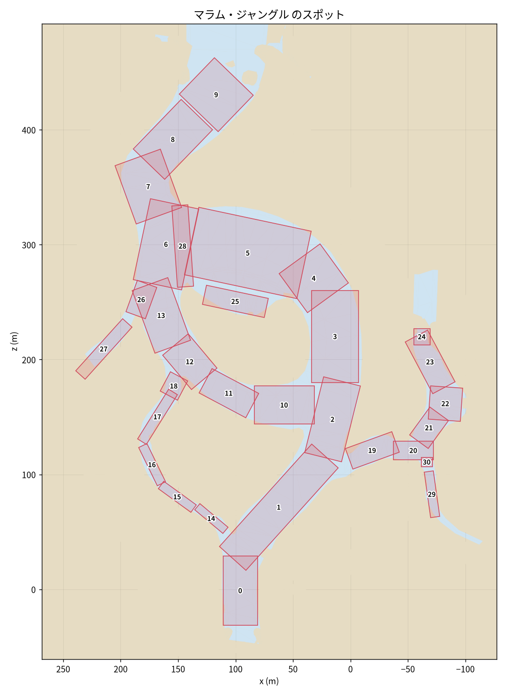

# マラム・ジャングル

[湧き確率の読み方](../spawn.md) ・ [地図の読み方](../maps.md) ・ [目次](../../README.md)

## スポット一覧

| スポット | 出現表 | 幅×奥行 m | 面積 m² | 上限 朝/昼/夕/夜 | 補充秒 | エサ補正 |
|--:|:-:|--:|--:|:-:|--:|--:|
| 0 | A | 30×60 | 1,800 | 30/20/24/26 | 54 | -1 |
| 1 | A | 120×31 | 3,720 | 40/28/30/32 | 54 | -1 |
| 2 | B | 68×33 | 2,244 | 36/30/32/34 | 54 | -1 |
| 3 | B | 41×80 | 3,280 | 40/32/34/36 | 54 | -1 |
| 4 | C | 44×42 | 1,848 | 30/30/30/30 | 54 | -1 |
| 5 | D | 100×60 | 6,000 | 60/50/54/58 | 54 | -1 |
| 6 | C | 43×72 | 3,096 | 30/30/30/30 | 54 | -1 |
| 7 | E | 42×54 | 2,268 | 30/25/26/28 | 54 | -1 |
| 8 | F | 38×60 | 2,280 | 32/26/28/30 | 54 | -1 |
| 9 | G | 47×44 | 2,068 | 40/32/34/36 | 54 | -1 |
| 10 | H | 52×33 | 1,716 | 26/20/22/24 | 54 | -1 |
| 11 | H | 46×24 | 1,104 | 26/20/22/24 | 54 | -1 |
| 12 | I | 29×39 | 1,131 | 26/20/22/24 | 54 | -1 |
| 13 | J | 33×58 | 1,914 | 30/24/26/28 | 54 | -1 |
| 14 | K | 32×7 | 224 | 12/8/9/10 | 54 | -1 |
| 15 | L | 35×8 | 280 | 20/20/20/20 | 54 | -1 |
| 16 | L | 37×8 | 296 | 20/20/20/20 | 54 | -1 |
| 17 | K | 9×51 | 459 | 24/18/20/22 | 54 | -1 |
| 18 | M | 17×19 | 323 | 10/10/10/10 | 54 | -1 |
| 19 | N | 43×19 | 817 | 14/12/12/14 | 54 | -1 |
| 20 | N | 35×16 | 560 | 14/12/12/14 | 54 | -1 |
| 21 | N | 20×30 | 600 | 14/12/12/14 | 54 | -1 |
| 22 | N | 28×29 | 812 | 20/14/16/18 | 54 | -1 |
| 23 | N | 22×51 | 1,122 | 26/22/24/26 | 54 | -1 |
| 24 | N | 14×14 | 196 | 12/8/9/10 | 54 | -1 |
| 25 | O | 55×17 | 935 | 30/30/30/30 | 54 | -1 |
| 26 | P | 18×29 | 522 | 15/15/15/15 | 54 | -1 |
| 27 | Q | 61×11 | 671 | 10/10/10/10 | 54 | -1 |
| 28 | R | 14×71 | 994 | 20/20/20/20 | 54 | -1 |
| 29 | S | 8×40 | 320 | 10/10/10/10 | 54 | -1 |
| 30 | N | 10×8 | 80 | 10/10/10/10 | 54 | -1 |

「補充秒」は、そのスポットで魚がつつき始めてから60秒の間の補充の間隔である ([補充の速さ](../spawn-paths.md#補充の速さ))。

## 出現表

### 表A (スポット 0〜1)

| 魚 | 重み | 確率% | 放流解禁時% | 条件 |
|---|--:|--:|--:|---|
| ロイヤルナイフフィッシュ | 3 | 33.3 | 33.3 |  |
| バタフライフィッシュ | 3 | 33.3 | 33.3 |  |
| エレファントノーズフィッシュ | 1 | 11.1 | 11.1 |  |
| ポリプテルス | 1 | 11.1 | 11.1 |  |
| ふつうの流木 | 1 | 11.1 | 11.1 |  |

### 表B (スポット 2〜3)

| 魚 | 重み | 確率% | 放流解禁時% | 条件 |
|---|--:|--:|--:|---|
| ロイヤルナイフフィッシュ | 3 | 27.3 | 27.3 |  |
| バタフライフィッシュ | 3 | 27.3 | 27.3 |  |
| ナイルパーチ | 2 | 18.2 | 18.2 |  |
| エレファントノーズフィッシュ | 1 | 9.1 | 9.1 |  |
| ポリプテルス | 1 | 9.1 | 9.1 |  |
| ふつうの流木 | 1 | 9.1 | 9.1 |  |

### 表C (スポット 4、6)

| 魚 | 重み | 確率% | 放流解禁時% | 条件 |
|---|--:|--:|--:|---|
| アーモンドスネークヘッド | 4 | 28.6 | 28.6 |  |
| ロイヤルナイフフィッシュ | 3 | 21.4 | 21.4 |  |
| バタフライフィッシュ | 3 | 21.4 | 21.4 |  |
| エレファントノーズフィッシュ | 1 | 7.1 | 7.1 |  |
| ポリプテルス | 1 | 7.1 | 7.1 |  |
| トーマン | 1 | 7.1 | 7.1 |  |
| ふつうの流木 | 1 | 7.1 | 7.1 |  |

### 表D (スポット 5)

| 魚 | 重み | 確率% | 放流解禁時% | 条件 |
|---|--:|--:|--:|---|
| トーマン | 3 | 23.1 | 23.1 |  |
| アーモンドスネークヘッド | 3 | 23.1 | 23.1 |  |
| ロイヤルナイフフィッシュ | 2 | 15.4 | 15.4 |  |
| バタフライフィッシュ | 2 | 15.4 | 15.4 |  |
| エレファントノーズフィッシュ | 1 | 7.7 | 7.7 |  |
| ポリプテルス | 1 | 7.7 | 7.7 |  |
| まっすぐな流木 | 1 | 7.7 | 7.7 |  |

### 表E (スポット 7)

| 魚 | 重み | 確率% | 放流解禁時% | 条件 |
|---|--:|--:|--:|---|
| パプアンバス | 3 | 33.3 | 33.3 |  |
| エレファントノーズフィッシュ | 1 | 11.1 | 11.1 |  |
| ロイヤルナイフフィッシュ | 1 | 11.1 | 11.1 |  |
| ポリプテルス | 1 | 11.1 | 11.1 |  |
| バタフライフィッシュ | 1 | 11.1 | 11.1 |  |
| アーモンドスネークヘッド | 1 | 11.1 | 11.1 |  |
| ふつうの流木 | 1 | 11.1 | 11.1 |  |

### 表F (スポット 8)

| 魚 | 重み | 確率% | 放流解禁時% | 条件 |
|---|--:|--:|--:|---|
| パプアンバス | 4 | 30.8 | 30.8 |  |
| バラマンディ | 2 | 15.4 | 15.4 | クエスト |
| ナイルパーチ | 1 | 7.7 | 7.7 |  |
| エレファントノーズフィッシュ | 1 | 7.7 | 7.7 |  |
| ロイヤルナイフフィッシュ | 1 | 7.7 | 7.7 |  |
| ポリプテルス | 1 | 7.7 | 7.7 |  |
| バタフライフィッシュ | 1 | 7.7 | 7.7 |  |
| アーモンドスネークヘッド | 1 | 7.7 | 7.7 |  |
| ふつうの流木 | 1 | 7.7 | 7.7 |  |

### 表G (スポット 9)

| 魚 | 重み | 確率% | 放流解禁時% | 条件 |
|---|--:|--:|--:|---|
| パプアンバス | 4 | 28.6 | 28.6 |  |
| バラマンディ | 3 | 21.4 | 21.4 | クエスト |
| ナイルパーチ | 1 | 7.1 | 7.1 |  |
| エレファントノーズフィッシュ | 1 | 7.1 | 7.1 |  |
| ロイヤルナイフフィッシュ | 1 | 7.1 | 7.1 |  |
| ポリプテルス | 1 | 7.1 | 7.1 |  |
| バタフライフィッシュ | 1 | 7.1 | 7.1 |  |
| アーモンドスネークヘッド | 1 | 7.1 | 7.1 |  |
| まっすぐな流木 | 1 | 7.1 | 7.1 |  |

### 表H (スポット 10〜11)

| 魚 | 重み | 確率% | 放流解禁時% | 条件 |
|---|--:|--:|--:|---|
| ナイルパーチ | 3 | 27.3 | 27.3 |  |
| エレファントノーズフィッシュ | 2 | 18.2 | 18.2 |  |
| ポリプテルス | 2 | 18.2 | 18.2 |  |
| タイガーフィッシュ | 1 | 9.1 | 9.1 | クエスト |
| ロイヤルナイフフィッシュ | 1 | 9.1 | 9.1 |  |
| バタフライフィッシュ | 1 | 9.1 | 9.1 |  |
| ふつうの流木 | 1 | 9.1 | 9.1 |  |

### 表I (スポット 12)

| 魚 | 重み | 確率% | 放流解禁時% | 条件 |
|---|--:|--:|--:|---|
| ナイルパーチ | 3 | 25.0 | 25.0 |  |
| タイガーフィッシュ | 2 | 16.7 | 16.7 | クエスト |
| エレファントノーズフィッシュ | 2 | 16.7 | 16.7 |  |
| ポリプテルス | 2 | 16.7 | 16.7 |  |
| ロイヤルナイフフィッシュ | 1 | 8.3 | 8.3 |  |
| バタフライフィッシュ | 1 | 8.3 | 8.3 |  |
| まっすぐな流木 | 1 | 8.3 | 8.3 |  |

### 表J (スポット 13)

| 魚 | 重み | 確率% | 放流解禁時% | 条件 |
|---|--:|--:|--:|---|
| エレファントノーズフィッシュ | 2 | 28.6 | 28.6 |  |
| ポリプテルス | 2 | 28.6 | 28.6 |  |
| ロイヤルナイフフィッシュ | 1 | 14.3 | 14.3 |  |
| バタフライフィッシュ | 1 | 14.3 | 14.3 |  |
| ふつうの流木 | 1 | 14.3 | 14.3 |  |

### 表K (スポット 14、17)

| 魚 | 重み | 確率% | 放流解禁時% | 条件 |
|---|--:|--:|--:|---|
| グッピー | 10 | 26.3 | 26.3 |  |
| トウギョ | 10 | 26.3 | 26.3 |  |
| バタフライフィッシュ | 8 | 21.1 | 21.1 |  |
| プラチナグッピー | 5 | 13.2 | 13.2 |  |
| ごてごてした水草 | 5 | 13.2 | 13.2 |  |

### 表L (スポット 15〜16)

| 魚 | 重み | 確率% | 放流解禁時% | 条件 |
|---|--:|--:|--:|---|
| グッピー | 9 | 24.3 | 24.3 |  |
| トウギョ | 9 | 24.3 | 24.3 |  |
| バタフライフィッシュ | 8 | 21.6 | 21.6 |  |
| プラチナグッピー | 5 | 13.5 | 13.5 |  |
| ごてごてした水草 | 5 | 13.5 | 13.5 |  |
| クリマティウス | 1 | 2.7 | 2.7 |  |

### 表M (スポット 18)

| 魚 | 重み | 確率% | 放流解禁時% | 条件 |
|---|--:|--:|--:|---|
| グッピー | 2 | 12.5 | 12.5 |  |
| プラチナグッピー | 2 | 12.5 | 12.5 |  |
| ナイルパーチ | 2 | 12.5 | 12.5 |  |
| エレファントノーズフィッシュ | 2 | 12.5 | 12.5 |  |
| ポリプテルス | 2 | 12.5 | 12.5 |  |
| バタフライフィッシュ | 2 | 12.5 | 12.5 |  |
| トウギョ | 2 | 12.5 | 12.5 |  |
| ごてごてした水草 | 1 | 6.2 | 6.2 |  |
| ふつうの流木 | 1 | 6.2 | 6.2 |  |

### 表N (スポット 19〜24、30)

| 魚 | 重み | 確率% | 放流解禁時% | 条件 |
|---|--:|--:|--:|---|
| エレファントノーズフィッシュ | 3 | 18.8 | 18.8 |  |
| ロイヤルナイフフィッシュ | 2 | 12.5 | 12.5 |  |
| バタフライフィッシュ | 2 | 12.5 | 12.5 |  |
| アーモンドスネークヘッド | 2 | 12.5 | 12.5 |  |
| フラワートーマン | 2 | 12.5 | 12.5 |  |
| グッピー | 1 | 6.2 | 6.2 |  |
| ポリプテルス | 1 | 6.2 | 6.2 |  |
| トウギョ | 1 | 6.2 | 6.2 |  |
| ふつうの流木 | 1 | 6.2 | 6.2 |  |
| まっすぐな流木 | 1 | 6.2 | 6.2 |  |

### 表O (スポット 25)

| 魚 | 重み | 確率% | 放流解禁時% | 条件 |
|---|--:|--:|--:|---|
| アーモンドスネークヘッド | 3 | 20.0 | 20.0 |  |
| フラワートーマン | 3 | 20.0 | 20.0 |  |
| ロイヤルナイフフィッシュ | 2 | 13.3 | 13.3 |  |
| バタフライフィッシュ | 2 | 13.3 | 13.3 |  |
| エレファントノーズフィッシュ | 1 | 6.7 | 6.7 |  |
| ポリプテルス | 1 | 6.7 | 6.7 |  |
| トーマン | 1 | 6.7 | 6.7 |  |
| ふつうの流木 | 1 | 6.7 | 6.7 |  |
| まっすぐな流木 | 1 | 6.7 | 6.7 |  |

### 表P (スポット 26)

| 魚 | 重み | 確率% | 放流解禁時% | 条件 |
|---|--:|--:|--:|---|
| エレファントノーズフィッシュ | 2 | 20.0 | 20.0 |  |
| ポリプテルス | 2 | 20.0 | 20.0 |  |
| グッピー | 1 | 10.0 | 10.0 |  |
| ロイヤルナイフフィッシュ | 1 | 10.0 | 10.0 |  |
| バタフライフィッシュ | 1 | 10.0 | 10.0 |  |
| トウギョ | 1 | 10.0 | 10.0 |  |
| ふつうの流木 | 1 | 10.0 | 10.0 |  |
| まっすぐな流木 | 1 | 10.0 | 10.0 |  |

### 表Q (スポット 27)

| 魚 | 重み | 確率% | 放流解禁時% | 条件 |
|---|--:|--:|--:|---|
| グッピー | 5 | 35.7 | 35.7 |  |
| トウギョ | 5 | 35.7 | 35.7 |  |
| プラチナグッピー | 2 | 14.3 | 14.3 |  |
| ふつうの流木 | 1 | 7.1 | 7.1 |  |
| まっすぐな流木 | 1 | 7.1 | 7.1 |  |

### 表R (スポット 28)

| 魚 | 重み | 確率% | 放流解禁時% | 条件 |
|---|--:|--:|--:|---|
| トーマン | 3 | 21.4 | 21.4 |  |
| アーモンドスネークヘッド | 3 | 21.4 | 21.4 |  |
| ロイヤルナイフフィッシュ | 2 | 14.3 | 14.3 |  |
| バタフライフィッシュ | 2 | 14.3 | 14.3 |  |
| エレファントノーズフィッシュ | 1 | 7.1 | 7.1 |  |
| ポリプテルス | 1 | 7.1 | 7.1 |  |
| ふつうの流木 | 1 | 7.1 | 7.1 |  |
| まっすぐな流木 | 1 | 7.1 | 7.1 |  |

### 表S (スポット 29)

| 魚 | 重み | 確率% | 放流解禁時% | 条件 |
|---|--:|--:|--:|---|
| エレファントノーズフィッシュ | 1 | 25.0 | 25.0 |  |
| アーモンドスネークヘッド | 1 | 25.0 | 25.0 |  |
| ふつうの流木 | 1 | 25.0 | 25.0 |  |
| まっすぐな流木 | 1 | 25.0 | 25.0 |  |
