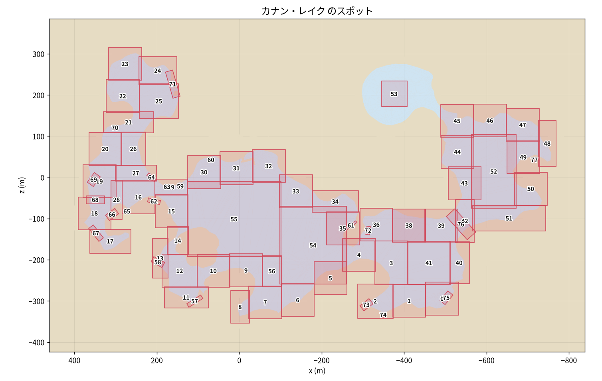

# カナン・レイク

[湧き確率の読み方](../spawn.md) ・ [地図の読み方](../maps.md) ・ [目次](../../README.md)

## スポット一覧

| スポット | 出現表 | 幅×奥行 m | 面積 m² | 上限 朝/昼/夕/夜 | 補充秒 | エサ補正 |
|--:|:-:|--:|--:|:-:|--:|--:|
| 0 | A | 80×80 | 6,400 | 60/60/60/60 | 36 | 0 |
| 1 | A | 80×80 | 6,400 | 60/60/60/60 | 36 | 0 |
| 2 | A | 86×83 | 7,138 | 60/60/60/60 | 36 | 0 |
| 3 | B | 80×107 | 8,560 | 60/60/60/60 | 36 | 0 |
| 4 | B | 80×80 | 6,400 | 30/30/30/30 | 36 | 0 |
| 5 | C | 80×80 | 6,400 | 30/30/30/30 | 36 | 0 |
| 6 | D | 80×80 | 6,400 | 40/40/40/40 | 36 | 0 |
| 7 | D | 80×80 | 6,400 | 50/50/50/50 | 36 | 0 |
| 8 | D | 45×79 | 3,555 | 60/60/60/60 | 36 | 0 |
| 9 | C | 80×80 | 6,400 | 40/40/40/40 | 36 | 0 |
| 10 | C | 80×80 | 6,400 | 50/50/50/50 | 36 | 0 |
| 11 | E | 106×52 | 5,512 | 60/60/60/60 | 36 | 0 |
| 12 | E | 85×80 | 6,800 | 60/60/60/60 | 36 | 0 |
| 13 | E | 38×96 | 3,648 | 60/60/60/60 | 36 | 0 |
| 14 | F | 51×68 | 3,468 | 40/40/40/40 | 36 | 0 |
| 15 | F | 80×80 | 6,400 | 30/30/30/30 | 36 | 0 |
| 16 | G | 80×80 | 6,400 | 30/30/30/30 | 36 | 0 |
| 17 | H | 99×58 | 5,742 | 60/60/60/60 | 36 | 0 |
| 18 | H | 80×80 | 6,400 | 50/50/50/50 | 36 | 0 |
| 19 | I | 80×80 | 6,400 | 40/40/40/40 | 36 | 0 |
| 20 | I | 80×80 | 6,400 | 40/40/40/40 | 36 | 0 |
| 21 | J | 122×51 | 6,222 | 30/30/30/30 | 36 | 0 |
| 22 | K | 80×80 | 6,400 | 50/50/50/50 | 36 | 0 |
| 23 | K | 80×80 | 6,400 | 60/60/60/60 | 36 | 0 |
| 24 | K | 92×68 | 6,256 | 60/60/60/60 | 36 | 0 |
| 25 | K | 95×84 | 7,980 | 50/50/50/50 | 36 | 0 |
| 26 | I | 60×82 | 4,920 | 40/40/40/40 | 36 | 0 |
| 27 | I | 99×38 | 3,762 | 30/30/30/30 | 36 | 0 |
| 28 | G | 27×95 | 2,565 | 30/30/30/30 | 36 | 0 |
| 29 | L | 80×39 | 3,120 | 30/30/30/30 | 36 | 0 |
| 30 | L | 80×80 | 6,400 | 30/30/30/30 | 36 | 0 |
| 31 | L | 80×80 | 6,400 | 30/30/30/30 | 36 | 0 |
| 32 | L | 80×80 | 6,400 | 30/30/30/30 | 36 | 0 |
| 33 | L | 80×80 | 6,400 | 30/30/30/30 | 36 | 0 |
| 34 | M | 112×52 | 5,824 | 50/50/50/50 | 36 | 0 |
| 35 | M | 80×80 | 6,400 | 40/40/40/40 | 36 | 0 |
| 36 | N | 80×80 | 6,400 | 40/40/40/40 | 36 | 0 |
| 37 | N | 80×80 | 6,400 | 40/40/40/40 | 36 | 0 |
| 38 | N | 80×80 | 6,400 | 40/40/39/40 | 36 | 0 |
| 39 | N | 80×80 | 6,400 | 40/40/40/40 | 36 | 0 |
| 40 | B | 50×102 | 5,100 | 50/50/50/50 | 36 | 0 |
| 41 | B | 104×105 | 10,920 | 30/30/30/30 | 36 | 0 |
| 42 | O | 45×105 | 4,725 | 60/60/60/60 | 36 | 0 |
| 43 | P | 80×80 | 6,400 | 40/40/40/40 | 36 | 0 |
| 44 | Q | 80×80 | 6,400 | 40/40/40/40 | 36 | 0 |
| 45 | P | 80×80 | 6,400 | 40/40/40/40 | 36 | 0 |
| 46 | P | 80×80 | 6,400 | 50/50/50/50 | 36 | 0 |
| 47 | Q | 80×80 | 6,400 | 50/50/50/50 | 36 | 0 |
| 48 | Q | 43×111 | 4,773 | 60/60/60/60 | 36 | 0 |
| 49 | P | 80×80 | 6,400 | 50/50/50/50 | 36 | 0 |
| 50 | Q | 80×80 | 6,400 | 60/60/60/60 | 36 | 0 |
| 51 | P | 177×62 | 10,974 | 50/50/50/50 | 36 | 0 |
| 52 | P | 108×179 | 19,332 | 40/40/40/40 | 36 | 0 |
| 53 | R | 62×62 | 3,844 | 10/10/10/10 | 36 | -1 |
| 54 | L | 162×189 | 30,618 | 50/50/50/50 | 36 | 0 |
| 55 | L | 227×182 | 41,314 | 60/60/60/60 | 36 | 0 |
| 56 | C | 46×74 | 3,404 | 30/30/30/30 | 36 | -1 |
| 57 | E | 40×10 | 400 | 30/30/30/30 | 36 | 0 |
| 58 | E | 30×14 | 420 | 30/30/30/30 | 36 | 0 |
| 59 | L | 8×8 | 64 | 15/15/15/15 | 36 | 0 |
| 60 | L | 8×8 | 64 | 15/15/15/15 | 36 | 0 |
| 61 | M | 31×5 | 155 | 25/25/25/25 | 36 | 0 |
| 62 | G | 30×10 | 300 | 15/15/15/15 | 36 | 0 |
| 63 | G | 14×8 | 112 | 15/15/15/15 | 36 | 0 |
| 64 | I | 24×8 | 192 | 15/15/15/15 | 36 | 0 |
| 65 | I | 9×8 | 72 | 15/15/15/15 | 36 | 0 |
| 66 | G | 28×16 | 448 | 30/30/30/30 | 36 | 0 |
| 67 | H | 40×14 | 560 | 30/30/30/30 | 36 | 0 |
| 68 | H | 44×19 | 836 | 30/30/30/30 | 36 | 0 |
| 69 | I | 18×29 | 522 | 30/30/30/30 | 36 | 0 |
| 70 | I | 9×9 | 81 | 15/15/15/15 | 36 | 0 |
| 71 | K | 18×66 | 1,188 | 15/15/15/15 | 36 | 0 |
| 72 | N | 9×20 | 180 | 15/15/15/15 | 36 | 0 |
| 73 | A | 16×28 | 448 | 30/30/30/30 | 36 | 0 |
| 74 | A | 12×12 | 144 | 30/30/30/30 | 36 | 0 |
| 75 | A | 16×30 | 480 | 30/30/30/30 | 36 | 0 |
| 76 | O | 76×28 | 2,128 | 60/60/60/60 | 36 | 0 |
| 77 | Q | 8×8 | 64 | 30/30/30/30 | 36 | 0 |

「補充秒」は、そのスポットで魚がつつき始めてから60秒の間の補充の間隔である ([補充の速さ](../spawn-paths.md#補充の速さ))。

## 出現表

### 表A (スポット 0〜2、73〜75)

| 魚 | 重み | 確率% | 放流解禁時% | 条件 |
|---|--:|--:|--:|---|
| バーボット | 6 | 37.5 | 33.3 |  |
| ブルーギル | 3 | 18.8 | 16.7 |  |
| スモールマウスバス | 3 | 18.8 | 16.7 |  |
| チェーンパイク | 2 | - | 11.1 | 放流 |
| ウォールアイ | 1 | 6.2 | 5.6 |  |
| ふさふさな水草 | 1 | 6.2 | 5.6 |  |
| ふつうの流木 | 1 | 6.2 | 5.6 |  |
| まっすぐな流木 | 1 | 6.2 | 5.6 |  |

### 表B (スポット 3〜4、40〜41)

| 魚 | 重み | 確率% | 放流解禁時% | 条件 |
|---|--:|--:|--:|---|
| ブルーギル | 5 | 33.3 | 31.2 |  |
| スモールマウスバス | 5 | 33.3 | 31.2 |  |
| バーボット | 1 | 6.7 | 6.2 |  |
| チェーンパイク | 1 | - | 6.2 | 放流 |
| ウォールアイ | 1 | 6.7 | 6.2 |  |
| ふさふさな水草 | 1 | 6.7 | 6.2 |  |
| ふつうの流木 | 1 | 6.7 | 6.2 |  |
| まっすぐな流木 | 1 | 6.7 | 6.2 |  |

### 表C (スポット 5、9〜10、56)

| 魚 | 重み | 確率% | 放流解禁時% | 条件 |
|---|--:|--:|--:|---|
| ブラウントラウト | 6 | 37.5 | 37.5 |  |
| カワマス | 2 | 12.5 | 12.5 |  |
| シロサケ | 2 | 12.5 | 12.5 |  |
| レイクトラウト | 2 | 12.5 | 12.5 |  |
| カラフトマス | 1 | 6.2 | 6.2 |  |
| ふさふさな水草 | 1 | 6.2 | 6.2 |  |
| ふつうの流木 | 1 | 6.2 | 6.2 |  |
| まっすぐな流木 | 1 | 6.2 | 6.2 |  |

### 表D (スポット 6〜8)

| 魚 | 重み | 確率% | 放流解禁時% | 条件 |
|---|--:|--:|--:|---|
| シロサケ | 5 | 27.8 | 27.8 |  |
| スティールヘッド | 3 | 16.7 | 16.7 | クエスト |
| ブラウントラウト | 2 | 11.1 | 11.1 |  |
| カワマス | 2 | 11.1 | 11.1 |  |
| レイクトラウト | 2 | 11.1 | 11.1 |  |
| カラフトマス | 1 | 5.6 | 5.6 |  |
| ふさふさな水草 | 1 | 5.6 | 5.6 |  |
| ふつうの流木 | 1 | 5.6 | 5.6 |  |
| まっすぐな流木 | 1 | 5.6 | 5.6 |  |

### 表E (スポット 11〜13、57〜58)

| 魚 | 重み | 確率% | 放流解禁時% | 条件 |
|---|--:|--:|--:|---|
| カラフトマス | 5 | 29.4 | 29.4 |  |
| スティールヘッド | 2 | 11.8 | 11.8 | クエスト |
| ブラウントラウト | 2 | 11.8 | 11.8 |  |
| カワマス | 2 | 11.8 | 11.8 |  |
| レイクトラウト | 2 | 11.8 | 11.8 |  |
| シロサケ | 1 | 5.9 | 5.9 |  |
| ふさふさな水草 | 1 | 5.9 | 5.9 |  |
| ふつうの流木 | 1 | 5.9 | 5.9 |  |
| まっすぐな流木 | 1 | 5.9 | 5.9 |  |

### 表F (スポット 14〜15)

| 魚 | 重み | 確率% | 放流解禁時% | 条件 |
|---|--:|--:|--:|---|
| カワマス | 6 | 37.5 | 37.5 |  |
| ブラウントラウト | 2 | 12.5 | 12.5 |  |
| カラフトマス | 2 | 12.5 | 12.5 |  |
| レイクトラウト | 2 | 12.5 | 12.5 |  |
| シロサケ | 1 | 6.2 | 6.2 |  |
| ふさふさな水草 | 1 | 6.2 | 6.2 |  |
| ふつうの流木 | 1 | 6.2 | 6.2 |  |
| まっすぐな流木 | 1 | 6.2 | 6.2 |  |

### 表G (スポット 16、28、62〜63、66)

| 魚 | 重み | 確率% | 放流解禁時% | 条件 |
|---|--:|--:|--:|---|
| レイクトラウト | 6 | 31.6 | 31.6 |  |
| ブラウントラウト | 2 | 10.5 | 10.5 |  |
| カワマス | 2 | 10.5 | 10.5 |  |
| ベニザケ　産卵期オス | 2 | 10.5 | 10.5 |  |
| ギンザケ | 2 | 10.5 | 10.5 |  |
| ベニザケ　産卵期メス | 2 | 10.5 | 10.5 |  |
| ふさふさな水草 | 1 | 5.3 | 5.3 |  |
| ふつうの流木 | 1 | 5.3 | 5.3 |  |
| まっすぐな流木 | 1 | 5.3 | 5.3 |  |

### 表H (スポット 17〜18、67〜68)

| 魚 | 重み | 確率% | 放流解禁時% | 条件 |
|---|--:|--:|--:|---|
| カットスロートトラウト | 4 | 23.5 | 23.5 |  |
| ベニザケ　産卵期オス | 2 | 11.8 | 11.8 |  |
| ギンザケ | 2 | 11.8 | 11.8 |  |
| ベニザケ　産卵期メス | 2 | 11.8 | 11.8 |  |
| レイクトラウト | 2 | 11.8 | 11.8 |  |
| ブラウントラウト | 1 | 5.9 | 5.9 |  |
| カワマス | 1 | 5.9 | 5.9 |  |
| ふさふさな水草 | 1 | 5.9 | 5.9 |  |
| ふつうの流木 | 1 | 5.9 | 5.9 |  |
| まっすぐな流木 | 1 | 5.9 | 5.9 |  |

### 表I (スポット 19〜20、26〜27、64〜65、69〜70)

| 魚 | 重み | 確率% | 放流解禁時% | 条件 |
|---|--:|--:|--:|---|
| ベニザケ　産卵期オス | 4 | 20.0 | 20.0 |  |
| ギンザケ | 4 | 20.0 | 20.0 |  |
| ベニザケ　産卵期メス | 4 | 20.0 | 20.0 |  |
| レイクトラウト | 2 | 10.0 | 10.0 |  |
| ブラウントラウト | 1 | 5.0 | 5.0 |  |
| カワマス | 1 | 5.0 | 5.0 |  |
| カットスロートトラウト | 1 | 5.0 | 5.0 |  |
| ふさふさな水草 | 1 | 5.0 | 5.0 |  |
| ふつうの流木 | 1 | 5.0 | 5.0 |  |
| まっすぐな流木 | 1 | 5.0 | 5.0 |  |

### 表J (スポット 21)

| 魚 | 重み | 確率% | 放流解禁時% | 条件 |
|---|--:|--:|--:|---|
| レイクトラウト | 6 | 33.3 | 33.3 |  |
| ベニザケ　産卵期オス | 3 | 16.7 | 16.7 |  |
| ギンザケ | 3 | 16.7 | 16.7 |  |
| ニジマス | 1 | 5.6 | 5.6 | クエスト |
| ブラウントラウト | 1 | 5.6 | 5.6 |  |
| カワマス | 1 | 5.6 | 5.6 |  |
| ふさふさな水草 | 1 | 5.6 | 5.6 |  |
| ふつうの流木 | 1 | 5.6 | 5.6 |  |
| まっすぐな流木 | 1 | 5.6 | 5.6 |  |

### 表K (スポット 22〜25、71)

| 魚 | 重み | 確率% | 放流解禁時% | 条件 |
|---|--:|--:|--:|---|
| ニジマス | 10 | 16.9 | 16.9 | クエスト |
| レイクトラウト | 10 | 16.9 | 16.9 |  |
| ベニザケ　産卵期オス | 8 | 13.6 | 13.6 |  |
| ギンザケ | 8 | 13.6 | 13.6 |  |
| ブラウントラウト | 5 | 8.5 | 8.5 |  |
| カワマス | 5 | 8.5 | 8.5 |  |
| ふさふさな水草 | 4 | 6.8 | 6.8 |  |
| ふつうの流木 | 4 | 6.8 | 6.8 |  |
| まっすぐな流木 | 4 | 6.8 | 6.8 |  |
| ハイネリア | 1 | 1.7 | 1.7 |  |

### 表L (スポット 29〜33、54〜55、59〜60)

| 魚 | 重み | 確率% | 放流解禁時% | 条件 |
|---|--:|--:|--:|---|
| ブラウントラウト | 5 | 31.2 | 31.2 |  |
| カワマス | 5 | 31.2 | 31.2 |  |
| シロサケ | 1 | 6.2 | 6.2 |  |
| カラフトマス | 1 | 6.2 | 6.2 |  |
| レイクトラウト | 1 | 6.2 | 6.2 |  |
| ふさふさな水草 | 1 | 6.2 | 6.2 |  |
| ふつうの流木 | 1 | 6.2 | 6.2 |  |
| まっすぐな流木 | 1 | 6.2 | 6.2 |  |

### 表M (スポット 34〜35、61)

| 魚 | 重み | 確率% | 放流解禁時% | 条件 |
|---|--:|--:|--:|---|
| スティールヘッド | 5 | 26.3 | 26.3 | クエスト |
| ブラウントラウト | 4 | 21.1 | 21.1 |  |
| カワマス | 4 | 21.1 | 21.1 |  |
| シロサケ | 1 | 5.3 | 5.3 |  |
| カラフトマス | 1 | 5.3 | 5.3 |  |
| レイクトラウト | 1 | 5.3 | 5.3 |  |
| ふさふさな水草 | 1 | 5.3 | 5.3 |  |
| ふつうの流木 | 1 | 5.3 | 5.3 |  |
| まっすぐな流木 | 1 | 5.3 | 5.3 |  |

### 表N (スポット 36〜39、72)

| 魚 | 重み | 確率% | 放流解禁時% | 条件 |
|---|--:|--:|--:|---|
| ウォールアイ | 6 | 37.5 | 33.3 |  |
| ブルーギル | 3 | 18.8 | 16.7 |  |
| スモールマウスバス | 3 | 18.8 | 16.7 |  |
| チェーンパイク | 2 | - | 11.1 | 放流 |
| バーボット | 1 | 6.3 | 5.6 |  |
| ふさふさな水草 | 1 | 6.2 | 5.6 |  |
| ふつうの流木 | 1 | 6.2 | 5.6 |  |
| まっすぐな流木 | 1 | 6.2 | 5.6 |  |

### 表O (スポット 42、76)

| 魚 | 重み | 確率% | 放流解禁時% | 条件 |
|---|--:|--:|--:|---|
| バーボット | 4 | 22.2 | 18.2 |  |
| チェーンパイク | 4 | - | 18.2 | 放流 |
| ウォールアイ | 4 | 22.2 | 18.2 |  |
| ブルーギル | 3 | 16.7 | 13.6 |  |
| スモールマウスバス | 3 | 16.7 | 13.6 |  |
| マスキーパイク | 1 | 5.6 | 4.5 |  |
| ふさふさな水草 | 1 | 5.6 | 4.5 |  |
| ふつうの流木 | 1 | 5.6 | 4.5 |  |
| まっすぐな流木 | 1 | 5.6 | 4.5 |  |

### 表P (スポット 43、45〜46、49、51〜52)

| 魚 | 重み | 確率% | 放流解禁時% | 条件 |
|---|--:|--:|--:|---|
| ブルーギル | 2 | 15.4 | 13.3 |  |
| バーボット | 2 | 15.4 | 13.3 |  |
| マスキーパイク | 2 | 15.4 | 13.3 |  |
| チェーンパイク | 2 | - | 13.3 | 放流 |
| スモールマウスバス | 2 | 15.4 | 13.3 |  |
| ウォールアイ | 2 | 15.4 | 13.3 |  |
| ふさふさな水草 | 1 | 7.7 | 6.7 |  |
| ふつうの流木 | 1 | 7.7 | 6.7 |  |
| まっすぐな流木 | 1 | 7.7 | 6.7 |  |

### 表Q (スポット 44、47〜48、50、77)

| 魚 | 重み | 確率% | 放流解禁時% | 条件 |
|---|--:|--:|--:|---|
| マスキーパイク | 6 | 35.3 | 31.6 |  |
| ブルーギル | 2 | 11.8 | 10.5 |  |
| バーボット | 2 | 11.8 | 10.5 |  |
| チェーンパイク | 2 | - | 10.5 | 放流 |
| スモールマウスバス | 2 | 11.8 | 10.5 |  |
| ウォールアイ | 2 | 11.8 | 10.5 |  |
| ふさふさな水草 | 1 | 5.9 | 5.3 |  |
| ふつうの流木 | 1 | 5.9 | 5.3 |  |
| まっすぐな流木 | 1 | 5.9 | 5.3 |  |

### 表R (スポット 53)

| 魚 | 重み | 確率% | 放流解禁時% | 条件 |
|---|--:|--:|--:|---|
| ブラウントラウト | 10 | 41.7 | 41.7 |  |
| レイクトラウト | 10 | 41.7 | 41.7 |  |
| スタージオン | 1 | 4.2 | 4.2 | クエスト |
| ふさふさな水草 | 1 | 4.2 | 4.2 |  |
| ふつうの流木 | 1 | 4.2 | 4.2 |  |
| まっすぐな流木 | 1 | 4.2 | 4.2 |  |
