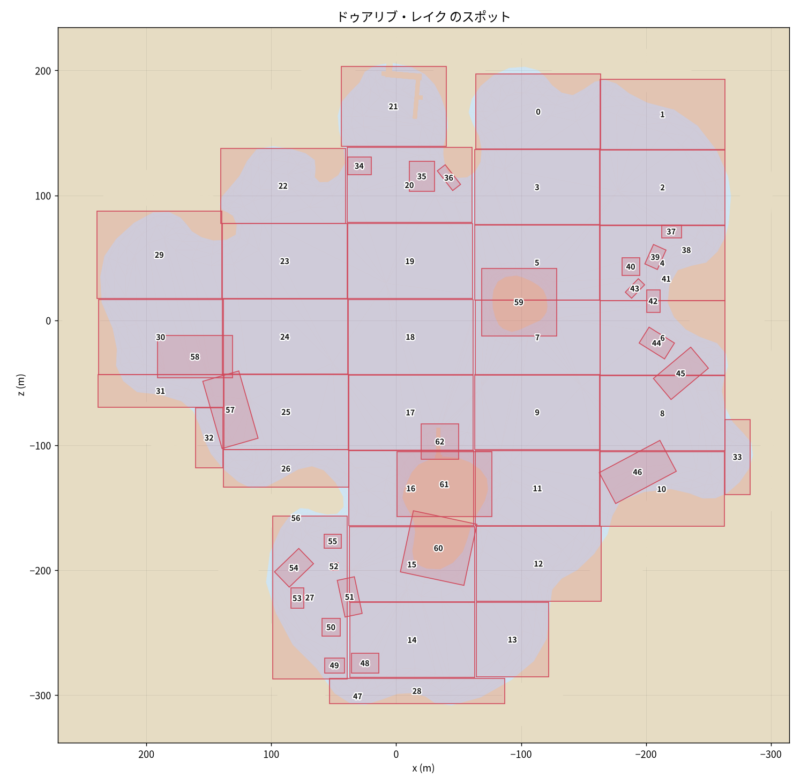

# ドゥアリブ・レイク

[湧き確率の読み方](../spawn.md) ・ [地図の読み方](../maps.md) ・ [目次](../../README.md)

## スポット一覧

| スポット | 出現表 | 幅×奥行 m | 面積 m² | 上限 朝/昼/夕/夜 | 補充秒 | エサ補正 |
|--:|:-:|--:|--:|:-:|--:|--:|
| 0 | A | 100×60 | 6,000 | 60/50/50/55 | 36 | +1 |
| 1 | B | 100×56 | 5,600 | 60/50/50/55 | 36 | +1 |
| 2 | C | 100×60 | 6,000 | 60/50/50/55 | 36 | +1 |
| 3 | A | 100×60 | 6,000 | 60/50/50/55 | 36 | +1 |
| 4 | D | 100×60 | 6,000 | 60/50/50/55 | 36 | +1 |
| 5 | E | 100×60 | 6,000 | 60/50/50/55 | 36 | +1 |
| 6 | F | 100×60 | 6,000 | 60/50/50/55 | 36 | +1 |
| 7 | D | 100×60 | 6,000 | 60/50/50/55 | 36 | +1 |
| 8 | G | 100×60 | 6,000 | 60/50/50/55 | 36 | +1 |
| 9 | H | 100×60 | 6,000 | 60/50/50/55 | 36 | +1 |
| 10 | I | 100×60 | 6,000 | 60/50/50/55 | 36 | +1 |
| 11 | J | 100×60 | 6,000 | 60/50/50/55 | 36 | +1 |
| 12 | K | 100×60 | 6,000 | 60/50/50/55 | 36 | +1 |
| 13 | I | 58×60 | 3,480 | 60/50/50/55 | 36 | +1 |
| 14 | L | 100×60 | 6,000 | 60/50/50/55 | 36 | +1 |
| 15 | M | 100×60 | 6,000 | 60/50/50/55 | 36 | +1 |
| 16 | N | 100×60 | 6,000 | 60/50/50/55 | 36 | +1 |
| 17 | O | 100×60 | 6,000 | 60/50/50/55 | 36 | +1 |
| 18 | P | 100×60 | 6,000 | 60/50/50/55 | 36 | +1 |
| 19 | Q | 100×60 | 6,000 | 60/50/50/55 | 36 | +1 |
| 20 | R | 100×60 | 6,000 | 60/50/50/55 | 36 | +1 |
| 21 | P | 84×64 | 5,376 | 60/50/50/55 | 36 | +1 |
| 22 | S | 100×60 | 6,000 | 60/50/50/55 | 36 | +1 |
| 23 | T | 100×60 | 6,000 | 60/50/50/55 | 36 | +1 |
| 24 | U | 100×60 | 6,000 | 60/50/50/55 | 36 | +1 |
| 25 | V | 100×60 | 6,000 | 60/50/50/55 | 36 | +1 |
| 26 | W | 100×30 | 3,000 | 60/50/50/55 | 42 | +1 |
| 27 | X | 60×130 | 7,800 | 60/50/50/55 | 36 | +1 |
| 28 | X | 140×20 | 2,800 | 60/50/50/55 | 36 | +1 |
| 29 | Y | 100×70 | 7,000 | 60/50/50/55 | 36 | +1 |
| 30 | Z | 100×60 | 6,000 | 60/50/50/55 | 36 | +1 |
| 31 | AA | 100×26 | 2,600 | 30/30/30/30 | 36 | +1 |
| 32 | AB | 22×48 | 1,056 | 25/25/25/25 | 36 | +1 |
| 33 | L | 20×60 | 1,200 | 25/25/25/25 | 36 | +1 |
| 34 | Q | 19×14 | 266 | 15/15/15/15 | 36 | +1 |
| 35 | R | 20×24 | 480 | 20/20/20/20 | 36 | +1 |
| 36 | P | 20×8 | 160 | 15/15/15/15 | 36 | +1 |
| 37 | AC | 16×10 | 160 | 15/15/15/15 | 36 | +1 |
| 38 | AD | 3×3 | 9 | 8/8/8/8 | 36 | +1 |
| 39 | AC | 11×17 | 187 | 15/15/15/15 | 36 | +1 |
| 40 | AC | 14×14 | 196 | 15/15/15/15 | 36 | +1 |
| 41 | AE | 3×3 | 9 | 4/4/4/4 | 36 | +1 |
| 42 | AF | 11×18 | 198 | 15/15/15/15 | 36 | +1 |
| 43 | AC | 7×15 | 105 | 10/10/10/10 | 36 | +1 |
| 44 | AF | 24×15 | 360 | 15/15/15/15 | 36 | +1 |
| 45 | AF | 39×22 | 858 | 20/20/20/20 | 36 | +1 |
| 46 | AG | 55×28 | 1,540 | 30/30/30/30 | 36 | +1 |
| 47 | AH | 3×3 | 9 | 4/4/4/4 | 36 | +1 |
| 48 | AI | 22×16 | 352 | 15/15/15/15 | 36 | +1 |
| 49 | AI | 16×12 | 192 | 12/12/12/12 | 36 | +1 |
| 50 | AI | 15×14 | 210 | 12/12/12/12 | 36 | +1 |
| 51 | AJ | 14×30 | 420 | 15/15/15/15 | 36 | +1 |
| 52 | AJ | 6×6 | 36 | 8/8/8/8 | 36 | +1 |
| 53 | AI | 10×16 | 160 | 12/12/12/12 | 36 | +1 |
| 54 | AI | 27×17 | 459 | 20/20/20/20 | 36 | +1 |
| 55 | AJ | 14×11 | 154 | 12/12/12/12 | 36 | +1 |
| 56 | AH | 3×3 | 9 | 4/4/4/4 | 36 | +1 |
| 57 | AK | 30×56 | 1,680 | 40/40/40/40 | 36 | +1 |
| 58 | AK | 60×34 | 2,040 | 40/40/40/40 | 36 | +1 |
| 59 | AL | 60×54 | 3,240 | 30/30/30/30 | 36 | +1 |
| 60 | AM | 52×50 | 2,600 | 25/25/25/25 | 36 | +1 |
| 61 | AN | 76×52 | 3,952 | 40/40/40/40 | 36 | +1 |
| 62 | AO | 30×28 | 840 | 25/25/25/25 | 36 | +1 |

「補充秒」は、そのスポットで魚がつつき始めてから60秒の間の補充の間隔である ([補充の速さ](../spawn-paths.md#補充の速さ))。

## 出現表

### 表A (スポット 0、3)

| 魚 | 重み | 確率% | 放流解禁時% | 条件 |
|---|--:|--:|--:|---|
| ブルーギル | 3 | 33.3 | 27.3 |  |
| ホワイトパーチ | 2 | 22.2 | 18.2 |  |
| ロックバス | 2 | - | 18.2 | 放流 |
| ナマズ | 1 | 11.1 | 9.1 |  |
| スモールマウスバス | 1 | 11.1 | 9.1 |  |
| イエローパーチ | 1 | 11.1 | 9.1 |  |
| ふつうの流木 | 1 | 11.1 | 9.1 |  |

### 表B (スポット 1)

| 魚 | 重み | 確率% | 放流解禁時% | 条件 |
|---|--:|--:|--:|---|
| イエローパーチ | 3 | 30.0 | 25.0 |  |
| ブルーギル | 2 | 20.0 | 16.7 |  |
| ホワイトパーチ | 2 | 20.0 | 16.7 |  |
| ロックバス | 2 | - | 16.7 | 放流 |
| ナマズ | 1 | 10.0 | 8.3 |  |
| スモールマウスバス | 1 | 10.0 | 8.3 |  |
| まっすぐな流木 | 1 | 10.0 | 8.3 |  |

### 表C (スポット 2)

| 魚 | 重み | 確率% | 放流解禁時% | 条件 |
|---|--:|--:|--:|---|
| イエローパーチ | 3 | 30.0 | 25.0 |  |
| ブルーギル | 2 | 20.0 | 16.7 |  |
| ホワイトパーチ | 2 | 20.0 | 16.7 |  |
| ロックバス | 2 | - | 16.7 | 放流 |
| ナマズ | 1 | 10.0 | 8.3 |  |
| スモールマウスバス | 1 | 10.0 | 8.3 |  |
| ごてごてした水草 | 1 | 10.0 | 8.3 |  |

### 表D (スポット 4、7)

| 魚 | 重み | 確率% | 放流解禁時% | 条件 |
|---|--:|--:|--:|---|
| ナマズ | 2 | 18.2 | 15.4 |  |
| ブルーギル | 2 | 18.2 | 15.4 |  |
| ビッグマウスバッファロー | 2 | 18.2 | 15.4 |  |
| スモールマウスバッファロー | 2 | 18.2 | 15.4 |  |
| ロックバス | 2 | - | 15.4 | 放流 |
| ホワイトパーチ | 1 | 9.1 | 7.7 |  |
| スモールマウスバス | 1 | 9.1 | 7.7 |  |
| まっすぐな流木 | 1 | 9.1 | 7.7 |  |

### 表E (スポット 5)

| 魚 | 重み | 確率% | 放流解禁時% | 条件 |
|---|--:|--:|--:|---|
| ナマズ | 2 | 18.2 | 15.4 |  |
| ブルーギル | 2 | 18.2 | 15.4 |  |
| ビッグマウスバッファロー | 2 | 18.2 | 15.4 |  |
| スモールマウスバッファロー | 2 | 18.2 | 15.4 |  |
| ロックバス | 2 | - | 15.4 | 放流 |
| ホワイトパーチ | 1 | 9.1 | 7.7 |  |
| スモールマウスバス | 1 | 9.1 | 7.7 |  |
| ごてごてした水草 | 1 | 9.1 | 7.7 |  |

### 表F (スポット 6)

| 魚 | 重み | 確率% | 放流解禁時% | 条件 |
|---|--:|--:|--:|---|
| ナマズ | 2 | 18.2 | 15.4 |  |
| ブルーギル | 2 | 18.2 | 15.4 |  |
| ビッグマウスバッファロー | 2 | 18.2 | 15.4 |  |
| スモールマウスバッファロー | 2 | 18.2 | 15.4 |  |
| ロックバス | 2 | - | 15.4 | 放流 |
| ホワイトパーチ | 1 | 9.1 | 7.7 |  |
| スモールマウスバス | 1 | 9.1 | 7.7 |  |
| ふつうの流木 | 1 | 9.1 | 7.7 |  |

### 表G (スポット 8)

| 魚 | 重み | 確率% | 放流解禁時% | 条件 |
|---|--:|--:|--:|---|
| ナマズ | 1 | 10.0 | 8.3 |  |
| ブルーギル | 1 | 10.0 | 8.3 |  |
| ラージマウスバス | 1 | 10.0 | 8.3 |  |
| ビッグマウスバッファロー | 1 | 10.0 | 8.3 |  |
| スモールマウスバッファロー | 1 | 10.0 | 8.3 |  |
| ホワイトパーチ | 1 | 10.0 | 8.3 |  |
| ロックバス | 1 | - | 8.3 | 放流 |
| アメリカヌス | 1 | 10.0 | 8.3 |  |
| ショートノーズガー | 1 | - | 8.3 | 放流 |
| スモールマウスバス | 1 | 10.0 | 8.3 |  |
| イエローパーチ | 1 | 10.0 | 8.3 |  |
| ふつうの流木 | 1 | 10.0 | 8.3 |  |

### 表H (スポット 9)

| 魚 | 重み | 確率% | 放流解禁時% | 条件 |
|---|--:|--:|--:|---|
| ナマズ | 1 | 10.0 | 8.3 |  |
| ブルーギル | 1 | 10.0 | 8.3 |  |
| ラージマウスバス | 1 | 10.0 | 8.3 |  |
| ビッグマウスバッファロー | 1 | 10.0 | 8.3 |  |
| スモールマウスバッファロー | 1 | 10.0 | 8.3 |  |
| ホワイトパーチ | 1 | 10.0 | 8.3 |  |
| ロックバス | 1 | - | 8.3 | 放流 |
| アメリカヌス | 1 | 10.0 | 8.3 |  |
| ショートノーズガー | 1 | - | 8.3 | 放流 |
| スモールマウスバス | 1 | 10.0 | 8.3 |  |
| イエローパーチ | 1 | 10.0 | 8.3 |  |
| まっすぐな流木 | 1 | 10.0 | 8.3 |  |

### 表I (スポット 10、13)

| 魚 | 重み | 確率% | 放流解禁時% | 条件 |
|---|--:|--:|--:|---|
| ラージマウスバス | 4 | 36.4 | 30.8 |  |
| ブルーギル | 2 | 18.2 | 15.4 |  |
| アメリカヌス | 2 | 18.2 | 15.4 |  |
| ショートノーズガー | 2 | - | 15.4 | 放流 |
| ホワイトパーチ | 1 | 9.1 | 7.7 |  |
| スモールマウスバス | 1 | 9.1 | 7.7 |  |
| ふつうの流木 | 1 | 9.1 | 7.7 |  |

### 表J (スポット 11)

| 魚 | 重み | 確率% | 放流解禁時% | 条件 |
|---|--:|--:|--:|---|
| ラージマウスバス | 4 | 36.4 | 30.8 |  |
| ブルーギル | 2 | 18.2 | 15.4 |  |
| アメリカヌス | 2 | 18.2 | 15.4 |  |
| ショートノーズガー | 2 | - | 15.4 | 放流 |
| ホワイトパーチ | 1 | 9.1 | 7.7 |  |
| スモールマウスバス | 1 | 9.1 | 7.7 |  |
| まっすぐな流木 | 1 | 9.1 | 7.7 |  |

### 表K (スポット 12)

| 魚 | 重み | 確率% | 放流解禁時% | 条件 |
|---|--:|--:|--:|---|
| ラージマウスバス | 4 | 36.4 | 30.8 |  |
| ブルーギル | 2 | 18.2 | 15.4 |  |
| アメリカヌス | 2 | 18.2 | 15.4 |  |
| ショートノーズガー | 2 | - | 15.4 | 放流 |
| ホワイトパーチ | 1 | 9.1 | 7.7 |  |
| スモールマウスバス | 1 | 9.1 | 7.7 |  |
| ごてごてした水草 | 1 | 9.1 | 7.7 |  |

### 表L (スポット 14、33)

| 魚 | 重み | 確率% | 放流解禁時% | 条件 |
|---|--:|--:|--:|---|
| ラージマウスバス | 4 | 33.3 | 28.6 |  |
| ブルーギル | 2 | 16.7 | 14.3 |  |
| アメリカヌス | 2 | 16.7 | 14.3 |  |
| ショートノーズガー | 2 | - | 14.3 | 放流 |
| マーレコッド | 1 | 8.3 | 7.1 |  |
| ホワイトパーチ | 1 | 8.3 | 7.1 |  |
| スモールマウスバス | 1 | 8.3 | 7.1 |  |
| まっすぐな流木 | 1 | 8.3 | 7.1 |  |

### 表M (スポット 15)

| 魚 | 重み | 確率% | 放流解禁時% | 条件 |
|---|--:|--:|--:|---|
| ラージマウスバス | 4 | 33.3 | 28.6 |  |
| ブルーギル | 2 | 16.7 | 14.3 |  |
| アメリカヌス | 2 | 16.7 | 14.3 |  |
| ショートノーズガー | 2 | - | 14.3 | 放流 |
| マーレコッド | 1 | 8.3 | 7.1 |  |
| ホワイトパーチ | 1 | 8.3 | 7.1 |  |
| スモールマウスバス | 1 | 8.3 | 7.1 |  |
| ごてごてした水草 | 1 | 8.3 | 7.1 |  |

### 表N (スポット 16)

| 魚 | 重み | 確率% | 放流解禁時% | 条件 |
|---|--:|--:|--:|---|
| ラージマウスバス | 4 | 33.3 | 28.6 |  |
| ブルーギル | 2 | 16.7 | 14.3 |  |
| アメリカヌス | 2 | 16.7 | 14.3 |  |
| ショートノーズガー | 2 | - | 14.3 | 放流 |
| マーレコッド | 1 | 8.3 | 7.1 |  |
| ホワイトパーチ | 1 | 8.3 | 7.1 |  |
| スモールマウスバス | 1 | 8.3 | 7.1 |  |
| ふつうの流木 | 1 | 8.3 | 7.1 |  |

### 表O (スポット 17)

| 魚 | 重み | 確率% | 放流解禁時% | 条件 |
|---|--:|--:|--:|---|
| ナマズ | 2 | 12.5 | 11.1 |  |
| ブルーギル | 2 | 12.5 | 11.1 |  |
| ホワイトパーチ | 2 | 12.5 | 11.1 |  |
| ロックバス | 2 | - | 11.1 | 放流 |
| スモールマウスバス | 2 | 12.5 | 11.1 |  |
| ラージマウスバス | 1 | 6.3 | 5.6 |  |
| ビッグマウスバッファロー | 1 | 6.2 | 5.6 |  |
| スモールマウスバッファロー | 1 | 6.2 | 5.6 |  |
| ブラックブルヘッド | 1 | 6.2 | 5.6 |  |
| ブラウンブルヘッド | 1 | 6.2 | 5.6 |  |
| イエローブルヘッド | 1 | 6.2 | 5.6 | クエスト |
| イエローパーチ | 1 | 6.2 | 5.6 |  |
| ふつうの流木 | 1 | 6.2 | 5.6 |  |

### 表P (スポット 18、21、36)

| 魚 | 重み | 確率% | 放流解禁時% | 条件 |
|---|--:|--:|--:|---|
| ブルーギル | 3 | 30.0 | 25.0 |  |
| ホワイトパーチ | 2 | 20.0 | 16.7 |  |
| ロックバス | 2 | - | 16.7 | 放流 |
| スモールマウスバス | 2 | 20.0 | 16.7 |  |
| ナマズ | 1 | 10.0 | 8.3 |  |
| イエローパーチ | 1 | 10.0 | 8.3 |  |
| まっすぐな流木 | 1 | 10.0 | 8.3 |  |

### 表Q (スポット 19、34)

| 魚 | 重み | 確率% | 放流解禁時% | 条件 |
|---|--:|--:|--:|---|
| ブルーギル | 3 | 30.0 | 25.0 |  |
| ホワイトパーチ | 2 | 20.0 | 16.7 |  |
| ロックバス | 2 | - | 16.7 | 放流 |
| スモールマウスバス | 2 | 20.0 | 16.7 |  |
| ナマズ | 1 | 10.0 | 8.3 |  |
| ごてごてした水草 | 1 | 10.0 | 8.3 |  |
| イエローパーチ | 1 | 10.0 | 8.3 |  |

### 表R (スポット 20、35)

| 魚 | 重み | 確率% | 放流解禁時% | 条件 |
|---|--:|--:|--:|---|
| ブルーギル | 3 | 30.0 | 25.0 |  |
| ホワイトパーチ | 2 | 20.0 | 16.7 |  |
| ロックバス | 2 | - | 16.7 | 放流 |
| スモールマウスバス | 2 | 20.0 | 16.7 |  |
| ナマズ | 1 | 10.0 | 8.3 |  |
| イエローパーチ | 1 | 10.0 | 8.3 |  |
| ふつうの流木 | 1 | 10.0 | 8.3 |  |

### 表S (スポット 22)

| 魚 | 重み | 確率% | 放流解禁時% | 条件 |
|---|--:|--:|--:|---|
| ブルーギル | 2 | 25.0 | 16.7 |  |
| ロックバス | 2 | - | 16.7 | 放流 |
| アメリカヌス | 2 | 25.0 | 16.7 |  |
| ショートノーズガー | 2 | - | 16.7 | 放流 |
| スモールマウスバス | 2 | 25.0 | 16.7 |  |
| ラージマウスバス | 1 | 12.5 | 8.3 |  |
| ごてごてした水草 | 1 | 12.5 | 8.3 |  |

### 表T (スポット 23)

| 魚 | 重み | 確率% | 放流解禁時% | 条件 |
|---|--:|--:|--:|---|
| ブルーギル | 2 | 25.0 | 16.7 |  |
| ロックバス | 2 | - | 16.7 | 放流 |
| アメリカヌス | 2 | 25.0 | 16.7 |  |
| ショートノーズガー | 2 | - | 16.7 | 放流 |
| スモールマウスバス | 2 | 25.0 | 16.7 |  |
| ラージマウスバス | 1 | 12.5 | 8.3 |  |
| ふつうの流木 | 1 | 12.5 | 8.3 |  |

### 表U (スポット 24)

| 魚 | 重み | 確率% | 放流解禁時% | 条件 |
|---|--:|--:|--:|---|
| ブルーギル | 2 | 22.2 | 15.4 |  |
| ラージマウスバス | 2 | 22.2 | 15.4 |  |
| ロックバス | 2 | - | 15.4 | 放流 |
| アメリカヌス | 2 | 22.2 | 15.4 |  |
| ショートノーズガー | 2 | - | 15.4 | 放流 |
| スモールマウスバス | 2 | 22.2 | 15.4 |  |
| まっすぐな流木 | 1 | 11.1 | 7.7 |  |

### 表V (スポット 25)

| 魚 | 重み | 確率% | 放流解禁時% | 条件 |
|---|--:|--:|--:|---|
| ブルーギル | 1 | 12.5 | 10.0 |  |
| ラージマウスバス | 1 | 12.5 | 10.0 |  |
| ブラックブルヘッド | 1 | 12.5 | 10.0 |  |
| ブラウンブルヘッド | 1 | 12.5 | 10.0 |  |
| イエローブルヘッド | 1 | 12.5 | 10.0 | クエスト |
| ロックバス | 1 | - | 10.0 | 放流 |
| アメリカヌス | 1 | 12.5 | 10.0 |  |
| ショートノーズガー | 1 | - | 10.0 | 放流 |
| スモールマウスバス | 1 | 12.5 | 10.0 |  |
| ごてごてした水草 | 1 | 12.5 | 10.0 |  |

### 表W (スポット 26)

| 魚 | 重み | 確率% | 放流解禁時% | 条件 |
|---|--:|--:|--:|---|
| ブルーギル | 1 | 12.5 | 10.0 |  |
| ラージマウスバス | 1 | 12.5 | 10.0 |  |
| ブラックブルヘッド | 1 | 12.5 | 10.0 |  |
| ブラウンブルヘッド | 1 | 12.5 | 10.0 |  |
| イエローブルヘッド | 1 | 12.5 | 10.0 | クエスト |
| ロックバス | 1 | - | 10.0 | 放流 |
| アメリカヌス | 1 | 12.5 | 10.0 |  |
| ショートノーズガー | 1 | - | 10.0 | 放流 |
| スモールマウスバス | 1 | 12.5 | 10.0 |  |
| ふつうの流木 | 1 | 12.5 | 10.0 |  |

### 表X (スポット 27〜28)

| 魚 | 重み | 確率% | 放流解禁時% | 条件 |
|---|--:|--:|--:|---|
| ラージマウスバス | 6 | 27.3 | 21.4 |  |
| ブルーギル | 4 | 18.2 | 14.3 |  |
| アメリカヌス | 4 | 18.2 | 14.3 |  |
| ショートノーズガー | 4 | - | 14.3 | 放流 |
| マーレコッド | 3 | 13.6 | 10.7 |  |
| ロックバス | 2 | - | 7.1 | 放流 |
| スモールマウスバス | 2 | 9.1 | 7.1 |  |
| まっすぐな流木 | 2 | 9.1 | 7.1 |  |
| ヨーロッパオオナマズ | 1 | 4.5 | 3.6 | クエスト |

### 表Y (スポット 29)

| 魚 | 重み | 確率% | 放流解禁時% | 条件 |
|---|--:|--:|--:|---|
| ブルーギル | 2 | 22.2 | 15.4 |  |
| ラージマウスバス | 2 | 22.2 | 15.4 |  |
| ロックバス | 2 | - | 15.4 | 放流 |
| アメリカヌス | 2 | 22.2 | 15.4 |  |
| ショートノーズガー | 2 | - | 15.4 | 放流 |
| スモールマウスバス | 2 | 22.2 | 15.4 |  |
| ふつうの流木 | 1 | 11.1 | 7.7 |  |

### 表Z (スポット 30)

| 魚 | 重み | 確率% | 放流解禁時% | 条件 |
|---|--:|--:|--:|---|
| ブルーギル | 2 | 15.4 | 13.3 |  |
| ブラックブルヘッド | 2 | 15.4 | 13.3 |  |
| ブラウンブルヘッド | 2 | 15.4 | 13.3 |  |
| イエローブルヘッド | 2 | 15.4 | 13.3 | クエスト |
| アメリカヌス | 2 | 15.4 | 13.3 |  |
| ラージマウスバス | 1 | 7.7 | 6.7 |  |
| ロックバス | 1 | - | 6.7 | 放流 |
| ショートノーズガー | 1 | - | 6.7 | 放流 |
| スモールマウスバス | 1 | 7.7 | 6.7 |  |
| まっすぐな流木 | 1 | 7.7 | 6.7 |  |

### 表AA (スポット 31)

| 魚 | 重み | 確率% | 放流解禁時% | 条件 |
|---|--:|--:|--:|---|
| ブルーギル | 2 | 15.4 | 13.3 |  |
| ブラックブルヘッド | 2 | 15.4 | 13.3 |  |
| ブラウンブルヘッド | 2 | 15.4 | 13.3 |  |
| イエローブルヘッド | 2 | 15.4 | 13.3 | クエスト |
| アメリカヌス | 2 | 15.4 | 13.3 |  |
| ラージマウスバス | 1 | 7.7 | 6.7 |  |
| ロックバス | 1 | - | 6.7 | 放流 |
| ショートノーズガー | 1 | - | 6.7 | 放流 |
| スモールマウスバス | 1 | 7.7 | 6.7 |  |
| ごてごてした水草 | 1 | 7.7 | 6.7 |  |

### 表AB (スポット 32)

| 魚 | 重み | 確率% | 放流解禁時% | 条件 |
|---|--:|--:|--:|---|
| ブルーギル | 2 | 15.4 | 13.3 |  |
| ブラックブルヘッド | 2 | 15.4 | 13.3 |  |
| ブラウンブルヘッド | 2 | 15.4 | 13.3 |  |
| イエローブルヘッド | 2 | 15.4 | 13.3 | クエスト |
| アメリカヌス | 2 | 15.4 | 13.3 |  |
| ラージマウスバス | 1 | 7.7 | 6.7 |  |
| ロックバス | 1 | - | 6.7 | 放流 |
| ショートノーズガー | 1 | - | 6.7 | 放流 |
| スモールマウスバス | 1 | 7.7 | 6.7 |  |
| ふつうの流木 | 1 | 7.7 | 6.7 |  |

### 表AC (スポット 37、39〜40、43)

| 魚 | 重み | 確率% | 放流解禁時% | 条件 |
|---|--:|--:|--:|---|
| ナマズ | 2 | 16.7 | 14.3 |  |
| ブルーギル | 2 | 16.7 | 14.3 |  |
| ビッグマウスバッファロー | 2 | 16.7 | 14.3 |  |
| スモールマウスバッファロー | 2 | 16.7 | 14.3 |  |
| ロックバス | 2 | - | 14.3 | 放流 |
| ごてごてした水草 | 2 | 16.7 | 14.3 |  |
| ホワイトパーチ | 1 | 8.3 | 7.1 |  |
| スモールマウスバス | 1 | 8.3 | 7.1 |  |

### 表AD (スポット 38)

| 魚 | 重み | 確率% | 放流解禁時% | 条件 |
|---|--:|--:|--:|---|
| ビッグマウスバッファロー | 4 | 17.4 | 15.4 |  |
| スモールマウスバッファロー | 4 | 17.4 | 15.4 |  |
| ナマズ | 3 | 13.0 | 11.5 |  |
| ブルーギル | 3 | 13.0 | 11.5 |  |
| ロックバス | 3 | - | 11.5 | 放流 |
| ホワイトパーチ | 2 | 8.7 | 7.7 |  |
| スモールマウスバス | 2 | 8.7 | 7.7 |  |
| ふつうの流木 | 2 | 8.7 | 7.7 |  |
| まっすぐな流木 | 2 | 8.7 | 7.7 |  |
| アカントデス | 1 | 4.3 | 3.8 |  |

### 表AE (スポット 41)

| 魚 | 重み | 確率% | 放流解禁時% | 条件 |
|---|--:|--:|--:|---|
| ビッグマウスバッファロー | 4 | 16.0 | 14.3 |  |
| スモールマウスバッファロー | 4 | 16.0 | 14.3 |  |
| ナマズ | 3 | 12.0 | 10.7 |  |
| ブルーギル | 3 | 12.0 | 10.7 |  |
| ロックバス | 3 | - | 10.7 | 放流 |
| ホワイトパーチ | 2 | 8.0 | 7.1 |  |
| ロングノーズガー | 2 | 8.0 | 7.1 |  |
| スモールマウスバス | 2 | 8.0 | 7.1 |  |
| ふつうの流木 | 2 | 8.0 | 7.1 |  |
| まっすぐな流木 | 2 | 8.0 | 7.1 |  |
| アカントデス | 1 | 4.0 | 3.6 |  |

### 表AF (スポット 42、44〜45)

| 魚 | 重み | 確率% | 放流解禁時% | 条件 |
|---|--:|--:|--:|---|
| ナマズ | 2 | 14.3 | 12.5 |  |
| ブルーギル | 2 | 14.3 | 12.5 |  |
| ビッグマウスバッファロー | 2 | 14.3 | 12.5 |  |
| スモールマウスバッファロー | 2 | 14.3 | 12.5 |  |
| ロックバス | 2 | - | 12.5 | 放流 |
| ロングノーズガー | 2 | 14.3 | 12.5 |  |
| ごてごてした水草 | 2 | 14.3 | 12.5 |  |
| ホワイトパーチ | 1 | 7.1 | 6.2 |  |
| スモールマウスバス | 1 | 7.1 | 6.2 |  |

### 表AG (スポット 46)

| 魚 | 重み | 確率% | 放流解禁時% | 条件 |
|---|--:|--:|--:|---|
| ラージマウスバス | 4 | 26.7 | 23.5 |  |
| アミア・カルヴァ | 3 | 20.0 | 17.6 |  |
| ブルーギル | 2 | 13.3 | 11.8 |  |
| アメリカヌス | 2 | 13.3 | 11.8 |  |
| ショートノーズガー | 2 | - | 11.8 | 放流 |
| ごてごてした水草 | 2 | 13.3 | 11.8 |  |
| ホワイトパーチ | 1 | 6.7 | 5.9 |  |
| スモールマウスバス | 1 | 6.7 | 5.9 |  |

### 表AH (スポット 47、56)

| 魚 | 重み | 確率% | 放流解禁時% | 条件 |
|---|--:|--:|--:|---|
| ラージマウスバス | 3 | 23.1 | 20.0 |  |
| ブルーギル | 2 | 15.4 | 13.3 |  |
| アメリカヌス | 2 | 15.4 | 13.3 |  |
| ふつうの流木 | 2 | 15.4 | 13.3 |  |
| まっすぐな流木 | 2 | 15.4 | 13.3 |  |
| マーレコッド | 1 | 7.7 | 6.7 |  |
| ロックバス | 1 | - | 6.7 | 放流 |
| ショートノーズガー | 1 | - | 6.7 | 放流 |
| スモールマウスバス | 1 | 7.7 | 6.7 |  |

### 表AI (スポット 48〜50、53〜54)

| 魚 | 重み | 確率% | 放流解禁時% | 条件 |
|---|--:|--:|--:|---|
| ラージマウスバス | 3 | 18.8 | 16.7 |  |
| マーレコッド | 3 | 18.8 | 16.7 |  |
| ブルーギル | 2 | 12.5 | 11.1 |  |
| アメリカヌス | 2 | 12.5 | 11.1 |  |
| スモールマウスバス | 2 | 12.5 | 11.1 |  |
| ヨーロッパオオナマズ | 2 | 12.5 | 11.1 | クエスト |
| ごてごてした水草 | 2 | 12.5 | 11.1 |  |
| ロックバス | 1 | - | 5.6 | 放流 |
| ショートノーズガー | 1 | - | 5.6 | 放流 |

### 表AJ (スポット 51〜52、55)

| 魚 | 重み | 確率% | 放流解禁時% | 条件 |
|---|--:|--:|--:|---|
| ラージマウスバス | 3 | 27.3 | 23.1 |  |
| ブルーギル | 2 | 18.2 | 15.4 |  |
| アメリカヌス | 2 | 18.2 | 15.4 |  |
| ごてごてした水草 | 2 | 18.2 | 15.4 |  |
| マーレコッド | 1 | 9.1 | 7.7 |  |
| ロックバス | 1 | - | 7.7 | 放流 |
| ショートノーズガー | 1 | - | 7.7 | 放流 |
| スモールマウスバス | 1 | 9.1 | 7.7 |  |

### 表AK (スポット 57〜58)

| 魚 | 重み | 確率% | 放流解禁時% | 条件 |
|---|--:|--:|--:|---|
| ごてごてした水草 | 2 | 22.2 | 18.2 |  |
| ブルーギル | 1 | 11.1 | 9.1 |  |
| ラージマウスバス | 1 | 11.1 | 9.1 |  |
| ブラックブルヘッド | 1 | 11.1 | 9.1 |  |
| ブラウンブルヘッド | 1 | 11.1 | 9.1 |  |
| イエローブルヘッド | 1 | 11.1 | 9.1 | クエスト |
| ロックバス | 1 | - | 9.1 | 放流 |
| アメリカヌス | 1 | 11.1 | 9.1 |  |
| ショートノーズガー | 1 | - | 9.1 | 放流 |
| スモールマウスバス | 1 | 11.1 | 9.1 |  |

### 表AL (スポット 59)

| 魚 | 重み | 確率% | 放流解禁時% | 条件 |
|---|--:|--:|--:|---|
| アミア・カルヴァ | 3 | 30.0 | 25.0 |  |
| ナマズ | 2 | 20.0 | 16.7 |  |
| ブルーギル | 2 | 20.0 | 16.7 |  |
| ロックバス | 2 | - | 16.7 | 放流 |
| ホワイトパーチ | 1 | 10.0 | 8.3 |  |
| スモールマウスバス | 1 | 10.0 | 8.3 |  |
| ふつうの流木 | 1 | 10.0 | 8.3 |  |

### 表AM (スポット 60)

| 魚 | 重み | 確率% | 放流解禁時% | 条件 |
|---|--:|--:|--:|---|
| ブルーギル | 5 | 14.7 | 12.8 |  |
| ホワイトパーチ | 5 | 14.7 | 12.8 |  |
| アメリカヌス | 5 | 14.7 | 12.8 |  |
| ショートノーズガー | 5 | - | 12.8 | 放流 |
| スモールマウスバス | 5 | 14.7 | 12.8 |  |
| ラージマウスバス | 4 | 11.8 | 10.3 |  |
| ライギョ | 4 | 11.8 | 10.3 |  |
| マーレコッド | 4 | 11.8 | 10.3 |  |
| アカントデス | 1 | 2.9 | 2.6 |  |
| まっすぐな流木 | 1 | 2.9 | 2.6 |  |

### 表AN (スポット 61)

| 魚 | 重み | 確率% | 放流解禁時% | 条件 |
|---|--:|--:|--:|---|
| ライギョ | 2 | 22.2 | 20.0 |  |
| ブルーギル | 1 | 11.1 | 10.0 |  |
| ラージマウスバス | 1 | 11.1 | 10.0 |  |
| マーレコッド | 1 | 11.1 | 10.0 |  |
| ホワイトパーチ | 1 | 11.1 | 10.0 |  |
| アメリカヌス | 1 | 11.1 | 10.0 |  |
| ショートノーズガー | 1 | - | 10.0 | 放流 |
| スモールマウスバス | 1 | 11.1 | 10.0 |  |
| ふつうの流木 | 1 | 11.1 | 10.0 |  |

### 表AO (スポット 62)

| 魚 | 重み | 確率% | 放流解禁時% | 条件 |
|---|--:|--:|--:|---|
| ライギョ | 3 | 30.0 | 27.3 |  |
| ブルーギル | 1 | 10.0 | 9.1 |  |
| ラージマウスバス | 1 | 10.0 | 9.1 |  |
| マーレコッド | 1 | 10.0 | 9.1 |  |
| ホワイトパーチ | 1 | 10.0 | 9.1 |  |
| アメリカヌス | 1 | 10.0 | 9.1 |  |
| ショートノーズガー | 1 | - | 9.1 | 放流 |
| スモールマウスバス | 1 | 10.0 | 9.1 |  |
| まっすぐな流木 | 1 | 10.0 | 9.1 |  |
