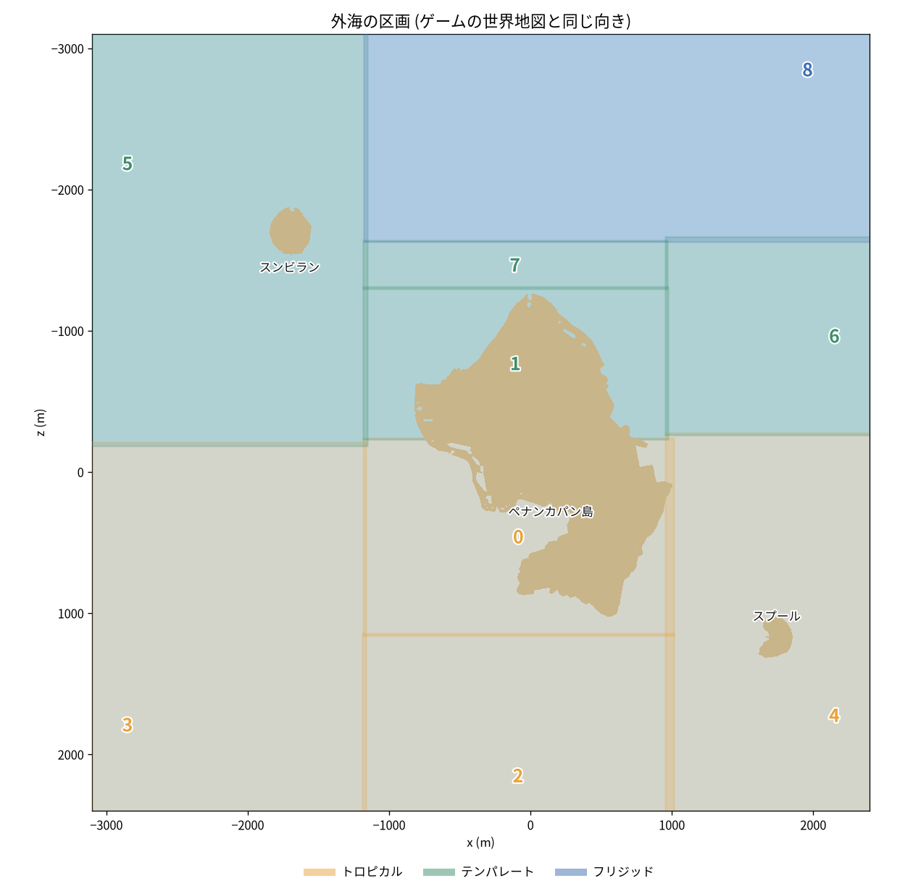

# 外海 (ペナンカパン・オーシャン)

[湧き確率の読み方](../spawn.md) ・ [地図の読み方](../maps.md) ・ [目次](../../README.md)

クルーザーを止めて釣るときの出現表である。
船がいる区画で表が決まり、魚は船の周り ±30m に湧く。
各区画の上限は64匹である。

## 区画 0、2〜4 (トロピカル)

| 魚 | 重み | 確率% | 放流解禁時% | 条件 |
|---|--:|--:|--:|---|
| ありきたりな流木 | 1 | 5.9 | 5.6 |  |
| トビウオ | 1 | - | 5.6 | 放流 |
| ヒラマサ | 1 | 5.9 | 5.6 |  |
| カンパチ | 1 | 5.9 | 5.6 |  |
| もさもさした海藻 | 1 | 5.9 | 5.6 |  |
| ミルクフィッシュ | 1 | 5.9 | 5.6 |  |
| カツオ | 1 | 5.9 | 5.6 |  |
| マトウダイ | 1 | 5.9 | 5.6 |  |
| コーラルトラウト | 1 | 5.9 | 5.6 |  |
| レッドエンペラー | 1 | 5.9 | 5.6 |  |
| ナニガイ | 1 | 5.9 | 5.6 |  |
| スマ | 1 | 5.9 | 5.6 |  |
| パーミット | 1 | 5.9 | 5.6 |  |
| ヒレナガカンパチ | 1 | 5.9 | 5.6 |  |
| ジャイアントトレバリー | 1 | 5.9 | 5.6 | クエスト |
| マルソウダ | 1 | 5.9 | 5.6 |  |
| りっぱな流木 | 1 | 5.9 | 5.6 |  |
| ふつうの海藻 | 1 | 5.9 | 5.6 |  |

## 区画 1、5〜7 (テンパレート)

| 魚 | 重み | 確率% | 放流解禁時% | 条件 |
|---|--:|--:|--:|---|
| もさもさした海藻 | 2 | 11.1 | 10.5 |  |
| アジ | 1 | 5.6 | 5.3 |  |
| サバ | 1 | 5.6 | 5.3 |  |
| シーバス | 1 | 5.6 | 5.3 |  |
| ありきたりな流木 | 1 | 5.6 | 5.3 |  |
| シロギス | 1 | 5.6 | 5.3 |  |
| ホウボウ | 1 | 5.6 | 5.3 |  |
| ヒラマサ | 1 | 5.6 | 5.3 |  |
| カンパチ | 1 | 5.6 | 5.3 |  |
| ツムブリ | 1 | 5.6 | 5.3 |  |
| サワラ | 1 | 5.6 | 5.3 |  |
| カツオ | 1 | 5.6 | 5.3 |  |
| ブリ | 1 | 5.6 | 5.3 |  |
| マトウダイ | 1 | 5.6 | 5.3 |  |
| イサキ | 1 | 5.6 | 5.3 |  |
| マダコ | 1 | 5.6 | 5.3 |  |
| タチウオ | 1 | - | 5.3 | 放流 |
| りっぱな流木 | 1 | 5.6 | 5.3 |  |

## 区画 8 (フリジッド)

| 魚 | 重み | 確率% | 放流解禁時% | 条件 |
|---|--:|--:|--:|---|
| サンマ | 1 | 6.2 | 5.9 |  |
| ギンダラ | 1 | 6.2 | 5.9 |  |
| ありきたりな流木 | 1 | 6.2 | 5.9 |  |
| もさもさした海藻 | 1 | 6.2 | 5.9 |  |
| ギンザケ | 1 | 6.2 | 5.9 |  |
| シロサケ | 1 | 6.2 | 5.9 |  |
| ベニザケ | 1 | 6.2 | 5.9 |  |
| スケトウダラ | 1 | - | 5.9 | 放流 |
| コールフィッシュ | 1 | 6.2 | 5.9 |  |
| ニシン | 1 | 6.2 | 5.9 |  |
| コオリカマス | 1 | 6.2 | 5.9 |  |
| マダイ | 1 | 6.2 | 5.9 |  |
| ホッケ | 1 | 6.2 | 5.9 |  |
| カワハギ | 1 | 6.2 | 5.9 |  |
| トラフグ | 1 | 6.2 | 5.9 |  |
| りっぱな流木 | 1 | 6.2 | 5.9 |  |
| ふつうの海藻 | 1 | 6.2 | 5.9 |  |
