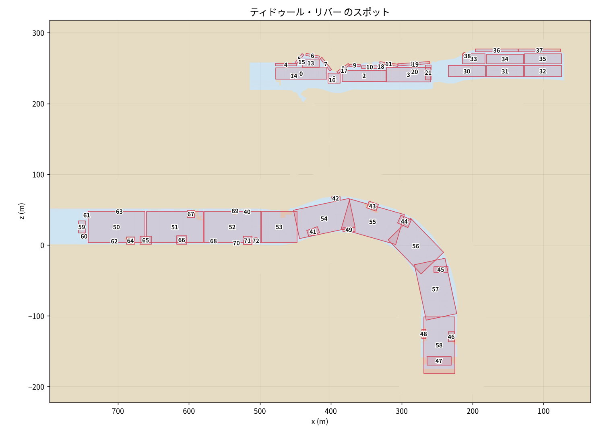

# ティドゥール・リバー

[湧き確率の読み方](../spawn.md) ・ [地図の読み方](../maps.md) ・ [目次](../../README.md)

## スポット一覧

| スポット | 出現表 | 幅×奥行 m | 面積 m² | 上限 朝/昼/夕/夜 | 補充秒 | エサ補正 |
|--:|:-:|--:|--:|:-:|--:|--:|
| 0 | A | 72×16 | 1,152 | 10/7/8/9 | 36 | +1 |
| 1 | A | 17×14 | 238 | 5/2/3/4 | 36 | +1 |
| 2 | A | 62×16 | 992 | 10/7/8/9 | 36 | +1 |
| 3 | A | 62×20 | 1,240 | 10/7/8/9 | 36 | +1 |
| 4 | B | 30×3 | 90 | 8/5/6/7 | 36 | +1 |
| 5 | B | 16×3 | 48 | 8/5/6/7 | 36 | +1 |
| 6 | B | 19×3 | 57 | 8/5/6/7 | 36 | +1 |
| 7 | B | 22×3 | 66 | 8/5/6/7 | 36 | +1 |
| 8 | B | 20×3 | 60 | 8/5/6/7 | 36 | +1 |
| 9 | C | 16×3 | 48 | 8/5/6/7 | 36 | +1 |
| 10 | C | 23×3 | 69 | 8/5/6/7 | 36 | +1 |
| 11 | D | 26×3 | 78 | 8/5/6/7 | 36 | +1 |
| 12 | D | 45×3 | 135 | 8/5/6/7 | 36 | +1 |
| 13 | E | 24×11 | 264 | 5/2/3/4 | 36 | +1 |
| 14 | F | 4×4 | 16 | 3/3/3/3 | 36 | +1 |
| 15 | F | 5×5 | 25 | 4/4/4/4 | 36 | +1 |
| 16 | F | 5×5 | 25 | 3/3/3/3 | 36 | +1 |
| 17 | F | 4×4 | 16 | 4/4/4/4 | 36 | +1 |
| 18 | G | 5×5 | 25 | 4/4/4/4 | 36 | +1 |
| 19 | H | 6×5 | 30 | 4/4/4/4 | 36 | +1 |
| 20 | H | 5×4 | 20 | 3/3/3/3 | 36 | +1 |
| 21 | I | 8×21 | 168 | 5/5/5/5 | 36 | +1 |
| 30 | J | 52×16 | 832 | 10/7/8/9 | 36 | +1 |
| 31 | J | 52×16 | 832 | 10/7/8/9 | 36 | +1 |
| 32 | J | 52×16 | 832 | 10/7/8/9 | 36 | +1 |
| 33 | K | 32×14 | 448 | 15/12/13/14 | 36 | +1 |
| 34 | L | 52×14 | 728 | 15/12/13/14 | 36 | +1 |
| 35 | L | 52×14 | 728 | 15/12/13/14 | 36 | +1 |
| 36 | M | 60×4 | 240 | 8/5/6/7 | 36 | +1 |
| 37 | M | 60×4 | 240 | 8/5/6/7 | 36 | +1 |
| 38 | N | 4×14 | 56 | 8/5/6/7 | 36 | +1 |
| 40 | O | 4×6 | 24 | 4/4/4/4 | 36 | +1 |
| 41 | P | 16×9 | 144 | 5/5/5/5 | 36 | +1 |
| 42 | Q | 12×4 | 48 | 6/6/6/6 | 36 | +1 |
| 43 | R | 14×10 | 140 | 8/8/8/8 | 36 | +1 |
| 44 | Q | 16×12 | 192 | 8/8/8/8 | 36 | +1 |
| 45 | R | 20×8 | 160 | 6/6/6/6 | 36 | +1 |
| 46 | S | 8×14 | 112 | 6/6/6/6 | 36 | +1 |
| 47 | T | 34×12 | 408 | 12/12/12/12 | 36 | +1 |
| 48 | S | 6×13 | 78 | 6/6/6/6 | 36 | +1 |
| 49 | U | 17×5 | 85 | 8/8/8/8 | 36 | +1 |
| 50 | V | 80×44 | 3,520 | 40/30/35/40 | 36 | +1 |
| 51 | V | 80×44 | 3,520 | 40/30/35/30 | 36 | +1 |
| 52 | V | 80×44 | 3,520 | 40/30/35/40 | 36 | +1 |
| 53 | W | 50×44 | 2,200 | 30/20/25/30 | 36 | +1 |
| 54 | W | 80×41 | 3,280 | 30/20/25/30 | 36 | +1 |
| 55 | W | 80×44 | 3,520 | 40/30/35/40 | 36 | +1 |
| 56 | X | 44×67 | 2,948 | 40/30/35/40 | 36 | +1 |
| 57 | X | 44×80 | 3,520 | 40/30/35/40 | 36 | +1 |
| 58 | X | 44×80 | 3,520 | 40/35/30/40 | 36 | +1 |
| 59 | Y | 10×17 | 170 | 9/9/9/9 | 36 | +1 |
| 60 | Z | 4×7 | 28 | 5/5/5/5 | 36 | +1 |
| 61 | Z | 4×6 | 24 | 5/5/5/5 | 36 | +1 |
| 62 | AA | 5×5 | 25 | 4/4/4/4 | 36 | +1 |
| 63 | O | 5×5 | 25 | 4/4/4/4 | 36 | +1 |
| 64 | AA | 12×10 | 120 | 4/4/4/4 | 36 | +1 |
| 65 | AB | 16×11 | 176 | 7/7/7/7 | 36 | +1 |
| 66 | AC | 14×12 | 168 | 7/7/7/7 | 36 | +1 |
| 67 | O | 10×10 | 100 | 4/4/4/4 | 36 | +1 |
| 68 | AA | 5×5 | 25 | 4/4/4/4 | 36 | +1 |
| 69 | O | 5×5 | 25 | 4/4/4/4 | 36 | +1 |
| 70 | AA | 5×5 | 25 | 4/4/4/4 | 36 | +1 |
| 71 | AB | 12×12 | 144 | 9/9/9/9 | 36 | +1 |
| 72 | AD | 3×8 | 24 | 4/4/4/4 | 36 | +1 |

「補充秒」は、そのスポットで魚がつつき始めてから60秒の間の補充の間隔である ([補充の速さ](../spawn-paths.md#補充の速さ))。

## 出現表

### 表A (スポット 0〜3)

| 魚 | 重み | 確率% | 放流解禁時% | 条件 |
|---|--:|--:|--:|---|
| ボラ | 10 | 41.7 | 41.7 |  |
| マハゼ | 10 | 41.7 | 41.7 |  |
| フナ | 1 | 4.2 | 4.2 |  |
| シロサケ | 1 | 4.2 | 4.2 |  |
| マゴイ | 1 | 4.2 | 4.2 |  |
| ふつうの流木 | 1 | 4.2 | 4.2 |  |

### 表B (スポット 4〜8)

| 魚 | 重み | 確率% | 放流解禁時% | 条件 |
|---|--:|--:|--:|---|
| シロサケ | 3 | 25.0 | 25.0 |  |
| ボラ | 3 | 25.0 | 25.0 |  |
| マハゼ | 3 | 25.0 | 25.0 |  |
| フナ | 1 | 8.3 | 8.3 |  |
| マゴイ | 1 | 8.3 | 8.3 |  |
| ふつうの流木 | 1 | 8.3 | 8.3 |  |

### 表C (スポット 9〜10)

| 魚 | 重み | 確率% | 放流解禁時% | 条件 |
|---|--:|--:|--:|---|
| シロサケ | 3 | 23.1 | 23.1 |  |
| ボラ | 3 | 23.1 | 23.1 |  |
| マハゼ | 3 | 23.1 | 23.1 |  |
| フナ | 1 | 7.7 | 7.7 |  |
| ベニザケ　産卵期オス | 1 | 7.7 | 7.7 |  |
| マゴイ | 1 | 7.7 | 7.7 |  |
| ふつうの流木 | 1 | 7.7 | 7.7 |  |

### 表D (スポット 11〜12)

| 魚 | 重み | 確率% | 放流解禁時% | 条件 |
|---|--:|--:|--:|---|
| ベニザケ　産卵期オス | 3 | 23.1 | 23.1 |  |
| ボラ | 3 | 23.1 | 23.1 |  |
| マハゼ | 3 | 23.1 | 23.1 |  |
| フナ | 1 | 7.7 | 7.7 |  |
| シロサケ | 1 | 7.7 | 7.7 |  |
| マゴイ | 1 | 7.7 | 7.7 |  |
| ふつうの流木 | 1 | 7.7 | 7.7 |  |

### 表E (スポット 13)

| 魚 | 重み | 確率% | 放流解禁時% | 条件 |
|---|--:|--:|--:|---|
| ボラ | 10 | 40.0 | 40.0 |  |
| マハゼ | 10 | 40.0 | 40.0 |  |
| フナ | 1 | 4.0 | 4.0 |  |
| ベニザケ　産卵期オス | 1 | 4.0 | 4.0 |  |
| シロサケ | 1 | 4.0 | 4.0 |  |
| マゴイ | 1 | 4.0 | 4.0 |  |
| ふつうの流木 | 1 | 4.0 | 4.0 |  |

### 表F (スポット 14〜17)

| 魚 | 重み | 確率% | 放流解禁時% | 条件 |
|---|--:|--:|--:|---|
| シロサケ | 2 | 40.0 | 40.0 |  |
| ボラ | 1 | 20.0 | 20.0 |  |
| マハゼ | 1 | 20.0 | 20.0 |  |
| ふつうの流木 | 1 | 20.0 | 20.0 |  |

### 表G (スポット 18)

| 魚 | 重み | 確率% | 放流解禁時% | 条件 |
|---|--:|--:|--:|---|
| ベニザケ　産卵期オス | 2 | 25.0 | 25.0 |  |
| シロサケ | 2 | 25.0 | 25.0 |  |
| ベニザケ　産卵期メス | 1 | 12.5 | 12.5 |  |
| ボラ | 1 | 12.5 | 12.5 |  |
| マハゼ | 1 | 12.5 | 12.5 |  |
| ふつうの流木 | 1 | 12.5 | 12.5 |  |

### 表H (スポット 19〜20)

| 魚 | 重み | 確率% | 放流解禁時% | 条件 |
|---|--:|--:|--:|---|
| ベニザケ　産卵期オス | 2 | 33.3 | 33.3 |  |
| ベニザケ　産卵期メス | 1 | 16.7 | 16.7 |  |
| ボラ | 1 | 16.7 | 16.7 |  |
| マハゼ | 1 | 16.7 | 16.7 |  |
| ふつうの流木 | 1 | 16.7 | 16.7 |  |

### 表I (スポット 21)

| 魚 | 重み | 確率% | 放流解禁時% | 条件 |
|---|--:|--:|--:|---|
| ベニザケ　産卵期オス | 1 | 20.0 | 20.0 |  |
| ベニザケ　産卵期メス | 1 | 20.0 | 20.0 |  |
| ボラ | 1 | 20.0 | 20.0 |  |
| マハゼ | 1 | 20.0 | 20.0 |  |
| ふつうの流木 | 1 | 20.0 | 20.0 |  |

### 表J (スポット 30〜32)

| 魚 | 重み | 確率% | 放流解禁時% | 条件 |
|---|--:|--:|--:|---|
| フナ | 10 | 40.0 | 40.0 |  |
| マゴイ | 10 | 40.0 | 40.0 |  |
| ギンザケ | 1 | 4.0 | 4.0 |  |
| ふさふさな水草 | 1 | 4.0 | 4.0 |  |
| ボラ | 1 | 4.0 | 4.0 |  |
| マハゼ | 1 | 4.0 | 4.0 |  |
| まっすぐな流木 | 1 | 4.0 | 4.0 |  |

### 表K (スポット 33)

| 魚 | 重み | 確率% | 放流解禁時% | 条件 |
|---|--:|--:|--:|---|
| フナ | 5 | 25.0 | 25.0 |  |
| マゴイ | 5 | 25.0 | 25.0 |  |
| ギンザケ | 3 | 15.0 | 15.0 |  |
| ベニザケ　産卵期オス | 2 | 10.0 | 10.0 |  |
| ベニザケ　産卵期メス | 1 | 5.0 | 5.0 |  |
| ふさふさな水草 | 1 | 5.0 | 5.0 |  |
| ボラ | 1 | 5.0 | 5.0 |  |
| マハゼ | 1 | 5.0 | 5.0 |  |
| まっすぐな流木 | 1 | 5.0 | 5.0 |  |

### 表L (スポット 34〜35)

| 魚 | 重み | 確率% | 放流解禁時% | 条件 |
|---|--:|--:|--:|---|
| フナ | 5 | 29.4 | 29.4 |  |
| マゴイ | 5 | 29.4 | 29.4 |  |
| ギンザケ | 3 | 17.6 | 17.6 |  |
| ふさふさな水草 | 1 | 5.9 | 5.9 |  |
| ボラ | 1 | 5.9 | 5.9 |  |
| マハゼ | 1 | 5.9 | 5.9 |  |
| まっすぐな流木 | 1 | 5.9 | 5.9 |  |

### 表M (スポット 36〜37)

| 魚 | 重み | 確率% | 放流解禁時% | 条件 |
|---|--:|--:|--:|---|
| ギンザケ | 4 | 33.3 | 33.3 |  |
| フナ | 2 | 16.7 | 16.7 |  |
| マゴイ | 2 | 16.7 | 16.7 |  |
| ベニザケ　産卵期オス | 1 | 8.3 | 8.3 |  |
| ベニザケ　産卵期メス | 1 | 8.3 | 8.3 |  |
| ふさふさな水草 | 1 | 8.3 | 8.3 |  |
| まっすぐな流木 | 1 | 8.3 | 8.3 |  |

### 表N (スポット 38)

| 魚 | 重み | 確率% | 放流解禁時% | 条件 |
|---|--:|--:|--:|---|
| ベニザケ　産卵期オス | 2 | 20.0 | 20.0 |  |
| ギンザケ | 2 | 20.0 | 20.0 |  |
| ベニザケ　産卵期メス | 2 | 20.0 | 20.0 |  |
| ふさふさな水草 | 2 | 20.0 | 20.0 |  |
| フナ | 1 | 10.0 | 10.0 |  |
| マゴイ | 1 | 10.0 | 10.0 |  |

### 表O (スポット 40、63、67、69)

| 魚 | 重み | 確率% | 放流解禁時% | 条件 |
|---|--:|--:|--:|---|
| フナ | 6 | 20.0 | 20.0 |  |
| マゴイ | 6 | 20.0 | 20.0 |  |
| ライギョ | 5 | 16.7 | 16.7 |  |
| ナマズ | 3 | 10.0 | 10.0 |  |
| ふつうの流木 | 2 | 6.7 | 6.7 |  |
| まっすぐな流木 | 2 | 6.7 | 6.7 |  |
| ベニザケ　産卵期オス | 1 | 3.3 | 3.3 |  |
| ギンザケ | 1 | 3.3 | 3.3 |  |
| シロサケ | 1 | 3.3 | 3.3 |  |
| ベニザケ　産卵期メス | 1 | 3.3 | 3.3 |  |
| イトウ | 1 | 3.3 | 3.3 | クエスト |
| ハクレン | 1 | 3.3 | 3.3 | クエスト |

### 表P (スポット 41)

| 魚 | 重み | 確率% | 放流解禁時% | 条件 |
|---|--:|--:|--:|---|
| フナ | 6 | 22.2 | 22.2 |  |
| マゴイ | 6 | 22.2 | 22.2 |  |
| イトウ | 5 | 18.5 | 18.5 | クエスト |
| ナマズ | 3 | 11.1 | 11.1 |  |
| ふさふさな水草 | 2 | 7.4 | 7.4 |  |
| ライギョ | 1 | 3.7 | 3.7 |  |
| ベニザケ　産卵期オス | 1 | 3.7 | 3.7 |  |
| ギンザケ | 1 | 3.7 | 3.7 |  |
| シロサケ | 1 | 3.7 | 3.7 |  |
| ベニザケ　産卵期メス | 1 | 3.7 | 3.7 |  |

### 表Q (スポット 42、44)

| 魚 | 重み | 確率% | 放流解禁時% | 条件 |
|---|--:|--:|--:|---|
| フナ | 6 | 20.7 | 20.7 |  |
| マゴイ | 6 | 20.7 | 20.7 |  |
| イトウ | 5 | 17.2 | 17.2 | クエスト |
| ナマズ | 3 | 10.3 | 10.3 |  |
| ライギョ | 1 | 3.4 | 3.4 |  |
| ベニザケ　産卵期オス | 1 | 3.4 | 3.4 |  |
| ギンザケ | 1 | 3.4 | 3.4 |  |
| シロサケ | 1 | 3.4 | 3.4 |  |
| アオウオ | 1 | 3.4 | 3.4 | クエスト |
| ベニザケ　産卵期メス | 1 | 3.4 | 3.4 |  |
| ケイラカントゥス | 1 | 3.4 | 3.4 |  |
| ふつうの流木 | 1 | 3.4 | 3.4 |  |
| まっすぐな流木 | 1 | 3.4 | 3.4 |  |

### 表R (スポット 43、45)

| 魚 | 重み | 確率% | 放流解禁時% | 条件 |
|---|--:|--:|--:|---|
| フナ | 6 | 20.0 | 20.0 |  |
| マゴイ | 6 | 20.0 | 20.0 |  |
| イトウ | 5 | 16.7 | 16.7 | クエスト |
| ナマズ | 3 | 10.0 | 10.0 |  |
| ふつうの流木 | 2 | 6.7 | 6.7 |  |
| まっすぐな流木 | 2 | 6.7 | 6.7 |  |
| ライギョ | 1 | 3.3 | 3.3 |  |
| ベニザケ　産卵期オス | 1 | 3.3 | 3.3 |  |
| ギンザケ | 1 | 3.3 | 3.3 |  |
| シロサケ | 1 | 3.3 | 3.3 |  |
| ベニザケ　産卵期メス | 1 | 3.3 | 3.3 |  |
| ソウギョ | 1 | 3.3 | 3.3 | クエスト |

### 表S (スポット 46、48)

| 魚 | 重み | 確率% | 放流解禁時% | 条件 |
|---|--:|--:|--:|---|
| フナ | 6 | 17.1 | 17.1 |  |
| マゴイ | 6 | 17.1 | 17.1 |  |
| アオウオ | 5 | 14.3 | 14.3 | クエスト |
| イトウ | 5 | 14.3 | 14.3 | クエスト |
| ナマズ | 3 | 8.6 | 8.6 |  |
| ソウギョ | 3 | 8.6 | 8.6 | クエスト |
| ふさふさな水草 | 2 | 5.7 | 5.7 |  |
| ライギョ | 1 | 2.9 | 2.9 |  |
| ベニザケ　産卵期オス | 1 | 2.9 | 2.9 |  |
| ギンザケ | 1 | 2.9 | 2.9 |  |
| シロサケ | 1 | 2.9 | 2.9 |  |
| ベニザケ　産卵期メス | 1 | 2.9 | 2.9 |  |

### 表T (スポット 47)

| 魚 | 重み | 確率% | 放流解禁時% | 条件 |
|---|--:|--:|--:|---|
| フナ | 6 | 16.2 | 16.2 |  |
| マゴイ | 6 | 16.2 | 16.2 |  |
| アオウオ | 5 | 13.5 | 13.5 | クエスト |
| イトウ | 5 | 13.5 | 13.5 | クエスト |
| ナマズ | 3 | 8.1 | 8.1 |  |
| ソウギョ | 3 | 8.1 | 8.1 | クエスト |
| ふつうの流木 | 2 | 5.4 | 5.4 |  |
| まっすぐな流木 | 2 | 5.4 | 5.4 |  |
| ライギョ | 1 | 2.7 | 2.7 |  |
| ベニザケ　産卵期オス | 1 | 2.7 | 2.7 |  |
| ギンザケ | 1 | 2.7 | 2.7 |  |
| シロサケ | 1 | 2.7 | 2.7 |  |
| ベニザケ　産卵期メス | 1 | 2.7 | 2.7 |  |

### 表U (スポット 49)

| 魚 | 重み | 確率% | 放流解禁時% | 条件 |
|---|--:|--:|--:|---|
| フナ | 6 | 21.4 | 21.4 |  |
| マゴイ | 6 | 21.4 | 21.4 |  |
| イトウ | 5 | 17.9 | 17.9 | クエスト |
| ナマズ | 3 | 10.7 | 10.7 |  |
| ふさふさな水草 | 2 | 7.1 | 7.1 |  |
| ライギョ | 1 | 3.6 | 3.6 |  |
| ベニザケ　産卵期オス | 1 | 3.6 | 3.6 |  |
| ギンザケ | 1 | 3.6 | 3.6 |  |
| シロサケ | 1 | 3.6 | 3.6 |  |
| アオウオ | 1 | 3.6 | 3.6 | クエスト |
| ベニザケ　産卵期メス | 1 | 3.6 | 3.6 |  |

### 表V (スポット 50〜52)

| 魚 | 重み | 確率% | 放流解禁時% | 条件 |
|---|--:|--:|--:|---|
| フナ | 10 | 27.8 | 27.8 |  |
| マゴイ | 10 | 27.8 | 27.8 |  |
| ナマズ | 4 | 11.1 | 11.1 |  |
| ライギョ | 2 | 5.6 | 5.6 |  |
| イトウ | 2 | 5.6 | 5.6 | クエスト |
| ベニザケ　産卵期オス | 1 | 2.8 | 2.8 |  |
| ギンザケ | 1 | 2.8 | 2.8 |  |
| シロサケ | 1 | 2.8 | 2.8 |  |
| ベニザケ　産卵期メス | 1 | 2.8 | 2.8 |  |
| コクレン | 1 | 2.8 | 2.8 | クエスト |
| ハクレン | 1 | 2.8 | 2.8 | クエスト |
| ふつうの流木 | 1 | 2.8 | 2.8 |  |
| まっすぐな流木 | 1 | 2.8 | 2.8 |  |

### 表W (スポット 53〜55)

| 魚 | 重み | 確率% | 放流解禁時% | 条件 |
|---|--:|--:|--:|---|
| フナ | 10 | 29.4 | 29.4 |  |
| マゴイ | 10 | 29.4 | 29.4 |  |
| ナマズ | 4 | 11.8 | 11.8 |  |
| ライギョ | 2 | 5.9 | 5.9 |  |
| イトウ | 2 | 5.9 | 5.9 | クエスト |
| ベニザケ　産卵期オス | 1 | 2.9 | 2.9 |  |
| ギンザケ | 1 | 2.9 | 2.9 |  |
| シロサケ | 1 | 2.9 | 2.9 |  |
| ベニザケ　産卵期メス | 1 | 2.9 | 2.9 |  |
| ふつうの流木 | 1 | 2.9 | 2.9 |  |
| まっすぐな流木 | 1 | 2.9 | 2.9 |  |

### 表X (スポット 56〜58)

| 魚 | 重み | 確率% | 放流解禁時% | 条件 |
|---|--:|--:|--:|---|
| フナ | 10 | 27.8 | 27.8 |  |
| マゴイ | 10 | 27.8 | 27.8 |  |
| ナマズ | 4 | 11.1 | 11.1 |  |
| ライギョ | 2 | 5.6 | 5.6 |  |
| イトウ | 2 | 5.6 | 5.6 | クエスト |
| ベニザケ　産卵期オス | 1 | 2.8 | 2.8 |  |
| ギンザケ | 1 | 2.8 | 2.8 |  |
| シロサケ | 1 | 2.8 | 2.8 |  |
| アオウオ | 1 | 2.8 | 2.8 | クエスト |
| ベニザケ　産卵期メス | 1 | 2.8 | 2.8 |  |
| ソウギョ | 1 | 2.8 | 2.8 | クエスト |
| ふつうの流木 | 1 | 2.8 | 2.8 |  |
| まっすぐな流木 | 1 | 2.8 | 2.8 |  |

### 表Y (スポット 59)

| 魚 | 重み | 確率% | 放流解禁時% | 条件 |
|---|--:|--:|--:|---|
| フナ | 6 | 17.1 | 17.1 |  |
| マゴイ | 6 | 17.1 | 17.1 |  |
| ライギョ | 5 | 14.3 | 14.3 |  |
| ナマズ | 3 | 8.6 | 8.6 |  |
| コクレン | 3 | 8.6 | 8.6 | クエスト |
| ハクレン | 3 | 8.6 | 8.6 | クエスト |
| ふつうの流木 | 2 | 5.7 | 5.7 |  |
| まっすぐな流木 | 2 | 5.7 | 5.7 |  |
| ベニザケ　産卵期オス | 1 | 2.9 | 2.9 |  |
| ギンザケ | 1 | 2.9 | 2.9 |  |
| シロサケ | 1 | 2.9 | 2.9 |  |
| ベニザケ　産卵期メス | 1 | 2.9 | 2.9 |  |
| イトウ | 1 | 2.9 | 2.9 | クエスト |

### 表Z (スポット 60〜61)

| 魚 | 重み | 確率% | 放流解禁時% | 条件 |
|---|--:|--:|--:|---|
| フナ | 6 | 18.2 | 18.2 |  |
| マゴイ | 6 | 18.2 | 18.2 |  |
| ライギョ | 5 | 15.2 | 15.2 |  |
| ナマズ | 3 | 9.1 | 9.1 |  |
| コクレン | 3 | 9.1 | 9.1 | クエスト |
| ハクレン | 3 | 9.1 | 9.1 | クエスト |
| ふさふさな水草 | 2 | 6.1 | 6.1 |  |
| ベニザケ　産卵期オス | 1 | 3.0 | 3.0 |  |
| ギンザケ | 1 | 3.0 | 3.0 |  |
| シロサケ | 1 | 3.0 | 3.0 |  |
| ベニザケ　産卵期メス | 1 | 3.0 | 3.0 |  |
| イトウ | 1 | 3.0 | 3.0 | クエスト |

### 表AA (スポット 62、64、68、70)

| 魚 | 重み | 確率% | 放流解禁時% | 条件 |
|---|--:|--:|--:|---|
| フナ | 6 | 20.0 | 20.0 |  |
| マゴイ | 6 | 20.0 | 20.0 |  |
| ライギョ | 5 | 16.7 | 16.7 |  |
| ナマズ | 3 | 10.0 | 10.0 |  |
| ふつうの流木 | 2 | 6.7 | 6.7 |  |
| まっすぐな流木 | 2 | 6.7 | 6.7 |  |
| ベニザケ　産卵期オス | 1 | 3.3 | 3.3 |  |
| ギンザケ | 1 | 3.3 | 3.3 |  |
| シロサケ | 1 | 3.3 | 3.3 |  |
| ベニザケ　産卵期メス | 1 | 3.3 | 3.3 |  |
| イトウ | 1 | 3.3 | 3.3 | クエスト |
| コクレン | 1 | 3.3 | 3.3 | クエスト |

### 表AB (スポット 65、71)

| 魚 | 重み | 確率% | 放流解禁時% | 条件 |
|---|--:|--:|--:|---|
| フナ | 6 | 21.4 | 21.4 |  |
| マゴイ | 6 | 21.4 | 21.4 |  |
| ライギョ | 5 | 17.9 | 17.9 |  |
| ナマズ | 3 | 10.7 | 10.7 |  |
| ふさふさな水草 | 2 | 7.1 | 7.1 |  |
| ベニザケ　産卵期オス | 1 | 3.6 | 3.6 |  |
| ギンザケ | 1 | 3.6 | 3.6 |  |
| シロサケ | 1 | 3.6 | 3.6 |  |
| ベニザケ　産卵期メス | 1 | 3.6 | 3.6 |  |
| イトウ | 1 | 3.6 | 3.6 | クエスト |
| ハクレン | 1 | 3.6 | 3.6 | クエスト |

### 表AC (スポット 66)

| 魚 | 重み | 確率% | 放流解禁時% | 条件 |
|---|--:|--:|--:|---|
| フナ | 6 | 21.4 | 21.4 |  |
| マゴイ | 6 | 21.4 | 21.4 |  |
| ライギョ | 5 | 17.9 | 17.9 |  |
| ナマズ | 3 | 10.7 | 10.7 |  |
| ふさふさな水草 | 2 | 7.1 | 7.1 |  |
| ベニザケ　産卵期オス | 1 | 3.6 | 3.6 |  |
| ギンザケ | 1 | 3.6 | 3.6 |  |
| シロサケ | 1 | 3.6 | 3.6 |  |
| ベニザケ　産卵期メス | 1 | 3.6 | 3.6 |  |
| イトウ | 1 | 3.6 | 3.6 | クエスト |
| コクレン | 1 | 3.6 | 3.6 | クエスト |

### 表AD (スポット 72)

| 魚 | 重み | 確率% | 放流解禁時% | 条件 |
|---|--:|--:|--:|---|
| フナ | 6 | 21.4 | 21.4 |  |
| マゴイ | 6 | 21.4 | 21.4 |  |
| ライギョ | 5 | 17.9 | 17.9 |  |
| ナマズ | 3 | 10.7 | 10.7 |  |
| ベニザケ　産卵期オス | 1 | 3.6 | 3.6 |  |
| ギンザケ | 1 | 3.6 | 3.6 |  |
| シロサケ | 1 | 3.6 | 3.6 |  |
| ベニザケ　産卵期メス | 1 | 3.6 | 3.6 |  |
| イトウ | 1 | 3.6 | 3.6 | クエスト |
| コクレン | 1 | 3.6 | 3.6 | クエスト |
| ふつうの流木 | 1 | 3.6 | 3.6 |  |
| まっすぐな流木 | 1 | 3.6 | 3.6 |  |
