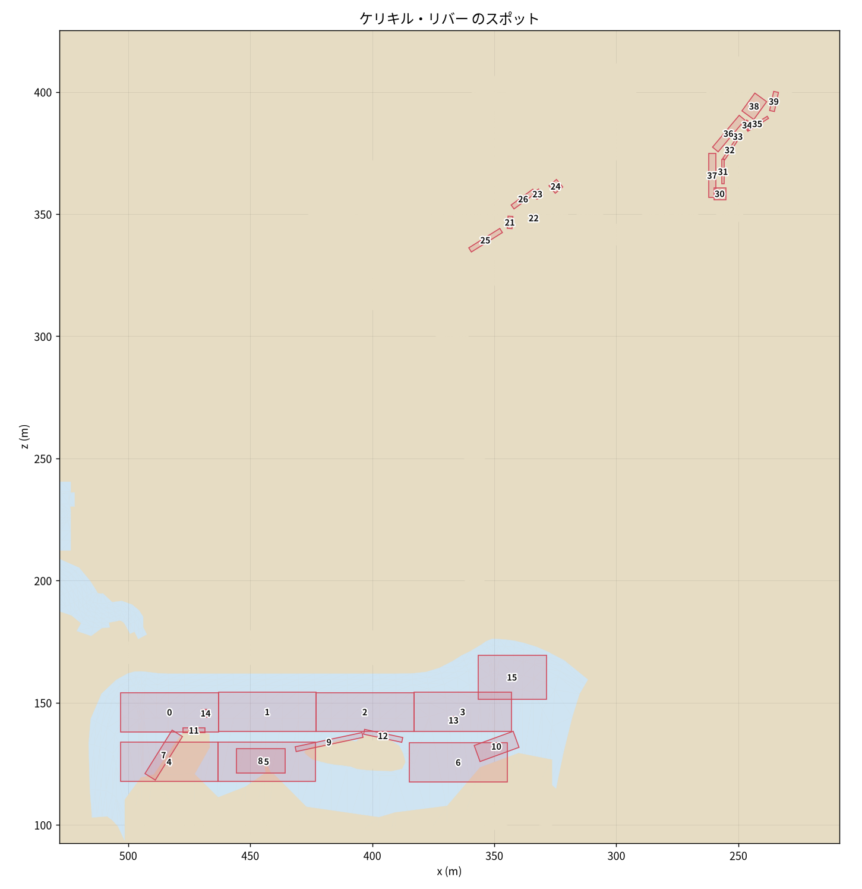

# ケリキル・リバー

[湧き確率の読み方](../spawn.md) ・ [地図の読み方](../maps.md) ・ [目次](../../README.md)

## スポット一覧

| スポット | 出現表 | 幅×奥行 m | 面積 m² | 上限 朝/昼/夕/夜 | 補充秒 | エサ補正 |
|--:|:-:|--:|--:|:-:|--:|--:|
| 0 | A | 40×16 | 640 | 14/12/12/14 | 42 | 0 |
| 1 | A | 40×16 | 640 | 16/14/14/16 | 42 | 0 |
| 2 | A | 40×16 | 640 | 16/14/14/16 | 42 | 0 |
| 3 | A | 40×16 | 640 | 16/14/14/16 | 42 | 0 |
| 4 | B | 40×16 | 640 | 16/12/13/14 | 42 | 0 |
| 5 | B | 40×16 | 640 | 16/12/13/14 | 42 | 0 |
| 6 | B | 40×16 | 640 | 16/12/13/14 | 42 | 0 |
| 7 | C | 5×21 | 105 | 10/7/8/9 | 42 | 0 |
| 8 | D | 20×10 | 200 | 12/9/10/11 | 42 | 0 |
| 9 | C | 28×2 | 56 | 10/7/8/9 | 42 | 0 |
| 10 | D | 17×7 | 119 | 10/7/8/9 | 42 | 0 |
| 11 | C | 9×2 | 18 | 7/4/5/6 | 42 | 0 |
| 12 | C | 16×2 | 32 | 7/4/5/6 | 42 | 0 |
| 13 | E | 3×3 | 9 | 5/5/5/5 | 42 | 0 |
| 14 | E | 3×3 | 9 | 5/5/5/5 | 42 | 0 |
| 15 | F | 28×18 | 504 | 16/10/12/14 | 42 | 0 |
| 21 | G | 2×5 | 10 | 5/5/5/5 | 42 | -1 |
| 22 | F | 3×3 | 9 | 5/5/5/5 | 42 | -1 |
| 23 | H | 3×3 | 9 | 5/5/5/5 | 42 | -1 |
| 24 | I | 4×4 | 16 | 7/4/5/6 | 42 | -1 |
| 25 | J | 15×2 | 30 | 10/7/8/9 | 42 | -1 |
| 26 | J | 11×2 | 22 | 7/4/5/6 | 42 | -1 |
| 30 | K | 5×5 | 25 | 5/4/4/5 | 42 | -2 |
| 31 | L | 1×10 | 10 | 5/2/3/4 | 42 | -2 |
| 32 | L | 9×1 | 9 | 5/2/3/4 | 42 | -2 |
| 33 | M | 2×2 | 4 | 3/3/3/3 | 42 | -2 |
| 34 | M | 3×3 | 9 | 3/3/3/3 | 42 | -2 |
| 35 | L | 10×1 | 10 | 5/2/3/4 | 42 | -2 |
| 36 | K | 3×17 | 51 | 5/2/3/4 | 42 | -2 |
| 37 | K | 3×18 | 54 | 5/2/3/4 | 42 | -2 |
| 38 | M | 6×9 | 54 | 7/4/5/6 | 42 | -2 |
| 39 | N | 2×8 | 16 | 5/2/3/4 | 42 | -2 |

「補充秒」は、そのスポットで魚がつつき始めてから60秒の間の補充の間隔である ([補充の速さ](../spawn-paths.md#補充の速さ))。

## 出現表

### 表A (スポット 0〜3)

| 魚 | 重み | 確率% | 放流解禁時% | 条件 |
|---|--:|--:|--:|---|
| フナ | 5 | 45.5 | 45.5 |  |
| タカハヤ | 3 | 27.3 | 27.3 |  |
| ブラウントラウト | 1 | 9.1 | 9.1 |  |
| マゴイ | 1 | 9.1 | 9.1 |  |
| ふつうの流木 | 1 | 9.1 | 9.1 |  |

### 表B (スポット 4〜6)

| 魚 | 重み | 確率% | 放流解禁時% | 条件 |
|---|--:|--:|--:|---|
| タカハヤ | 5 | 38.5 | 38.5 |  |
| フナ | 3 | 23.1 | 23.1 |  |
| マゴイ | 2 | 15.4 | 15.4 |  |
| ヤマメ | 1 | 7.7 | 7.7 |  |
| ブラウントラウト | 1 | 7.7 | 7.7 |  |
| まっすぐな流木 | 1 | 7.7 | 7.7 |  |

### 表C (スポット 7、9、11〜12)

| 魚 | 重み | 確率% | 放流解禁時% | 条件 |
|---|--:|--:|--:|---|
| ブラウントラウト | 3 | 23.1 | 23.1 |  |
| マゴイ | 3 | 23.1 | 23.1 |  |
| フナ | 2 | 15.4 | 15.4 |  |
| タカハヤ | 2 | 15.4 | 15.4 |  |
| ナマズ | 1 | 7.7 | 7.7 |  |
| ヤマメ | 1 | 7.7 | 7.7 |  |
| ふつうの流木 | 1 | 7.7 | 7.7 |  |

### 表D (スポット 8、10)

| 魚 | 重み | 確率% | 放流解禁時% | 条件 |
|---|--:|--:|--:|---|
| ナマズ | 5 | 21.7 | 21.7 |  |
| ヤマメ | 3 | 13.0 | 13.0 |  |
| フナ | 3 | 13.0 | 13.0 |  |
| ブラウントラウト | 3 | 13.0 | 13.0 |  |
| マゴイ | 3 | 13.0 | 13.0 |  |
| タカハヤ | 3 | 13.0 | 13.0 |  |
| ふさふさな水草 | 2 | 8.7 | 8.7 |  |
| ボトリオレピス | 1 | 4.3 | 4.3 |  |

### 表E (スポット 13〜14)

| 魚 | 重み | 確率% | 放流解禁時% | 条件 |
|---|--:|--:|--:|---|
| ヤマメ | 3 | 30.0 | 30.0 |  |
| ブラウントラウト | 3 | 30.0 | 30.0 |  |
| タカハヤ | 2 | 20.0 | 20.0 |  |
| マゴイ | 1 | 10.0 | 10.0 |  |
| ふつうの流木 | 1 | 10.0 | 10.0 |  |

### 表F (スポット 15、22)

| 魚 | 重み | 確率% | 放流解禁時% | 条件 |
|---|--:|--:|--:|---|
| フナ | 3 | 33.3 | 33.3 |  |
| ブラウントラウト | 2 | 22.2 | 22.2 |  |
| カワマス | 2 | 22.2 | 22.2 |  |
| ヤマメ | 1 | 11.1 | 11.1 |  |
| マゴイ | 1 | 11.1 | 11.1 |  |

### 表G (スポット 21)

| 魚 | 重み | 確率% | 放流解禁時% | 条件 |
|---|--:|--:|--:|---|
| フナ | 3 | 21.4 | 21.4 |  |
| イワナ | 2 | 14.3 | 14.3 |  |
| ウグイ | 2 | 14.3 | 14.3 |  |
| ブラウントラウト | 2 | 14.3 | 14.3 |  |
| カワマス | 2 | 14.3 | 14.3 |  |
| ヤマメ | 1 | 7.1 | 7.1 |  |
| マゴイ | 1 | 7.1 | 7.1 |  |
| ふつうの流木 | 1 | 7.1 | 7.1 |  |

### 表H (スポット 23)

| 魚 | 重み | 確率% | 放流解禁時% | 条件 |
|---|--:|--:|--:|---|
| フナ | 3 | 21.4 | 21.4 |  |
| イワナ | 2 | 14.3 | 14.3 |  |
| ウグイ | 2 | 14.3 | 14.3 |  |
| ブラウントラウト | 2 | 14.3 | 14.3 |  |
| カワマス | 2 | 14.3 | 14.3 |  |
| ヤマメ | 1 | 7.1 | 7.1 |  |
| マゴイ | 1 | 7.1 | 7.1 |  |
| まっすぐな流木 | 1 | 7.1 | 7.1 |  |

### 表I (スポット 24)

| 魚 | 重み | 確率% | 放流解禁時% | 条件 |
|---|--:|--:|--:|---|
| フナ | 3 | 23.1 | 23.1 |  |
| イワナ | 2 | 15.4 | 15.4 |  |
| ウグイ | 2 | 15.4 | 15.4 |  |
| ブラウントラウト | 2 | 15.4 | 15.4 |  |
| カワマス | 2 | 15.4 | 15.4 |  |
| ヤマメ | 1 | 7.7 | 7.7 |  |
| マゴイ | 1 | 7.7 | 7.7 |  |

### 表J (スポット 25〜26)

| 魚 | 重み | 確率% | 放流解禁時% | 条件 |
|---|--:|--:|--:|---|
| フナ | 3 | 27.3 | 27.3 |  |
| ブラウントラウト | 2 | 18.2 | 18.2 |  |
| カワマス | 2 | 18.2 | 18.2 |  |
| ヤマメ | 1 | 9.1 | 9.1 |  |
| イワナ | 1 | 9.1 | 9.1 |  |
| ウグイ | 1 | 9.1 | 9.1 |  |
| マゴイ | 1 | 9.1 | 9.1 |  |

### 表K (スポット 30、36〜37)

| 魚 | 重み | 確率% | 放流解禁時% | 条件 |
|---|--:|--:|--:|---|
| カワマス | 4 | 100.0 | 100.0 |  |

### 表L (スポット 31〜32、35)

| 魚 | 重み | 確率% | 放流解禁時% | 条件 |
|---|--:|--:|--:|---|
| ニジマス | 5 | 55.6 | 55.6 | クエスト |
| カワマス | 4 | 44.4 | 44.4 |  |

### 表M (スポット 33〜34、38)

| 魚 | 重み | 確率% | 放流解禁時% | 条件 |
|---|--:|--:|--:|---|
| ニジマス | 7 | 63.6 | 63.6 | クエスト |
| カワマス | 4 | 36.4 | 36.4 |  |

### 表N (スポット 39)

| 魚 | 重み | 確率% | 放流解禁時% | 条件 |
|---|--:|--:|--:|---|
| ニジマス | 10 | 71.4 | 71.4 | クエスト |
| カワマス | 4 | 28.6 | 28.6 |  |
