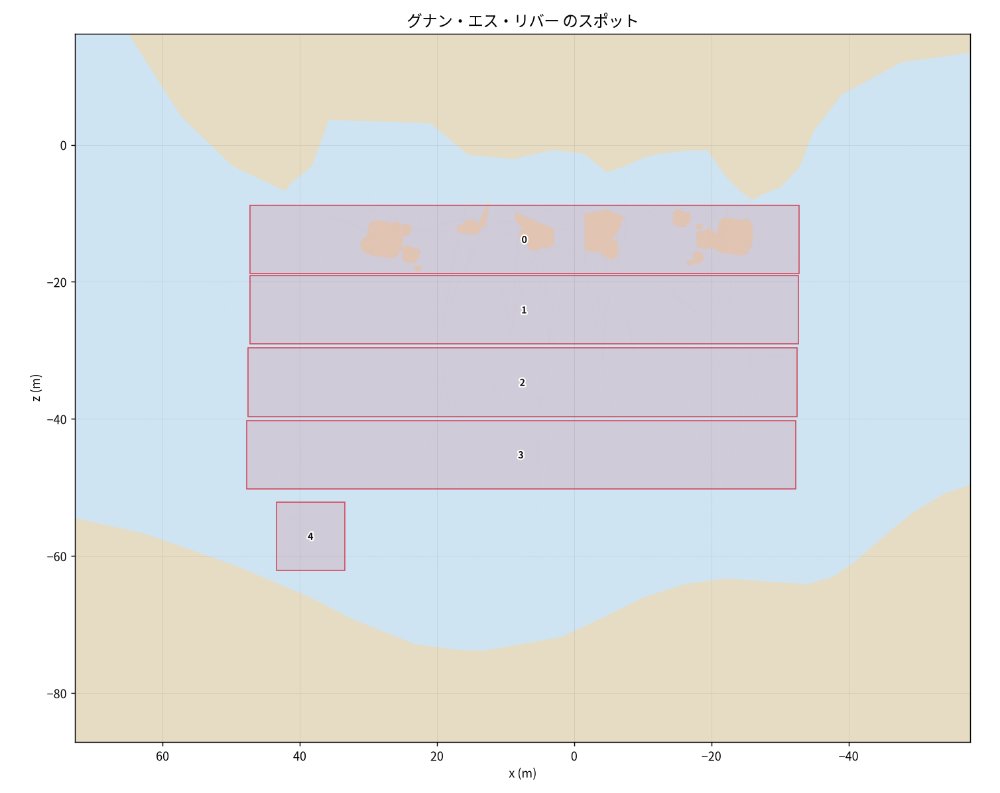

# グナン・エス・リバー

[湧き確率の読み方](../spawn.md) ・ [地図の読み方](../maps.md) ・ [目次](../../README.md)

## スポット一覧

| スポット | 出現表 | 幅×奥行 m | 面積 m² | 上限 朝/昼/夕/夜 | 補充秒 | エサ補正 |
|--:|:-:|--:|--:|:-:|--:|--:|
| 0 | A | 80×10 | 800 | 20/10/12/15 | 60 | -2 |
| 1 | B | 80×10 | 800 | 20/10/12/15 | 60 | -2 |
| 2 | C | 80×10 | 800 | 20/10/12/15 | 60 | -2 |
| 3 | D | 80×10 | 800 | 20/10/12/15 | 60 | -2 |
| 4 | E | 10×10 | 100 | 5/5/5/5 | 60 | -2 |

「補充秒」は、そのスポットで魚がつつき始めてから60秒の間の補充の間隔である ([補充の速さ](../spawn-paths.md#補充の速さ))。

## 出現表

### 表A (スポット 0)

| 魚 | 重み | 確率% | 放流解禁時% | 条件 |
|---|--:|--:|--:|---|
| ホッキョクカワヒメマス | 8 | 80.0 | 80.0 |  |
| ノーザンパイク | 2 | 20.0 | 20.0 |  |

### 表B (スポット 1)

| 魚 | 重み | 確率% | 放流解禁時% | 条件 |
|---|--:|--:|--:|---|
| ホッキョクカワヒメマス | 6 | 60.0 | 60.0 |  |
| ノーザンパイク | 4 | 40.0 | 40.0 |  |

### 表C (スポット 2)

| 魚 | 重み | 確率% | 放流解禁時% | 条件 |
|---|--:|--:|--:|---|
| ノーザンパイク | 4 | 40.0 | 40.0 |  |
| ホッキョクカワヒメマス | 4 | 40.0 | 40.0 |  |
| キングサーモン | 1 | 10.0 | 10.0 |  |
| オショロコマ | 1 | 10.0 | 10.0 |  |

### 表D (スポット 3)

| 魚 | 重み | 確率% | 放流解禁時% | 条件 |
|---|--:|--:|--:|---|
| ノーザンパイク | 5 | 35.7 | 35.7 |  |
| ホッキョクカワヒメマス | 5 | 35.7 | 35.7 |  |
| キングサーモン | 2 | 14.3 | 14.3 |  |
| オショロコマ | 2 | 14.3 | 14.3 |  |

### 表E (スポット 4)

| 魚 | 重み | 確率% | 放流解禁時% | 条件 |
|---|--:|--:|--:|---|
| キングサーモン | 1 | 50.0 | 50.0 |  |
| オショロコマ | 1 | 50.0 | 50.0 |  |
