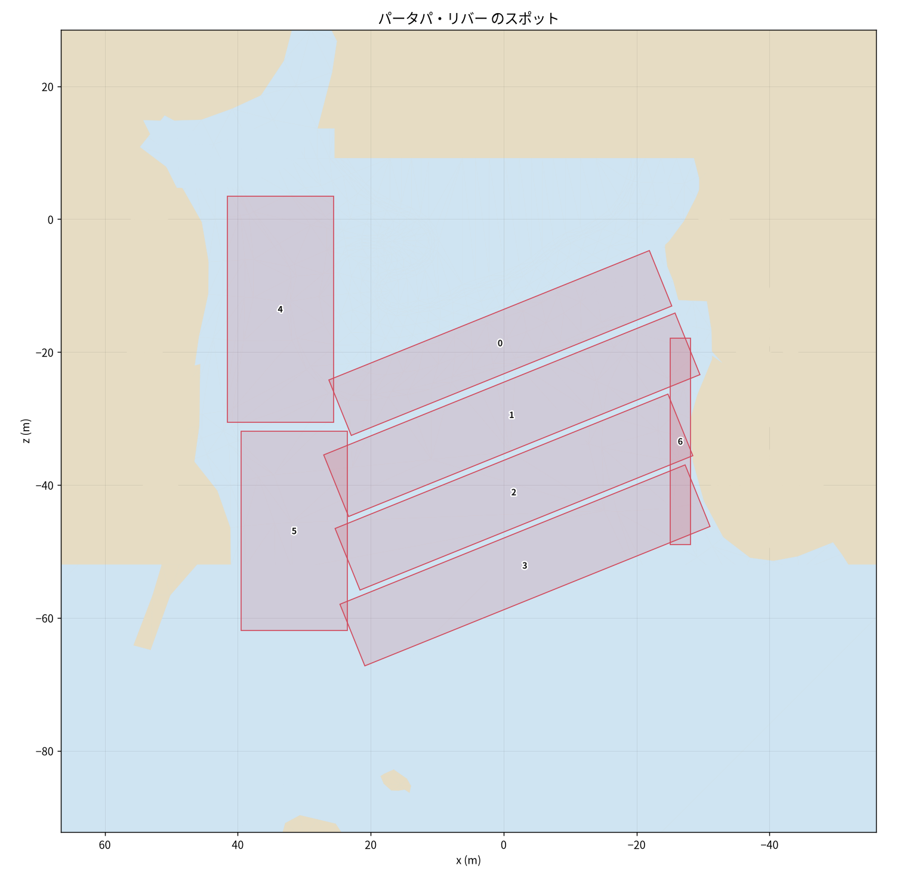

# パータパ・リバー

[湧き確率の読み方](../spawn.md) ・ [地図の読み方](../maps.md) ・ [目次](../../README.md)

## スポット一覧

| スポット | 出現表 | 幅×奥行 m | 面積 m² | 上限 朝/昼/夕/夜 | 補充秒 | エサ補正 |
|--:|:-:|--:|--:|:-:|--:|--:|
| 0 | A | 9×52 | 468 | 20/12/14/16 | 66 | -2 |
| 1 | B | 10×57 | 570 | 15/8/10/12 | 66 | -2 |
| 2 | C | 10×54 | 540 | 15/8/10/12 | 66 | -2 |
| 3 | D | 10×56 | 560 | 15/8/10/12 | 66 | -2 |
| 4 | E | 16×34 | 544 | 20/12/14/16 | 66 | -2 |
| 5 | F | 16×30 | 480 | 15/8/10/12 | 66 | -2 |
| 6 | G | 3×31 | 93 | 5/5/5/5 | 66 | -2 |

「補充秒」は、そのスポットで魚がつつき始めてから60秒の間の補充の間隔である ([補充の速さ](../spawn-paths.md#補充の速さ))。

## 出現表

### 表A (スポット 0)

| 魚 | 重み | 確率% | 放流解禁時% | 条件 |
|---|--:|--:|--:|---|
| レノック | 7 | 87.5 | 87.5 |  |
| アムールパイク | 1 | 12.5 | 12.5 |  |

### 表B (スポット 1)

| 魚 | 重み | 確率% | 放流解禁時% | 条件 |
|---|--:|--:|--:|---|
| レノック | 7 | 70.0 | 70.0 |  |
| アムールパイク | 3 | 30.0 | 30.0 |  |

### 表C (スポット 2)

| 魚 | 重み | 確率% | 放流解禁時% | 条件 |
|---|--:|--:|--:|---|
| レノック | 7 | 63.6 | 63.6 |  |
| アムールパイク | 4 | 36.4 | 36.4 |  |

### 表D (スポット 3)

| 魚 | 重み | 確率% | 放流解禁時% | 条件 |
|---|--:|--:|--:|---|
| アムールパイク | 6 | 50.0 | 50.0 |  |
| レノック | 5 | 41.7 | 41.7 |  |
| タイメン | 1 | 8.3 | 8.3 |  |

### 表E (スポット 4)

| 魚 | 重み | 確率% | 放流解禁時% | 条件 |
|---|--:|--:|--:|---|
| レノック | 7 | 70.0 | 70.0 |  |
| アムールパイク | 2 | 20.0 | 20.0 |  |
| タイメン | 1 | 10.0 | 10.0 |  |

### 表F (スポット 5)

| 魚 | 重み | 確率% | 放流解禁時% | 条件 |
|---|--:|--:|--:|---|
| アムールパイク | 5 | 50.0 | 50.0 |  |
| レノック | 3 | 30.0 | 30.0 |  |
| タイメン | 2 | 20.0 | 20.0 |  |

### 表G (スポット 6)

| 魚 | 重み | 確率% | 放流解禁時% | 条件 |
|---|--:|--:|--:|---|
| アムールパイク | 2 | 66.7 | 66.7 |  |
| タイメン | 1 | 33.3 | 33.3 |  |
