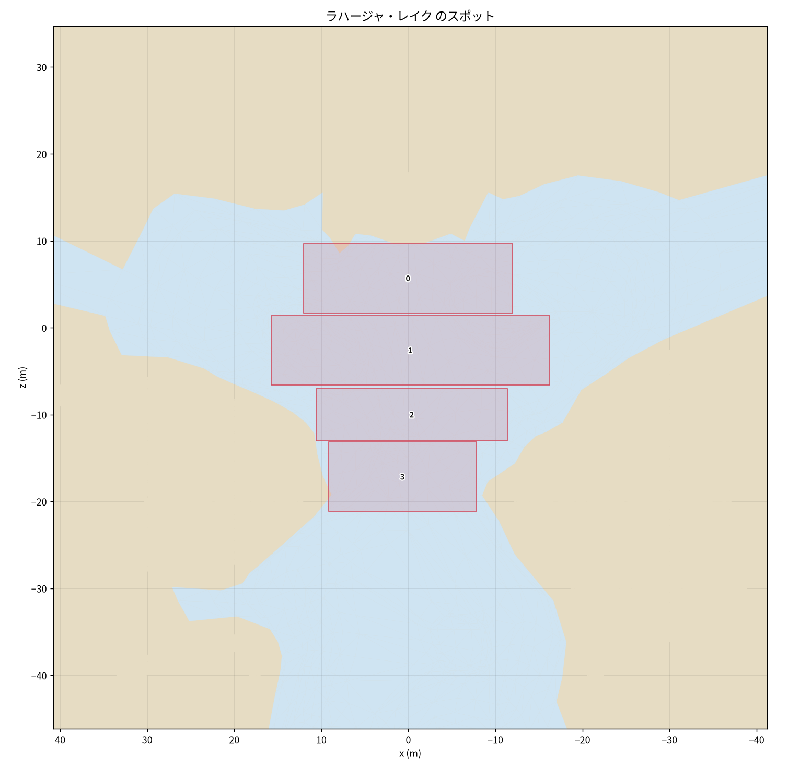

# ラハージャ・レイク

[湧き確率の読み方](../spawn.md) ・ [地図の読み方](../maps.md) ・ [目次](../../README.md)

## スポット一覧

| スポット | 出現表 | 幅×奥行 m | 面積 m² | 上限 朝/昼/夕/夜 | 補充秒 | エサ補正 |
|--:|:-:|--:|--:|:-:|--:|--:|
| 0 | A | 24×8 | 192 | 15/12/12/15 | 66 | -2 |
| 1 | B | 32×8 | 256 | 15/12/12/15 | 66 | -2 |
| 2 | C | 22×6 | 132 | 14/11/11/14 | 66 | -2 |
| 3 | D | 17×8 | 136 | 10/8/8/10 | 66 | -2 |

「補充秒」は、そのスポットで魚がつつき始めてから60秒の間の補充の間隔である ([補充の速さ](../spawn-paths.md#補充の速さ))。

## 出現表

### 表A (スポット 0)

| 魚 | 重み | 確率% | 放流解禁時% | 条件 |
|---|--:|--:|--:|---|
| 紅白 | 5 | 38.5 | 38.5 |  |
| 赤無地 | 5 | 38.5 | 38.5 |  |
| 白写 | 2 | 15.4 | 15.4 |  |
| 昭和三色 | 1 | 7.7 | 7.7 |  |

### 表B (スポット 1)

| 魚 | 重み | 確率% | 放流解禁時% | 条件 |
|---|--:|--:|--:|---|
| 紅白 | 5 | 31.2 | 31.2 |  |
| 赤無地 | 5 | 31.2 | 31.2 |  |
| 白写 | 3 | 18.8 | 18.8 |  |
| 昭和三色 | 2 | 12.5 | 12.5 |  |
| 丹頂 | 1 | 6.2 | 6.2 |  |

### 表C (スポット 2)

| 魚 | 重み | 確率% | 放流解禁時% | 条件 |
|---|--:|--:|--:|---|
| 丹頂 | 3 | 23.1 | 23.1 |  |
| 紅白 | 3 | 23.1 | 23.1 |  |
| 赤無地 | 3 | 23.1 | 23.1 |  |
| 昭和三色 | 2 | 15.4 | 15.4 |  |
| 白写 | 2 | 15.4 | 15.4 |  |

### 表D (スポット 3)

| 魚 | 重み | 確率% | 放流解禁時% | 条件 |
|---|--:|--:|--:|---|
| 紅白 | 3 | 23.1 | 23.1 |  |
| 赤無地 | 3 | 23.1 | 23.1 |  |
| 昭和三色 | 2 | 15.4 | 15.4 |  |
| 丹頂 | 2 | 15.4 | 15.4 |  |
| 白写 | 2 | 15.4 | 15.4 |  |
| 光無地 | 1 | 7.7 | 7.7 |  |
