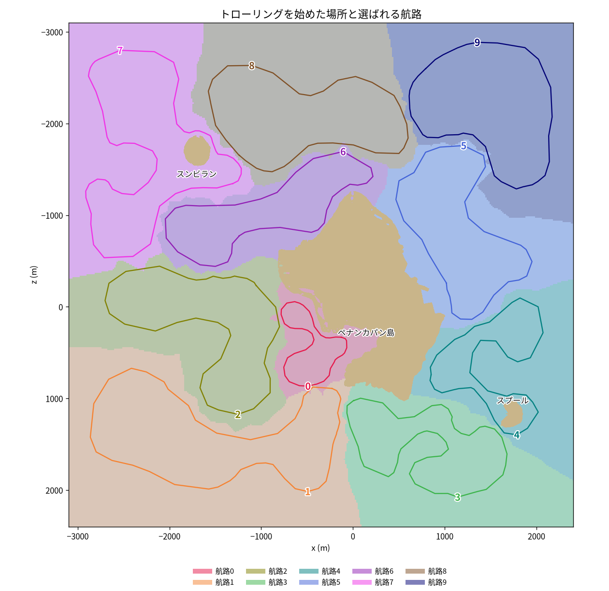

# トローリング

[目次](../README.md)

## 魚がかかる仕組み

トローリング中は、竿ごとに次の抽選を繰り返す。

1. 5〜10秒待つ (平均7.5秒)。
2. 走っている航路の表から、魚の種類を1つ選ぶ。
3. 「付けているルアー」と「その魚の基準色」の組み合わせの確率で、ヒットするかどうかを決める。
   外れたら1に戻る。
4. ヒットすると、竿がしなる。
   2〜5秒の間にその竿を選べばファイトに移る。

魚の種類を先に選ぶので、ルアーはヒットする頻度と、かかる魚の顔ぶれの両方を変える。
普通のルアー釣りの色の判定や体長の判定は使われない。
天気も関係しない。

竿ごとに別々に抽選する。

竿を出してから3分の間は、ヒットの確率に「経過時間 ÷ 3分」が掛かる (1分半なら半分)。
魚を釣り上げると竿は出し直しになり、ここからまた3分かかる。

海を泳いでいる魚はヒットに関係しない。

## ルアーと魚の基準色

ルアーの番号は、設定画面の左からの順番である。
単位は%で、30%以上を太字にしている。

<!-- table:troll-lure-color -->
| ルアー | 色1 | 色2 | 色3 | 色4 | 色5 | 色6 | 色7 | 色8 | 色9 | 色10 | 色11 | 色12 |
|---|--:|--:|--:|--:|--:|--:|--:|--:|--:|--:|--:|--:|
| 1番 赤橙 | 5 | 10 | **40** | **50** | **30** | 20 | 10 | 10 | 20 | 10 | 10 | 5 |
| 2番 紫 | 10 | 20 | 20 | 20 | **30** | 10 | 10 | 10 | 20 | 10 | 10 | 20 |
| 3番 黄 | 5 | 20 | 10 | 10 | 10 | 10 | 5 | **40** | **50** | 10 | **30** | 10 |
| 4番 銀灰 | **50** | 10 | 10 | 10 | 10 | 20 | 10 | 10 | 10 | 10 | 10 | 20 |
| 5番 水色 | 5 | 5 | 5 | 5 | 10 | 10 | **30** | **30** | 10 | 5 | 5 | 5 |
<!-- /table -->

どの組み合わせも確率は5%以上あるので、どのルアーでも、その航路の魚は全てかかる。
魚の基準色は[検索ページ](../index.html)の魚のページから調べられる。

## 航路

航路は、海の上の通過点を結んだルートである。
トローリングを始めたとき、クルーザーの位置から最も近い通過点を持つ航路が選ばれる。
クルーザーはその航路の最も近い通過点から合流し、あとは航路を回り続ける。

航路の番号はこの資料の中の呼び名である。

ツアーの曜日と行き先の海域は[時間と予定](calendar.md#トローリングツアー)にある。

下の地図の色分けは、その場所で始めたときに選ばれる航路である。

## 航路ごとの魚

航路ごとの魚、ルアーごとのヒットする確率と魚の割合は、[検索ページ](../index.html)のトローリングから検索できる。
魚ごとの確率は魚のページから調べられる。
全部の値は [trolling_route_fish.csv](../data/trolling_route_fish.csv) と [trolling_route_summary.csv](../data/trolling_route_summary.csv) から参照できる。

航路ごとの魚は、放流によりバショウカジキが加わる以外は、
時間帯、天気などの条件によらず、不変である。

検索ページの確率は、竿を出して3分たったあとの値である。
竿1本に魚がヒットするまでの平均の時間は、7.5秒 ÷ 確率である。
確率が50%なら15秒、5%なら150秒である。
竿5本ならその5分の1である。

## 外海のレーダー

レーダーには、本物の魚の点と架空の魚の点が映る。
どちらも同じ絵で、魚の種類は分からない。

| 点 | 数 | 位置 | 消えるとき |
|---|--:|---|---|
| 本物の魚 | 最大16 | 魚の位置 | 魚が消えたとき、魚がかかったとき |
| 架空の魚 | 最大3 | 秒速5〜10mでまっすぐ進む | クルーザーから100m離れたとき、表示時間が切れたとき |

レーダーの半径は50mで、回転する線は2秒で1周する。
点は回転する線が通ると光り、次に通るころまでに消えていく。
点いたり消えたりして見えるのはこのためである。

### 本物の魚の点

個体の番号が3の倍数の魚、つまり3匹に1匹ほどが対象である。
対象が多いときは全部は映らず、映るのは10匹余りまでである。

外海の魚は魚影が見えないので、泳いでいる魚の位置を知る手がかりはこの点だけである。
ただし架空の魚の点と絵が同じなので、動きで見分けるしかない。

トローリング中は、[ヒットの判定](#魚がかかる仕組み)が泳いでいる魚を見ないので、点は釣果に関係しない。

### 架空の魚の点

クルーザーの周り25〜75mの位置に作られ、ランダムな向きに進む。

ゲームは最後に走った航路 (まだ走っていなければ航路0) の魚の一覧から、重みを見ずに種類を均等に1つ選ぶ。
その魚のグレードで、表示時間が決まる。

<!-- table:radar-table -->
| グレード | 2 | 3 | 4 | 5 |
|---|:-:|:-:|:-:|:-:|
| 表示時間(秒) | 60〜120 | 90〜180 | 120〜240 | 120〜240 |
<!-- /table -->

ただしクルーザーが止まっていれば、点は表示時間が切れる前に100m離れて消える。
100m離れるまでの時間は平均13秒、長くても35秒である。
