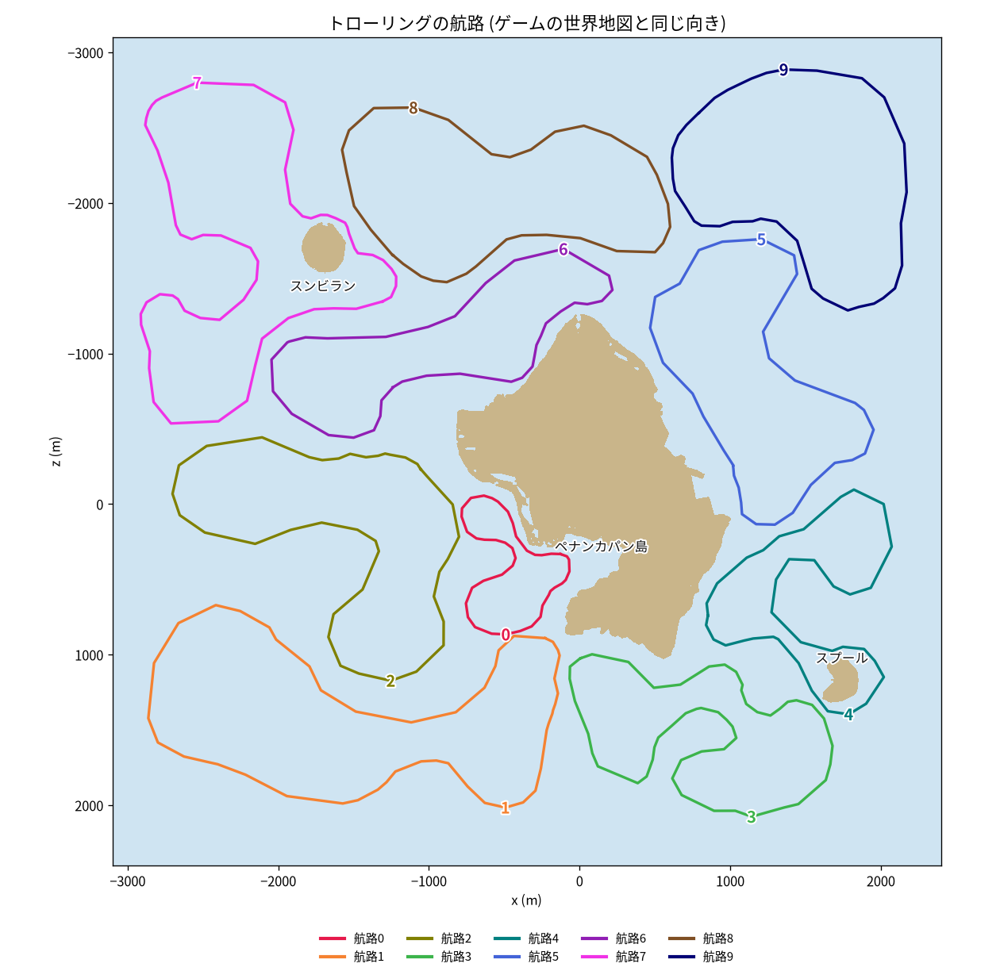

# トローリング

[目次](../README.md)

## 魚がかかる仕組み

トローリングでは、魚が仕掛けに寄ってくるのではない。
竿ごとに次の抽選を繰り返す。

1. 5〜10秒待つ (平均7.5秒)。
2. 走っている航路の表から、魚の種類を1つ選ぶ。
3. 「付けているルアー」と「その魚の基準色」の組み合わせの確率で、当たりかどうかを決める。
   外れたら1に戻る。
4. 当たると、竿がしなる。
   2〜5秒の間にその竿を選べばファイトに移る。

魚の種類を先に選ぶので、ルアーは当たる頻度と、かかる魚の顔ぶれの両方を変える。
普通のルアー釣りの色の判定や体長の判定は使われない。
天気も関係しない。

竿ごとに別々に抽選する。

竿を出してから3分の間は、当たりの確率に「経過時間 ÷ 3分」が掛かる (1分半なら半分)。
魚を釣り上げると竿は出し直しになり、ここからまた3分かかる。

海を泳いでいる魚は当たりに関係しない。

## ルアーと魚の基準色

ルアーの番号は、設定画面の左からの順番である。
単位は%で、30%以上を太字にしている。

<!-- table:troll-lure-color -->
| ルアー | 色1 | 色2 | 色3 | 色4 | 色5 | 色6 | 色7 | 色8 | 色9 | 色10 | 色11 | 色12 |
|---|--:|--:|--:|--:|--:|--:|--:|--:|--:|--:|--:|--:|
| 1番 赤橙 | 5 | 10 | **40** | **50** | **30** | 20 | 10 | 10 | 20 | 10 | 10 | 5 |
| 2番 紫 | 10 | 20 | 20 | 20 | **30** | 10 | 10 | 10 | 20 | 10 | 10 | 20 |
| 3番 黄 | 5 | 20 | 10 | 10 | 10 | 10 | 5 | **40** | **50** | 10 | **30** | 10 |
| 4番 銀灰 | **50** | 10 | 10 | 10 | 10 | 20 | 10 | 10 | 10 | 10 | 10 | 20 |
| 5番 水色 | 5 | 5 | 5 | 5 | 10 | 10 | **30** | **30** | 10 | 5 | 5 | 5 |
<!-- /table -->

どの組み合わせも確率は5%以上あるので、どのルアーでも、その航路の魚はすべてかかる。
魚の基準色は下の[狙いの魚で選ぶ](#狙いの魚で選ぶ)の表にある。

## 航路

航路は、海の上の通過点を結んだルートである。
トローリングを始めたとき、船の位置から最も近い通過点を持つ航路が選ばれる。
船はその航路の最も近い通過点から合流し、あとは航路を回り続ける。

航路の番号はこの資料の中の呼び名である。

ツアーの曜日と行き先の海域は[時間と予定](calendar.md#トローリングツアー)にある。

下の地図の色分けは、その場所で始めたときに選ばれる航路である。

航路ごとの1周の長さは次のとおりである。

<!-- table:troll-route-length -->
| 航路 | 海域 | 1周の長さ m |
|--:|---|--:|
| 0 | トロピカル | 3,112 |
| 1 | トロピカル | 7,794 |
| 2 | トロピカル | 6,511 |
| 3 | トロピカル | 6,260 |
| 4 | トロピカル | 5,825 |
| 5 | テンパレート | 5,551 |
| 6 | テンパレート | 5,747 |
| 7 | テンパレート | 8,061 |
| 8 | フリジッド | 5,771 |
| 9 | フリジッド | 5,207 |
<!-- /table -->

## 航路ごとの魚

数字は抽選の重みである。
バショウカジキは放流魚なので、解放するまで出ない (ここでは除いている)。

<!-- table:troll-route-weight -->
| 航路 | 海域 | 魚と抽選の重み |
|---|---|---|
| 0 | トロピカル | シイラ 3、コービア 3、マンボウ 2、クロカジキ 1 |
| 1 | トロピカル | シイラ 3、コービア 3、マンボウ 2、メカジキ 1、マカジキ 1 |
| 2 | トロピカル | シイラ 3、コービア 3、マンボウ 2、メカジキ 1、マカジキ 1 |
| 3 | トロピカル | シイラ 3、バラクーダ 3、キハダマグロ 3、ハンマーヘッドシャーク 2、シロカジキ 2、クロカジキ 2、シファクティヌス 1 |
| 4 | トロピカル | シイラ 2、バラクーダ 2、キハダマグロ 2、ハンマーヘッドシャーク 1、シロカジキ 1 |
| 5 | テンパレート | バラムツ 4、クロカジキ 2、ホオジロザメ 1、ダイオウイカ 1 |
| 6 | テンパレート | バラムツ 3、クロマグロ 1 |
| 7 | テンパレート | バラムツ 10、クロマグロ 6、ダイオウイカ 6、クロカジキ 6、ダンクルオステウス 1 |
| 8 | フリジッド | バラムツ 9、クロマグロ 7、オヒョウ 7、ミズダコ 7、ヘリコプリオン 1 |
| 9 | フリジッド | バラムツ 6、クロマグロ 4、オヒョウ 4 |
<!-- /table -->

時間帯、天気などの条件によらず、不変である。

## 当たりやすいルアー

1回の抽選で当たる確率 (%) である。
竿を出して3分たったあとの値で、いちばん高いルアーを太字にしている。

<!-- table:troll-route-hit -->
| 航路 | 海域 | 1番 赤橙 | 2番 紫 | 3番 黄 | 4番 銀灰 | 5番 水色 |
|--:|---|--:|--:|--:|--:|--:|
| 0 | トロピカル | 20.0 | 17.8 | **21.1** | 10.0 | 6.7 |
| 1 | トロピカル | 19.0 | 18.0 | **20.0** | 11.0 | 7.5 |
| 2 | トロピカル | 19.0 | 18.0 | **20.0** | 11.0 | 7.5 |
| 3 | トロピカル | **29.4** | 19.4 | 9.1 | 11.9 | 12.2 |
| 4 | トロピカル | **30.0** | 20.0 | 9.4 | 12.5 | 11.2 |
| 5 | テンパレート | 20.0 | 13.8 | 11.2 | **30.0** | 8.1 |
| 6 | テンパレート | 5.0 | 10.0 | 5.0 | **50.0** | 5.0 |
| 7 | テンパレート | 13.4 | 12.1 | 13.4 | **32.1** | 10.2 |
| 8 | フリジッド | 8.9 | 12.6 | 8.7 | **35.2** | 6.3 |
| 9 | フリジッド | 9.3 | 10.0 | 6.4 | **41.4** | 6.4 |
<!-- /table -->

竿1本が当たるまでの平均の時間は、7.5秒 ÷ 確率である。
確率が50%なら15秒、5%なら150秒である。
竿5本ならその5分の1である。

## 当たったときの魚の内訳

当たりの中で、それぞれの魚が占める割合 (%) である。

<!-- table:troll-route-share -->
| 航路 | ルアー | 当たったときの魚 (%) |
|--:|---|---|
| 0 | 1番 赤橙 | シイラ 50、クロカジキ 22、コービア 17、マンボウ 11 |
| 0 | 2番 紫 | シイラ 56、コービア 19、クロカジキ 13、マンボウ 13 |
| 0 | 3番 黄 | コービア 47、マンボウ 32、シイラ 16、クロカジキ 5 |
| 0 | 4番 銀灰 | コービア 33、シイラ 33、マンボウ 22、クロカジキ 11 |
| 0 | 5番 水色 | シイラ 50、コービア 25、マンボウ 17、クロカジキ 8 |
| 1 | 1番 赤橙 | シイラ 47、マカジキ 16、コービア 16、メカジキ 11、マンボウ 11 |
| 1 | 2番 紫 | シイラ 50、マカジキ 17、コービア 17、マンボウ 11、メカジキ 6 |
| 1 | 3番 黄 | コービア 45、マンボウ 30、シイラ 15、メカジキ 5、マカジキ 5 |
| 1 | 4番 銀灰 | コービア 27、シイラ 27、メカジキ 18、マンボウ 18、マカジキ 9 |
| 1 | 5番 水色 | シイラ 40、コービア 20、メカジキ 13、マカジキ 13、マンボウ 13 |
| 2 | 1番 赤橙 | シイラ 47、マカジキ 16、コービア 16、メカジキ 11、マンボウ 11 |
| 2 | 2番 紫 | シイラ 50、マカジキ 17、コービア 17、マンボウ 11、メカジキ 6 |
| 2 | 3番 黄 | コービア 45、マンボウ 30、シイラ 15、メカジキ 5、マカジキ 5 |
| 2 | 4番 銀灰 | コービア 27、シイラ 27、メカジキ 18、マンボウ 18、マカジキ 9 |
| 2 | 5番 水色 | シイラ 40、コービア 20、メカジキ 13、マカジキ 13、マンボウ 13 |
| 3 | 1番 赤橙 | キハダマグロ 32、シイラ 19、クロカジキ 17、バラクーダ 13、シロカジキ 13、ハンマーヘッドシャーク 4、シファクティヌス 2 |
| 3 | 2番 紫 | シイラ 29、キハダマグロ 19、シロカジキ 19、クロカジキ 13、バラクーダ 10、ハンマーヘッドシャーク 6、シファクティヌス 3 |
| 3 | 3番 黄 | バラクーダ 21、キハダマグロ 21、シイラ 21、シロカジキ 14、クロカジキ 14、ハンマーヘッドシャーク 7、シファクティヌス 3 |
| 3 | 4番 銀灰 | バラクーダ 32、キハダマグロ 16、シイラ 16、シロカジキ 11、クロカジキ 11、ハンマーヘッドシャーク 11、シファクティヌス 5 |
| 3 | 5番 水色 | ハンマーヘッドシャーク 31、バラクーダ 15、シイラ 15、シファクティヌス 15、シロカジキ 10、キハダマグロ 8、クロカジキ 5 |
| 4 | 1番 赤橙 | キハダマグロ 42、シイラ 25、バラクーダ 17、シロカジキ 12、ハンマーヘッドシャーク 4 |
| 4 | 2番 紫 | シイラ 37、キハダマグロ 25、シロカジキ 19、バラクーダ 12、ハンマーヘッドシャーク 6 |
| 4 | 3番 黄 | バラクーダ 27、キハダマグロ 27、シイラ 27、シロカジキ 13、ハンマーヘッドシャーク 7 |
| 4 | 4番 銀灰 | バラクーダ 40、キハダマグロ 20、シイラ 20、シロカジキ 10、ハンマーヘッドシャーク 10 |
| 4 | 5番 水色 | ハンマーヘッドシャーク 33、バラクーダ 22、シイラ 22、シロカジキ 11、キハダマグロ 11 |
| 5 | 1番 赤橙 | クロカジキ 50、ホオジロザメ 31、バラムツ 12、ダイオウイカ 6 |
| 5 | 2番 紫 | クロカジキ 36、バラムツ 36、ホオジロザメ 18、ダイオウイカ 9 |
| 5 | 3番 黄 | ダイオウイカ 44、クロカジキ 22、バラムツ 22、ホオジロザメ 11 |
| 5 | 4番 銀灰 | バラムツ 83、クロカジキ 8、ホオジロザメ 4、ダイオウイカ 4 |
| 5 | 5番 水色 | ダイオウイカ 46、バラムツ 31、クロカジキ 15、ホオジロザメ 8 |
| 6 | 1番 赤橙 | バラムツ 75、クロマグロ 25 |
| 6 | 2番 紫 | バラムツ 75、クロマグロ 25 |
| 6 | 3番 黄 | バラムツ 75、クロマグロ 25 |
| 6 | 4番 銀灰 | バラムツ 75、クロマグロ 25 |
| 6 | 5番 水色 | バラムツ 75、クロマグロ 25 |
| 7 | 1番 赤橙 | クロカジキ 62、ダイオウイカ 15、バラムツ 13、クロマグロ 8、ダンクルオステウス 3 |
| 7 | 2番 紫 | クロカジキ 34、バラムツ 29、クロマグロ 17、ダイオウイカ 17、ダンクルオステウス 3 |
| 7 | 3番 黄 | ダイオウイカ 62、クロカジキ 15、バラムツ 13、クロマグロ 8、ダンクルオステウス 3 |
| 7 | 4番 銀灰 | バラムツ 54、クロマグロ 32、ダイオウイカ 6、クロカジキ 6、ダンクルオステウス 1 |
| 7 | 5番 水色 | ダイオウイカ 61、バラムツ 17、クロマグロ 10、クロカジキ 10、ダンクルオステウス 2 |
| 8 | 1番 赤橙 | オヒョウ 51、バラムツ 16、クロマグロ 13、ミズダコ 13、ヘリコプリオン 7 |
| 8 | 2番 紫 | ミズダコ 36、バラムツ 23、クロマグロ 18、オヒョウ 18、ヘリコプリオン 5 |
| 8 | 3番 黄 | オヒョウ 26、ミズダコ 26、ヘリコプリオン 19、バラムツ 17、クロマグロ 13 |
| 8 | 4番 銀灰 | バラムツ 41、クロマグロ 32、オヒョウ 13、ミズダコ 13、ヘリコプリオン 1 |
| 8 | 5番 水色 | オヒョウ 36、バラムツ 23、クロマグロ 18、ミズダコ 18、ヘリコプリオン 5 |
| 9 | 1番 赤橙 | オヒョウ 62、バラムツ 23、クロマグロ 15 |
| 9 | 2番 紫 | バラムツ 43、クロマグロ 29、オヒョウ 29 |
| 9 | 3番 黄 | オヒョウ 44、バラムツ 33、クロマグロ 22 |
| 9 | 4番 銀灰 | バラムツ 52、クロマグロ 34、オヒョウ 14 |
| 9 | 5番 水色 | オヒョウ 44、バラムツ 33、クロマグロ 22 |
<!-- /table -->

## 狙いの魚で選ぶ

1回の抽選でその魚がかかる確率 (%) を、ルアーごとに載せた。
いちばん高いルアーが太字である。
ポイントの高い魚から順に並べている。

<!-- table:troll-target -->
| 魚 | 色 | 航路 | 重み | 1番 | 2番 | 3番 | 4番 | 5番 |
|---|--:|--:|--:|--:|--:|--:|--:|--:|
| ダンクルオステウス | 10 | 7 | 1/29 | **0.34** | **0.34** | **0.34** | **0.34** | 0.17 |
| ヘリコプリオン | 9 | 8 | 1/31 | 0.65 | 0.65 | **1.61** | 0.32 | 0.32 |
| シファクティヌス | 7 | 3 | 1/16 | 0.62 | 0.62 | 0.31 | 0.62 | **1.88** |
| メカジキ | 6 | 1 | 1/10 | **2.00** | 1.00 | 1.00 | **2.00** | 1.00 |
| メカジキ | 6 | 2 | 1/10 | **2.00** | 1.00 | 1.00 | **2.00** | 1.00 |
| クロカジキ | 3 | 0 | 1/9 | **4.44** | 2.22 | 1.11 | 1.11 | 0.56 |
| クロカジキ | 3 | 3 | 2/16 | **5.00** | 2.50 | 1.25 | 1.25 | 0.62 |
| クロカジキ | 3 | 5 | 2/8 | **10.00** | 5.00 | 2.50 | 2.50 | 1.25 |
| クロカジキ | 3 | 7 | 6/29 | **8.28** | 4.14 | 2.07 | 2.07 | 1.03 |
| マカジキ | 5 | 1 | 1/10 | **3.00** | **3.00** | 1.00 | 1.00 | 1.00 |
| マカジキ | 5 | 2 | 1/10 | **3.00** | **3.00** | 1.00 | 1.00 | 1.00 |
| シロカジキ | 5 | 3 | 2/16 | **3.75** | **3.75** | 1.25 | 1.25 | 1.25 |
| シロカジキ | 5 | 4 | 1/8 | **3.75** | **3.75** | 1.25 | 1.25 | 1.25 |
| オヒョウ | 6 | 8 | 7/31 | **4.52** | 2.26 | 2.26 | **4.52** | 2.26 |
| オヒョウ | 6 | 9 | 4/14 | **5.71** | 2.86 | 2.86 | **5.71** | 2.86 |
| ダイオウイカ | 8 | 5 | 1/8 | 1.25 | 1.25 | **5.00** | 1.25 | 3.75 |
| ダイオウイカ | 8 | 7 | 6/29 | 2.07 | 2.07 | **8.28** | 2.07 | 6.21 |
| クロマグロ | 1 | 6 | 1/4 | 1.25 | 2.50 | 1.25 | **12.50** | 1.25 |
| クロマグロ | 1 | 7 | 6/29 | 1.03 | 2.07 | 1.03 | **10.34** | 1.03 |
| クロマグロ | 1 | 8 | 7/31 | 1.13 | 2.26 | 1.13 | **11.29** | 1.13 |
| クロマグロ | 1 | 9 | 4/14 | 1.43 | 2.86 | 1.43 | **14.29** | 1.43 |
| ホオジロザメ | 4 | 5 | 1/8 | **6.25** | 2.50 | 1.25 | 1.25 | 0.62 |
| バラクーダ | 6 | 3 | 3/16 | **3.75** | 1.88 | 1.88 | **3.75** | 1.88 |
| バラクーダ | 6 | 4 | 2/8 | **5.00** | 2.50 | 2.50 | **5.00** | 2.50 |
| ミズダコ | 12 | 8 | 7/31 | 1.13 | **4.52** | 2.26 | **4.52** | 1.13 |
| ハンマーヘッドシャーク | 7 | 3 | 2/16 | 1.25 | 1.25 | 0.62 | 1.25 | **3.75** |
| ハンマーヘッドシャーク | 7 | 4 | 1/8 | 1.25 | 1.25 | 0.62 | 1.25 | **3.75** |
| マンボウ | 11 | 0 | 2/9 | 2.22 | 2.22 | **6.67** | 2.22 | 1.11 |
| マンボウ | 11 | 1 | 2/10 | 2.00 | 2.00 | **6.00** | 2.00 | 1.00 |
| マンボウ | 11 | 2 | 2/10 | 2.00 | 2.00 | **6.00** | 2.00 | 1.00 |
| キハダマグロ | 4 | 3 | 3/16 | **9.38** | 3.75 | 1.88 | 1.88 | 0.94 |
| キハダマグロ | 4 | 4 | 2/8 | **12.50** | 5.00 | 2.50 | 2.50 | 1.25 |
| シイラ | 5 | 0 | 3/9 | **10.00** | **10.00** | 3.33 | 3.33 | 3.33 |
| シイラ | 5 | 1 | 3/10 | **9.00** | **9.00** | 3.00 | 3.00 | 3.00 |
| シイラ | 5 | 2 | 3/10 | **9.00** | **9.00** | 3.00 | 3.00 | 3.00 |
| シイラ | 5 | 3 | 3/16 | **5.62** | **5.62** | 1.88 | 1.88 | 1.88 |
| シイラ | 5 | 4 | 2/8 | **7.50** | **7.50** | 2.50 | 2.50 | 2.50 |
| バラムツ | 1 | 5 | 4/8 | 2.50 | 5.00 | 2.50 | **25.00** | 2.50 |
| バラムツ | 1 | 6 | 3/4 | 3.75 | 7.50 | 3.75 | **37.50** | 3.75 |
| バラムツ | 1 | 7 | 10/29 | 1.72 | 3.45 | 1.72 | **17.24** | 1.72 |
| バラムツ | 1 | 8 | 9/31 | 1.45 | 2.90 | 1.45 | **14.52** | 1.45 |
| バラムツ | 1 | 9 | 6/14 | 2.14 | 4.29 | 2.14 | **21.43** | 2.14 |
| コービア | 11 | 0 | 3/9 | 3.33 | 3.33 | **10.00** | 3.33 | 1.67 |
| コービア | 11 | 1 | 3/10 | 3.00 | 3.00 | **9.00** | 3.00 | 1.50 |
| コービア | 11 | 2 | 3/10 | 3.00 | 3.00 | **9.00** | 3.00 | 1.50 |
<!-- /table -->

放流魚を解放したときの値も含めて、全部の値は [trolling_route_fish.csv](../data/trolling_route_fish.csv) と [trolling_route_summary.csv](../data/trolling_route_summary.csv) にある。

## 外海のレーダー

レーダーの点は、泳いでいる魚やかかる魚とは関係ない。

**ただの飾りである**。

ゲームは最後に走った航路 (まだ走っていなければ航路0) の魚の一覧から、重みを見ずに種類を均等に1つ選ぶ。
その魚の格付けで、点が映っている時間が決まる。

<!-- table:radar-table -->
| 格付け | 2 | 3 | 4 | 5 |
|---|:-:|:-:|:-:|:-:|
| 点が映る秒 | 60〜120 | 90〜180 | 120〜240 | 120〜240 |
<!-- /table -->

長く残る点は大物を引いた点だが、その魚がかかりやすくなるわけではない。
